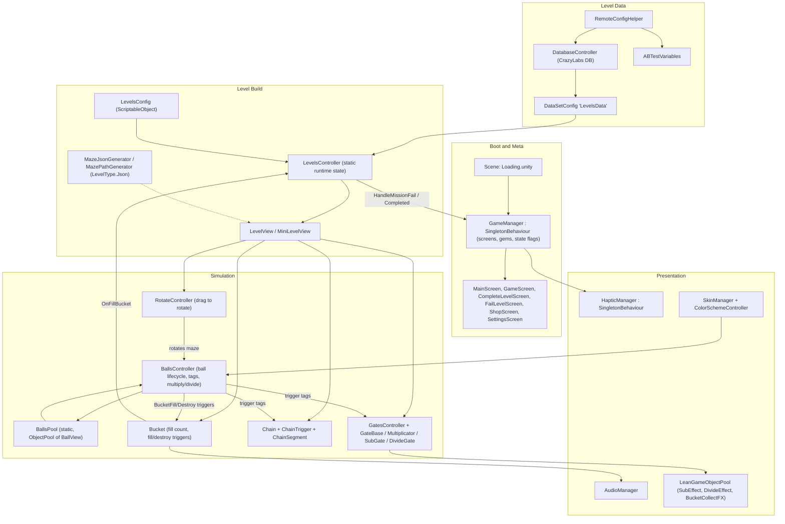

# 01. System Architecture

## 1. Purpose and Framing

This document describes the architecture of **Multi Maze 3D (v4.1.0.0)**, our own title. The original source was lost. The internal rebuild uses the recovered build as the source of truth. Where the recovered code and this document disagree, the recovered code wins.

Tags used throughout:

- **[Recovered]**: taken from a recovered asset or script. The source path is given.
- **[Inferred]**: a reasonable reading of recovered names or structure. Not confirmed by logic.
- **[Unknown]**: logic not recoverable from the export (method bodies are stubbed). To be designed and tuned.

Recovery source: `tools/export/MultiMaze3D_4.1.0.0/ExportedProject` (AssetRipper 2.0.0, IL2CPP). Fields, enums, signatures and serialized values are real. C# method bodies are not.

**Engine.** [Recovered] The original build is Unity **2022.3.62f2**, built-in render pipeline (Forward), Gamma colour space, portrait only, IL2CPP arm64 (`tools/export/MultiMaze3D_4.1.0.0/ExportedProject/ProjectSettings/`, `tools/recovery/FINDINGS.md`).
Rebuild target: pending engine decision (2022.3 built-in vs Unity 6 URP/built-in) — see README §5.

---

## 2. Subsystem Map

Diagram tags: the edges from `LC` to `GM`, and `MGen -.-> LV`, are [Inferred] from method names only. The rest reflects recovered fields and tags.

---

## 3. Subsystems

### 3.1 GameManager (coordinator)
- [Recovered] `GameManager.cs : SingletonBehaviour<GameManager>` (root). Screen refs: `mainScreen`, `failLevelScreen`, `completeLevelScreen`, `gameScreen`, `settingsScreen`, `shopScreen`, `abVariablesScreen`, `debugScreen`.
- [Recovered] Progress and flags: `int CurrentLevel`, `GemCounter`, `BestScore`, `LeaderBoardScore`; `bool GameStarted`, `LevelCompleted`, `gameRestarted`.
- [Recovered] Pools: `LeanGameObjectPool SubEffectPool`, `DivideEffectPool`. `SkinBallItem CurrentBallSkin`.
- [Recovered] Entry points: `CompleteLevel()`, `FailLevel()`, `OpenFailWindow()`, `Continue()`, `NextLevel()`, `DelayedNextLevel(bool withCoinsRV)`, `GemCollect(int)`, `SaveData(int)`, `LoadData()`.
- [Recovered] Zenject: `[Inject] Construct(IAdsService)`.
- [Unknown] Exact state machine. The original design lists states (Init, Playing, Paused, LevelClear, LevelFail, Shop). The export has no enum for them, so the state set is a design proposal, not a recovered fact.

### 3.2 LevelsController (level runtime)
- [Recovered] `Levels/LevelsController.cs : MonoBehaviour`. Static runtime state: `TotalBallCountInMiniLevel`, `TotalMiniLevelCount`, `TotalFillCount`, `FilledStarCount`, `Completed`, `MiniLevelIndex`, `StartBall`.
- [Recovered] Serialized: `LevelsConfig _config`. Injected: `IAdsService _adsService`.
- [Recovered] Events: `OnLevelSpawned`, `OnChunkStarted`, `OnChunkCompleted`, `OnChunkAboutToBeCompleted`, `OnBallEnterBucket`.
- [Recovered] Methods (signatures only): `Spawn(int playerProgressIndex)` (async), `OnFillBucket(bool filledBefore, int amount)`, `HandleMissionFail()`, `StartNextChunk()`, `UpdateStars(int perfect, int target)`, `SetDynamicBallGoals(string, int)`, `GetTargetBallAmount()`, `GetPerfectBallAmount()`, `GetSecondStarAmount()`.
- [Unknown] Star thresholds and the exact win/fail rule (see section 5).

### 3.3 Level data sources
- [Recovered] Primary table: `TextAsset/LevelsData.txt` (bundled fallback, 107 rows). Remote override: `LevelsData.csv`, selected by remote feature **`LevelFunnel`** (`tools/recovery/FINDINGS.md`, Levels).
- [Recovered] Access: `CrazyLabs/Extensions/Database/DatabaseController` (typed getters `GetInt/GetFloat/GetString/GetBool(dataSetId, itemId, propertyId)`), `DatabaseConfig` (`mainDataSetId`, `allDataSets`), `DataSetConfig` (`id`, `_dataAsset`, `remoteFileName`, `remoteFeatureName`).
- [Recovered] `LevelsController.DataSetId = "LevelsData"`. Column keys used in code: `Level Name`, `Mini Level Index`, `Level Difficulty`, `Is Looping`, `Is Boss Level`, `Start/Target/Perfect Ball Amount`, `Gate Types`, `Gate Values`, `Background Material Name`, `Maze Material Name`, `Level Type`, `Level Index`, `LevelAttempt`, `ChunkAttempt`.
- [Recovered] Remote switches: `RemoteConfigHelper` (`GetInt/GetBool/GetFloat/GetString`, `isRemoteReady`, `OnRemoteReady`). `ABTestVariables` holds the cohort flags `isMixedLevels`, `withBossLevels`, `bossLevelEveryFive`, `hasNoObstacles`, `hasNoRV`, `whiteBalls`, `extra_balls`, `better_than_score`.
- [Unknown] Which remote key maps to which ABTestVariables flag. Not visible in the export.
- [Inferred] Each row maps to one prefab, `Resources/prefabs/minilevels/<Level Name>.prefab`. `LevelData.miniLevelNames` lets one level chain several mini-levels.

### 3.4 Level build
- [Recovered] `LevelsConfig` (ScriptableObject): `MiniLevelView jsonBaseLevelPrefab`, `LevelView prefab`, `Vector3[] ballSpawnPositions`, `Vector3 distanceBetweenMiniLevels`, `float startBallAmountMultiplierOnContinue`, `ballGoalPercentTarget`, `ballGoalPercentPerfect`.
- [Recovered] `tools/recovery/FINDINGS.md`: camera (0, -0.4, -16.93), rotation x 3 deg, 20 ball spawn positions, `startBallAmountMultiplierOnContinue` 0.6, `ballGoalPercentTarget` 0.25, `ballGoalPercentPerfect` 0.75, `distanceBetweenMiniLevels` 18.
- [Recovered] `LevelType { Prefab = 0, Json = 1 }` (`Game/Levels/LevelType.cs`). Prefab rows come from the table. Json rows use `MazeJsonGenerator` / `MazePathGenerator`.
- [Recovered] `LevelView` (`transformCached`, `List<MiniLevelView> miniLevelViews`) and `MiniLevelView` (`ballsParentInsideMaze`, `ballsParentOutsideMaze`, `RotateController rotateController`, `Bucket bucket`, `TextMeshProUGUI bucketBallCounter`, `string mazeShape`, `GateBase[] allGates`, `Maze maze`).
- [Recovered] `MiniLevelData` (struct): `missionIndex`, `levelName`, `startBallAmount`, `targetBallAmount`, `perfectBallAmount`, `isBossLevel`, `LevelType levelType`, `List<GateType> gateTypes`, `List<int> gateValues`, `mazeMaterialName`.
- [Recovered] `MazePathGeneratorConfig.asset`: gate spawn settings (sub 20%, divide 10%, multiply 70%), 8 dynamic wall prefabs, 2 rotator prefabs. [Inferred] Not used by the table levels (every row is `LevelType.Prefab`).

### 3.5 Balls and pooling
- [Recovered] `Balls/BallsPool.cs`: `static class`. `_config : BallsConfig`, `_objectParent`, `_ballPool : UnityEngine.Pool.ObjectPool<BallView>`. Methods `Initialize(BallsConfig, Transform)`, `PreWarm(int)`, `Get()`, `Release(BallView)`. Events `OnBallInstantiated`, `OnBallAboutToBeDestroyed`.
- [Recovered] `Balls/BallsConfig.cs` (Android values, `tools/recovery/FINDINGS.md`): `initialPoolAmount` 200, `inMazeMaxSpeed` 10, `outMazeMaxSpeed` 40, `ignoreMultiplicatorCapacity` 10. Layer switch `useBallLayers` on, layers [9, 10, 11] at [200, 400, 600] balls. Value tiers `useBallValueTiers` on, `valuePerTier` [1, 2, 3, 999], `totalBallsForNextTier` [300, 450, 650, 775], `chancesToOverrideTier` [0.6, 0.5, 0.2, 0.1].
- [Recovered] iOS config (`BallsConfigIos`): layers off (layers [9, 10] at [300, 600]), tiers [1, 2, 3] at [450, 650, 775], chances [0.5, 0.5, 0.35].
- [Recovered] Ball scale: `smallScale`, `mediumScale`, `bigScale`. `BallSize { Small = 0, Medium = 1, Big = 2 }` (`Balls/BallSize.cs`).
- [Recovered] `Balls/BallView.cs`: cached refs (`rigidbodyCached`, `colliderCached`, `meshRendererCached`, `skinRotator`); events `OnTriggerEntered/Exited(Collider)`.
- [Recovered] `Balls/BallData.cs` (plain class): `maxSpeed`, `isActive`, `bucketInteraction`, `inBucket`, `inFinishSpace`, `inMaze`, `divisionStatus`, `int value`.
- [Inferred] Large ball counts are represented by higher-value balls rather than more bodies. Live physics bodies stay in the low hundreds (`tools/recovery/FINDINGS.md`, Balls and pooling). The mechanism is the tier config above. The override maths is [Unknown].
- [Recovered] `BallsController.cs`: `[Inject] Construct(IColorSchemeController)`. Tag constants: `Multiplicator`, `MazeSpace`, `BucketFillTrigger`, `BucketDestroyTrigger`, `SubGate`, `DivideGate`, `FinishSpace`, `DestroyTrigger`, `BucketShakeTrigger`. Static: `Spawn(Vector3, Transform)`, `Divide(BallView)`, `SendAllToPool()`, `GetBallValue(BallView | Collider)`, `DoBuffAnimation(...)`. Instance: `Despawn(BallView)`; private `OnBallTriggerEntered/Exited(BallView, Collider)`, `Multiply(BallView, Multiplicator, Collider, Transform) : bool`, `ApplyPhysicalLayerToBall`, `SetSizeOfBall`, `GetCurrentValueTierIndex`, `HandleBossLevelRotation`.
- [Unknown] Pool sizing at runtime and the exact recycle rules.

### 3.6 Gates
- [Recovered] `GateType { Multiply = 0, Subtract = 1, Divide = 2 }` (root `GateType.cs`). There is no Add operator in the enum.
- [Recovered] `GateBase` (abstract `MonoBehaviour`): `isMoveX`, `float MoveTime`, `[NonSerialized] stopped`, `[NonSerialized] startPosX`, `Tweener moveTweener`. Abstract `GateType Type`, `int Value`, `SetValue(int)`.
- [Recovered] `Multiplicator : GateBase` (multiply; `TextMeshPro Text`, `MeshRenderer visualMeshRenderer`). `SubGate : GateBase` (subtract; `int startValue`, `TextMeshPro ValueText`, `BoxCollider collider`, `Sub()`, `ResetGate()`). `DivideGate : GateBase` (divide; `ballsCounter`, `divideEffectTargetCount`, `divideEffectCurrentCount`, `Divide(BallView)`).
- [Recovered] `GatesController.cs`: `[SerializeField] GatesConfig _config` (prefabs: `multiplicationGatePrefab`, `substractionGatePrefab`, `dividerGatePrefab`). Static dictionaries of gates keyed by `Transform`. `SpawnGate(GateType, Vector3, Quaternion, Vector3, Transform)`. Gate roll seed: `GetGateRollSeed(string miniLevelName, int gateIndex)`.
- [Recovered] `MazeGateDefinition` (struct): `positionX/Y`, `rotationX/Y/Z`, `string type`, `int value`, `isMovable`, `moveTime`, `size`, loop pool `l_type_1..4` / `l_value_1..4`.
- [Recovered] Gate values come from the CSV at runtime. TMP labels inside prefabs are stale placeholders (`tools/recovery/FINDINGS.md`).
- [Recovered] Re-trigger guard field: `BallsController._ignoredMultiplicatorsByBalls : Dictionary<BallView, List<Collider>>`. [Inferred] Per-ball, per-collider memory of passed gates; no timed-cooldown field exists.
- [Unknown] Exact multiply, subtract and divide arithmetic. Field names suggest a count per gate (`SubGate.startValue`, `DivideGate` alternating counter), but method bodies are stubbed.

### 3.7 Chains (locks)
- [Recovered] `Chain : MonoBehaviour`: `int UnlockNumber`, `TextMeshProUGUI CounterText`, `CounterBG counterBG`, `GameObject P_Lock`, `[HideInInspector] int ChainCount`, private `unlocked`. Methods `ChainUpdate()`, `ResetChain()`, `ColorRed()`.
- [Recovered] `ChainTrigger : MonoBehaviour`: `const string BallTag = "Ball"`, `Chain chain`. `OnTriggerEnter/Exit(Collider)`.
- [Recovered] `ChainSegment : MonoBehaviour`: private `Quaternion rotation` only. Layer 8 (`ChainSegment`) (`tools/recovery/FINDINGS.md`, Physics).
- [Recovered] Cost lives in each level prefab. 38 level prefabs have a lock. Costs 30 / 40 / 45 / 50 / 60 / 80 / 100 / 120 (`tools/recovery/FINDINGS.md`, Locks).
- [Unknown] Whether a ball entering the trigger is consumed or only counted. The export does not show a recycle call.

### 3.8 Bucket (cup) and win/fail
- [Recovered] `Bucket : MonoBehaviour`: `int CurrentFillCount`, `GameObject DestroyTrigger`, `FillTrigger`, `bucketCollectFX`. Methods `OnFill(bool filledBefore, int amount = 1)`, `OnOut()`, `Shake()`, `OverFillCheck()`.
- [Recovered] Tags: `Bucket`, `BucketFillTrigger`, `BucketDestroyTrigger`, `BucketShakeTrigger`, `CupInTrigger` (`tools/recovery/FINDINGS.md`, Physics).
- [Recovered fields; how they combine is Inferred] Win inputs: `LevelsController.TotalFillCount`, `TargetBallAmount`, `PerfectBallAmount`, `FilledStarCount`; `LevelsConfig.ballGoalPercentTarget` (0.25) and `ballGoalPercentPerfect` (0.75).
- [Inferred; method names Recovered] Fail entry: `LevelsController.HandleMissionFail()`, `GameManager.FailLevel()`.
- [Unknown] The exact win/fail condition and the thresholds used for stars. Design target: target count to win, perfect count for the second star. The numbers come from the table, not from code.

### 3.9 Rotation and input
- [Recovered] `RotateController : MonoBehaviour`: `GameObject Target`, `List<RotateTarget> Targets`, `Space Space`, `Vector3 Axis`, `float Multiplier`, `Damping`, `bool ScaleByTime`. Methods `RotateAB()`, `RotateToDefault()`, `UpdateRotation(float)`.
- [Recovered] Values on level prefabs: `Multiplier` 3.5, `Damping` 16, `Axis` Z, world space. `GameManager` also has `ControllerMultiplier` 3 and `ControllerDamping` 20. Which one wins is [Unknown].
- [Recovered] `MazeRotator` (`Home/.../Mazes/MazeRotator.cs`): `string id`, `Transform transformCached`. `MazeRotatorDefinition` (struct): `id`, `positionX/Y/Z`.
- [Recovered] Maze rotators have no Rigidbody and about 40 MeshColliders each (`MazeRotator_OpenDown` / `OpenUp`) (`tools/recovery/FINDINGS.md`, Physics).
- [Recovered] Camera: perspective FOV 50, near 0.3, far 1000. `CameraMove`: damping 2, zoom padding 7.25, zoom 3 to 15, `BossLevelBucketOffset` 6.17 (`tools/recovery/FINDINGS.md`, Controls).
- [Unknown] Input-to-angle mapping and the drag handling. No `InputController` class exists in the export.

### 3.10 Presentation, audio, haptics
- [Recovered] `HapticManager : SingletonBehaviour<HapticManager>`: `isHapticPlay`; `HapticOn/Off`, `LightImpact`, `Selection`, `MediumImpact`, `HeavyImpact`, `Failure`, `Success`, `Warning`. No vibration library namespace is referenced by game code.
- [Recovered] `AudioManager` exists (root). Its fields were not catalogued in this pass.
- [Recovered] `SkinManager` and `ColorSchemeController` / `ColorSchemeInstaller` (`colorSchemesConfig`). `ColorSchemeItemType { Balls, MazeWalls, MazeBackground, StageBackground, Bucket, BucketGuides, BucketStand }`.
- [Recovered] Economy: shop variants `ShopConfig` (6 / 7 / 7 skins, price 500). Currency is gems (`GemCounter`). Detail in `06_SKIN_AND_ECONOMY_SPEC.md`.

---

## 4. Third-Party Libraries (used by game code)

| Library | Namespace | Where | Tag |
|---|---|---|---|
| DOTween | `DG.Tweening` | `GateBase`, `Multiplicator`, `DivideGate`, `Bucket`, `Chain`, screens | [Recovered] |
| Lean Pool | `Lean.Pool` | `GameManager` (`LeanGameObjectPool`), `SubEffect`, `DivideEffect`, `BucketCollectFX` | [Recovered] |
| Zenject | `Zenject` | Installers (`LevelsControllerInstaller`, `ColorSchemeInstaller`, `AdsInstaller`, `InAppPurchasesInstaller`) and `[Inject]` sites | [Recovered] |
| TextMesh Pro | `TMPro` | Gate, UI and chain labels | [Recovered] |
| CrazyLabs / TabTale TTP SDK | `CrazyLabs.*`, `Tabtale.*` | Ads, analytics, remote config, IAP | [Recovered] |
| LeanTouch / LeanTouchPlus | `Lean.Touch` | Shipped (`Plugins/LeanTouch*.dll`); call sites not visible | [Inferred] used for drag input |
| Lofelt NiceVibrations | `Lofelt.NiceVibrations` | Shipped (`Plugins/Lofelt.NiceVibrations.dll`); likely wrapped by `HapticManager` | [Inferred] |
| ParticleImage | — | Shipped (`Plugins/ParticleImage.dll`) | [Recovered] |

Note: library *call sites* live inside method bodies, which IL2CPP stripped. A library missing from field/signature types is therefore not evidence that it was unused; every DLL in `Assets/Plugins/` was shipped with the game.

---

## 5. Level Load → Play → Complete (flow)

1. [Inferred] Boot in `Loading.unity`, then `Main.unity` (scene names from `Assets/Scenes/`, [Recovered]).
2. [Inferred] `RemoteConfigHelper` resolves remote values; `DatabaseController` initialises the `LevelsData` dataset (remote CSV or bundled `LevelsData.txt`).
3. [Inferred] `LevelsController.Spawn(playerProgressIndex)` picks the row, builds the prefab (or Json maze) and fires `OnLevelSpawned`.
4. [Inferred] `BallsPool.PreWarm` / `BallsController.Spawn` place `startBallAmount` balls at `LevelsConfig.ballSpawnPositions`.
5. [Inferred] Play: drag drives `RotateController`; the maze rotates; balls move under gravity (0, -20, 0).
6. [Inferred] Balls trigger gates (`BallsController` tags), chains (`ChainTrigger`) and bucket triggers (`Bucket`).
7. [Unknown] Per-gate arithmetic and chain unlock rules.
8. [Inferred] `Bucket.OnFill` → `LevelsController.OnFillBucket` → counts update → `UpdateStars` / `OnChunkCompleted`.
9. [Inferred] Complete: `GameManager.CompleteLevel()` → `DelayedNextLevel(withCoinsRV)` → `NextLevel()`. Fail: `HandleMissionFail()` / `FailLevel()` → `OpenFailWindow()`.

---

## 6. Open Items

- [Unknown] All method bodies. Gate arithmetic, tier override maths, win/fail thresholds, star thresholds, coin reward values, ad frequency.
- [Unknown] Remote key → `ABTestVariables` mapping and live cohort values.
- [Unknown] Live `LevelsData.csv` and `IAPsData.txt` per cohort.
- Next step for the critical logic (gate arithmetic, tier override, stars, fail detection): IL2CPP builds contain no IL, but the native code in `libil2cpp.so` can be disassembled (e.g. Ghidra) using Cpp2IL / Il2CppDumper symbol maps to name each method. Target only the ~20 gameplay-critical methods; everything else is re-implemented from this spec and tuned by playtesting against the shipped app.
