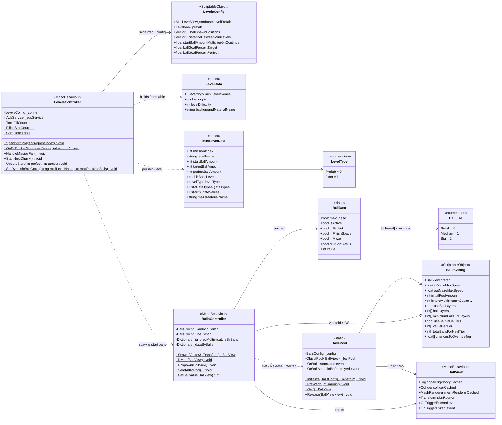
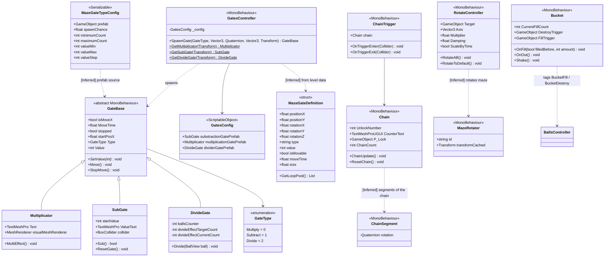
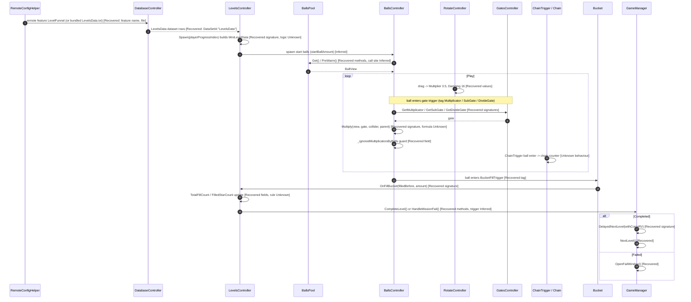
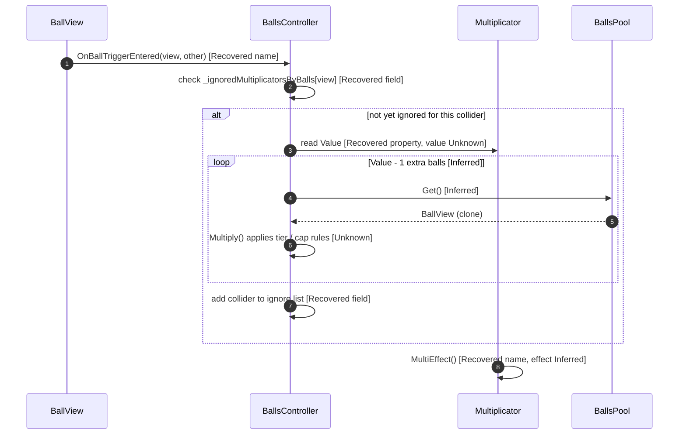
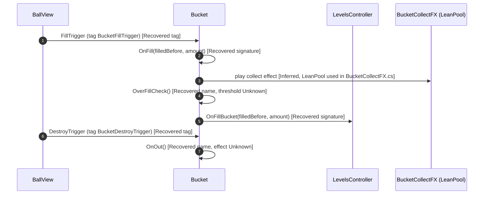

# 05. UML Diagrams and Schematics

Diagrams model the **recovered** classes of Multi Maze 3D v4.1.0.0 (Unity 2022.3.62f2, built-in RP). Class and field names are real. Method bodies are not recoverable, so behaviour in sequence diagrams is tagged.

Tags: **[Recovered]** (from script or asset), **[Inferred]** (from names or structure), **[Unknown]** (logic to be designed or tuned).

Rebuild target: pending engine decision (2022.3 built-in vs Unity 6 URP/built-in) — see README §5.

---

## 1. Class Diagram: Level and Balls

[Recovered] Fields and signatures from `Levels/`, `Balls/`, root gate and chain scripts.

Notes:
- `BallsPool` is a **static** class (not a `MonoBehaviour`), backed by `UnityEngine.Pool.ObjectPool<BallView>`.
- `BallsController.Get` / `Release` edges are [Inferred]: `BallsPool` exposes them, the caller is not confirmed.
- `BallSize` is linked to `BallData` as [Inferred]. The field `BallData` does not show a size field.

---

## 2. Class Diagram: Gates, Chains, Bucket, Maze

[Recovered] Fields and signatures from root scripts and `Home/.../Mazes/`.

Notes:
- `GateBase` is abstract and has no tag of its own. The tags `Multiplicator`, `SubGate`, `DivideGate` are set on the prefabs and checked by `BallsController`.
- `MazeGateTypeConfig` is a generator config (spawn chance and count ranges). Its link to `GateBase` is [Inferred].
- `Chain` and `ChainSegment` link is [Inferred] from names only.

---

## 3. Sequence: Level Load → Play → Complete

Tags on each step. Step 4 onward is mostly [Unknown] because bodies are stubbed.

---

## 4. Sequence: Multiplier Gate (Inferred Flow)

Entire flow is [Inferred] from field and method names. Counts and values are [Unknown].

---

## 5. Sequence: Bucket Fill and Overfill

---

## 6. Open Items

- [Unknown] All method bodies: multiply, subtract, divide arithmetic; tier override maths; star and win thresholds; chain unlock rule.
- [Unknown] Remote key to `ABTestVariables` flag mapping.
- Next step: IL2CPP builds contain no IL. To move sections 3–5 from [Inferred] to [Recovered], disassemble the relevant native methods in `libil2cpp.so` (e.g. Ghidra with Cpp2IL / Il2CppDumper symbol maps), or confirm behaviour by playtesting the shipped app.
