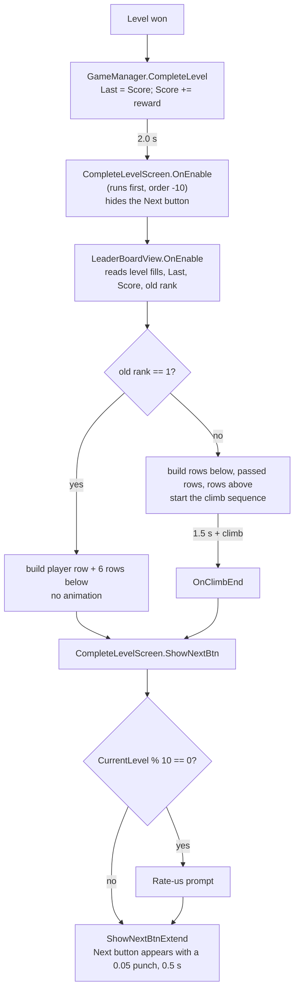

# 11. Leaderboard Ranking System

This document covers the "world ranking" board on the level-complete screen. It explains how the rank is worked out, how the other rows are made, and how the climb animation works. The logic comes from the original v4.1.0.0 build (Ghidra decompile, 2026-11-08; outputs in `tools/recovery/decompile-output/leaderboard/`, git-ignored). The rebuild follows it line by line, except for the differences in §8.

Each fact is marked `[Recovered]` (read from the decompile), `[Inferred]` (the most likely reading where the decompile is unclear), or `[Rebuild]` (a deliberate change in clone-bucket). Decision D31 in doc 09 records the scope: the board is local and simulated; a remote board is out of scope (Q17).

---

## 1. Core concepts

1. **There is no server.** The board is not a list of real players. It is a fixed, imaginary ladder of **15,000 ranks**, and the player's place on it depends only on their own total score. `[Recovered]`
2. **Each rank is worth 30 points.** The ladder is linear: going up one rank always costs 30 points, from #15000 at 0 points to #1 at 449,970 points. `[Recovered]`
3. **The other rows are made up from their rank.** A row's score comes from its rank. Its name, flag and icon come from a seeded random number, so the same seed always gives the same "player". No other player data is stored anywhere. `[Recovered]`
4. **Only a small window is built.** The screen builds only the rows around the player: a few below, the rows the player passes this level, and up to 3 rows above where they land. That is about 8 to 12 rows at most, plus one row for each rank passed. `[Recovered]`
5. **Each level produces two snapshots.** At level end the game keeps the score from before the level and the score after it. Each one gives a rank, and the difference between the two ranks is the **climb**. The animation plays the climb from the old rank to the new one. `[Recovered]`
6. **The rank never goes down.** The score only grows and the rank is a non-increasing function of the score, so the player can only stay or climb. `[Recovered]`

---

## 2. Formulas

| Quantity                               | Formula                                                                                                   | Code                                                                     |
| -------------------------------------- | --------------------------------------------------------------------------------------------------------- | ------------------------------------------------------------------------ |
| Rank from score                        | `rank = 15000 − (int)(score / 30f)`                                                                       | `LeaderBoardView.RankFromScore`                                          |
| Rank the player held before this level | `RankFromScore(LastLeaderBoardScore)`, shown as at least 1                                                | `GameManager.LeaderBoardPosition`, clamped in `LeaderBoardView.OnEnable` |
| Rank after this level                  | `RankFromScore(LeaderBoardScore)`; a result of 0 or less counts as 1                                      | `LeaderBoardView.ClimbSteps`                                             |
| Climb (ranks gained)                   | `climb = oldRank − max(1, newRank)`                                                                       | `ClimbSteps`                                                             |
| Landing rank                           | `targetRank = oldRank − climb`                                                                            | `Create`                                                                 |
| Score shown on another player's row    | `clamp((15000 − rank) × 30, 0, 99,999,999)`                                                               | `LeaderBoardView.ScoreFromRank`                                          |
| Rows below the player                  | old rank 1 → 6, rank 2 → 6, rank 3 → 5, otherwise 4                                                       | `BelowCount`                                                             |
| Rows above the landing rank            | `targetRank − 1` when that is 0, 1 or 2; otherwise 3 (unsigned compare, so a negative value also gives 3) | `AboveCount`                                                             |
| Climb duration                         | `climb × 0.03 s + 0.5 s`                                                                                  | `ClimbDuration`                                                          |
| Final scroll of the list               | `itemHeight × ((3 − above) − climb)`                                                                      | `ContentTargetY`                                                         |

Reference points on the ladder:

| Total score        | Rank                    |
| ------------------ | ----------------------- |
| 0 to 29            | #15000 (the bottom)     |
| 3,000              | #14900                  |
| 300,000            | #5000                   |
| 449,940 to 449,969 | #2                      |
| 449,970 or more    | #1 (the top, permanent) |

**Where the score comes from.** When a level is won, `GameManager.CompleteLevel` copies `LeaderBoardScore` into `LastLeaderBoardScore`. It then adds the level reward, `LevelsController.TotalFillCountAcrossLevels`: the number of balls that reached a bucket across all stages of the level. One rank is therefore about 30 balls. `[Recovered]`

**What is saved.** Only `LeaderBoardScore` is saved (PlayerPrefs key `leader_board_score`). `LastLeaderBoardScore` lives in memory only. It is always set just before the board opens, so it never needs to be saved. `BestScore` is a separate value: the best single-level reward. It is not used by the board. `[Recovered]`

---

## 3. Where it runs



The Next button cannot be pressed until the board has finished. This is how the original paces the end of a level. `[Recovered]`

---

## 4. Building the board (`LeaderBoardView.Create`)

The board has a scrolling container, `Content1`, behind a mask. Rows are placed by `y` in the container's local space, with one row every `itemHeight` (143 px in `Main.unity`). The player row starts at `y = 0`. Positive `y` is above the player (better ranks), negative `y` is below.

1. **Reset.** Stop any running climb, destroy all rows, and set both containers back to `(0, 0)`.
2. **Player row.** Use `playerItemPrefab`, with the name "YOU", the old rank, and the score from _before_ the level. It gets the "self" background, a green name `(0.12, 0.31, 0.09)`, an alpha-0 flag, icon 4, and size `(−10, 152)`, so it is a little taller than other rows. `[Recovered]`
3. **Seed for this showing.** `rnd = Random.Range(1, 10000)`. Each time the screen opens, the rows get new names. `[Recovered]`
4. **Pre-scroll near the top.** For old rank 2, `Content1` starts at `y = 286` (2 rows). For old rank 3, it starts at `y = 143` (1 row). The player sits lower in the view, so there is no empty space above #1. `[Recovered]` The reason is `[Inferred]`.
5. **Rows below** (`items3`). `BelowCount(oldRank)` rows, with ranks `oldRank + 1 …`, at `y = −itemHeight × (i + 1)`, seeded by `rnd + i + oldRank`. `[Recovered]`
6. **Already #1.** If the old rank is 1, the board ends here. There is no climb, and the Next button is requested at once. `[Recovered]`
7. **Rows above** (`items1`, then `items2`). For `j = 0 … above + climb − 1`, place a row with rank `oldRank − 1 − j` at `y = itemHeight × (j + 1)`, seeded by `rnd + above + j + oldRank`.
   - The first `climb` rows are the ones the player will **pass** (`items1`).
   - The rest are the rows that stay **above** the player after the climb (`items2`).
   - No row is made above #1.

   `[Recovered]`

### How a row gets its identity (`LeaderBoardItem.SetData`, `NickFlagManager.GetNick`)

| Part       | Rule                                                                                               |
| ---------- | -------------------------------------------------------------------------------------------------- |
| Name       | `Random.InitState(offset + 3141)`, then pick a random line of `Resources/textfiles/names.txt`      |
| Flag       | Same seed: `Random.Range(0, 34)`, one of 34 flag images                                            |
| Icon       | Next draw from the same seed: `Random.Range(0, 4)`, one of 4 avatar icons (icon 4 is the player's) |
| Score      | `ScoreFromRank(rank)`; it does not depend on the seed                                              |
| Rank badge | Ranks 1, 2 and 3 show medal images 0, 1 and 2 and hide the number; every other rank shows `#rank`  |

The name and the flag use the same seed, so a given offset always produces the same name, flag and icon together. `[Recovered]`

---

## 5. The climb animation

One DOTween sequence, built at the end of `Create`:

| Time              | Step               | What the player sees                                                                                                                                                                                                                                                                                                                              |
| ----------------- | ------------------ | ------------------------------------------------------------------------------------------------------------------------------------------------------------------------------------------------------------------------------------------------------------------------------------------------------------------------------------------------- |
| 0 → 1.5 s         | Wait               | The board at the old rank.                                                                                                                                                                                                                                                                                                                        |
| 1.5 s             | `OnClimbStart`     | The rows below slide up one row (0.3 s), closing the gap. The player row is taken out of the scrolling container: it is re-parented to `Content1.parent.parent` and keeps its screen position, so it stays fixed while the list moves under it. If the landing rank is 3, 2 or 1, the player row also slides up to `y` = 143, 286 or 424 (0.3 s). |
| 1.5 s → 1.5 s + d | Scroll + counters  | `Content1` scrolls to `ContentTargetY` over `d = ClimbDuration(climb)`. At the same time, the player's `#rank` counts down from the old rank to the landing rank, and the score counts up from the old score to `old score + this stage's fills`.                                                                                                 |
| end               | `OnPassedRowsDrop` | Each passed row gets rank `+1` and slides down one row (0.5 s). If the landing rank is in the top 3, its medal is updated. The rows below also slide down one row, re-opening the slot for the player.                                                                                                                                            |
| end               | `OnClimbEnd`       | The player row goes back into `Content1`. If the landing rank is in the top 3, it gets its medal. Then `ShowNextBtn()` is called.                                                                                                                                                                                                                 |

Why the scroll is `itemHeight × ((3 − above) − climb)`:

- The list moves **down** by one row for each rank passed (`−climb`), so the passed rows sweep down past the fixed player row.
- The `(3 − above)` term only matters near the top. There, fewer than 3 rows exist above the landing rank, and the list stops higher so no empty space is shown above #1.

`[Recovered]` Reasoning `[Inferred]`.

Why the player row lands at 143, 286 or 424 near the top: these are 1, 2 and 3 rows of 143 px. The value 424 is 3 rows minus 5 px. It probably makes up for the player row being 152 px tall instead of 143. `[Recovered]` values, `[Inferred]` reason.

---

## 6. Worked examples

### 6.1 Middle of the ladder

The player had 3,000 points and wins a one-stage level that fills 95 balls.

| Step         | Value                                                                                           |
| ------------ | ----------------------------------------------------------------------------------------------- |
| Old rank     | 15000 − (int)(3000 / 30) = **#14900**                                                           |
| New score    | 3,095                                                                                           |
| New rank     | 15000 − (int)(103.17) = **#14897**                                                              |
| Climb        | 14900 − 14897 = **3**                                                                           |
| Rows above   | `AboveCount(14897)` = 3                                                                         |
| Rows built   | 4 below (#14901 to #14904), 3 passed (#14899, #14898, #14897), 3 above (#14896, #14895, #14894) |
| Climb time   | 3 × 0.03 + 0.5 = **0.59 s** (after the 1.5 s wait)                                              |
| Final scroll | 143 × ((3 − 3) − 3) = **−429 px** (three rows down)                                             |

```
Before (t = 0)               After (t ≈ 2.6 s)
#14896  3120                 #14896  3120
#14897  3090  ← passed       YOU #14897  3095
#14898  3060  ← passed       #14898  3090   (was #14897)
#14899  3030  ← passed       #14899  3060   (was #14898)
YOU #14900  3000             #14900  3030   (was #14899)
#14901  2970                 #14901  2970
```

The passed rows get a new rank number, but they keep their old score text (see §7). The order is still correct, because every score shown above the player is higher than 3,095, and every score below is lower.

### 6.2 Reaching #1

The player is at #4 with 449,900 points and earns 120.

| Step         | Value                                                  |
| ------------ | ------------------------------------------------------ |
| Old rank     | 15000 − 14996 = **#4**                                 |
| New rank     | 15000 − (int)(450020 / 30) = 0, which counts as **#1** |
| Climb        | 4 − 1 = **3**                                          |
| Rows above   | `AboveCount(1)` = 0                                    |
| Rows built   | 4 below (#5 to #8), 3 passed (#3, #2, #1), none above  |
| Final scroll | 143 × ((3 − 0) − 3) = **0**, so the list does not move |

The list stays still. Instead, the player row slides up to `y = 424`. The passed rows then drop one row: the old gold row becomes #2 with silver, silver becomes bronze, and bronze becomes a plain #4. The player row gets the gold medal. From now on the player is permanently #1, and later boards skip the animation (step 6 in §4).

---

## 7. Known quirks, kept from the original

These match the original build. They are kept on purpose and are not bugs in the rebuild.

| Quirk                                                                                                 | Cause                                                                                                                                                                                                                                                                                                                                    |
| ----------------------------------------------------------------------------------------------------- | ---------------------------------------------------------------------------------------------------------------------------------------------------------------------------------------------------------------------------------------------------------------------------------------------------------------------------------------- |
| In a multi-stage level, the score shown on the player row counts up by less than was actually earned. | The count-up target is `LevelsController.TotalFillCount`, which is reset at each stage, so it holds only the last stage's fills. The saved score adds `TotalFillCountAcrossLevels`, the whole level. The landing rank and the score text at the top of the screen use the real total. For one-stage levels the two numbers are the same. |
| A player who was already #1 sees their score from before the level on their row.                      | The rank-1 path in §4 step 6 returns before the count-up.                                                                                                                                                                                                                                                                                |
| A passed row's score does not match its new rank.                                                     | `OnPassedRowsDrop` changes only the `#rank` text, not the score text.                                                                                                                                                                                                                                                                    |
| Names change every time the screen opens.                                                             | `rnd` is drawn again for each showing.                                                                                                                                                                                                                                                                                                   |
| A level worth under 30 points can show a climb of 0.                                                  | The board still waits 1.5 s, the score counts up over 0.5 s, and then the Next button appears.                                                                                                                                                                                                                                           |
| `GameManager.LeaderBoardPosition` can be 0 or negative at 450,000 points or more.                     | It is not clamped. The board clamps it to 1 when it reads it.                                                                                                                                                                                                                                                                            |

---

## 8. What the rebuild changed

| Change                                                                                                                                          | Why                                                                                                       |
| ----------------------------------------------------------------------------------------------------------------------------------------------- | --------------------------------------------------------------------------------------------------------- |
| The global random state is saved before the board is built and restored after. The original reseeded it, from time.                             | So the board does not change gameplay randomness. The board itself looks the same. `[Rebuild]`            |
| The ×3 reward (`LeaderBoardView.Reward`), the "No thanks" button and the interstitial before the Next button are removed.                       | They belonged to the rewarded-video and ad flows, which clone-bucket does not have. `[Rebuild]`           |
| `OnClimbEnd` calls `playerItem.UpdateData(targetRank)`.                                                                                         | Ghidra lost this call's argument. `targetRank` is the only value that gives the right medal. `[Inferred]` |
| `NickFlagManager` skips blank lines in the names file and falls back to "Player" if the file is missing.                                        | So a blank or missing line never shows an empty name. `[Rebuild]`                                         |
| The rate-us prompt on every 10th level goes through `TTPManager.ShowRateUsPopup()`. It only logs a message unless the `CLIK_SDK` define is set. | The publisher SDK is not in the project (doc 08, gate G0). `[Rebuild]`                                    |

---

## 9. Code and tests

| File                                                    | Role                                                                               |
| ------------------------------------------------------- | ---------------------------------------------------------------------------------- |
| `Assets/Scripts/Assembly-CSharp/GameManager.cs`         | `LeaderBoardScore`, `LastLeaderBoardScore`, `LeaderBoardPosition`, `CompleteLevel` |
| `Assets/Scripts/Assembly-CSharp/LeaderBoardView.cs`     | Rank maths (internal static helpers), building the board, the climb sequence       |
| `Assets/Scripts/Assembly-CSharp/LeaderBoardItem.cs`     | One row: player or other, seeded flag and icon, medals                             |
| `Assets/Scripts/Assembly-CSharp/LeaderBoardData.cs`     | Row data: position, rank, name, score text, seed offset, is-player flag            |
| `Assets/Scripts/Assembly-CSharp/NickFlagManager.cs`     | Name list and seeded name pick                                                     |
| `Assets/Scripts/Assembly-CSharp/CompleteLevelScreen.cs` | Hides the Next button, then `ShowNextBtn` / `ShowNextBtnExtend`                    |
| `Assets/Resources/textfiles/names.txt`                  | The name pool, one name per line                                                   |

`Assets/Tests/Editor/LeaderboardTests.cs` (EditMode, 15 tests) covers:

- `RankFromScore`: top rank, a 90-point step, and the clamp to 1.
- `ScoreFromRank`: the round trip with `RankFromScore`, and the clamps at 0 and the maximum.
- `BelowCount` and `AboveCount`, including a negative landing rank.
- `ContentTargetY`, `ClimbSteps` (including a new rank of 0) and `ClimbDuration`.
- `GameManager.LeaderBoardPosition`, which reads the last score, not the current one.

The animation itself has no automated test. Check it by eye in Play mode: win a level and watch the board.
