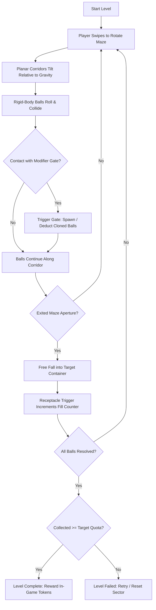
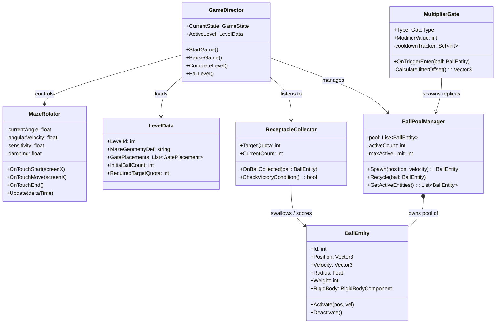
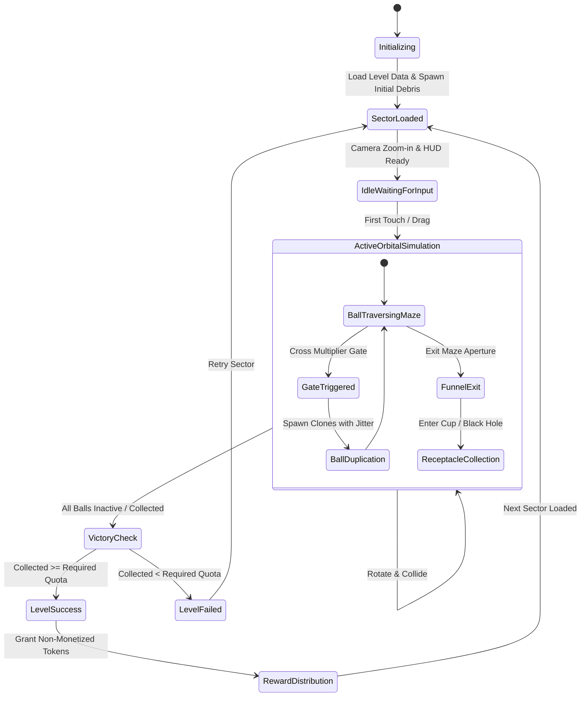
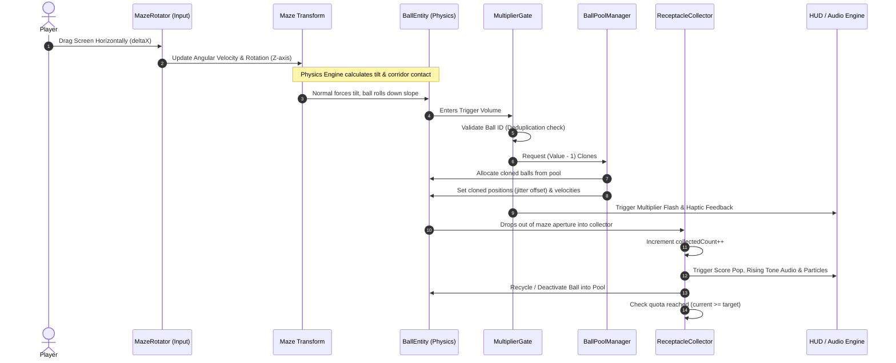

# Reference Game Analysis: Multi Maze 3D

**Technical Deconstruction, Mechanics Formulation, Pseudocode & UML Modeling**

- **Reference Title:** Multi Maze 3D
- **Reference URL:** [App Store Link](https://apps.apple.com/us/app/multi-maze-3d/id1583461846)
- **Primary Mechanics:** Rotational 3D Labyrinth, Rigid-Body Ball Physics, Dynamic Multiplier Gates, Funnel Collection Receptacle.
- **Monetization Status in Target Build:** **Completely Stripped** (0 Ads, 0 IAPs, 0 Subscriptions). Retaining persistent progression (Daily Contracts, In-Game Token Economy, Cosmetic Customization, Achievements).
- **Companion Documents:**
  - [`02_APP_STORE_SIMILARITY_AND_GUIDELINE_4_3.md`](./02_APP_STORE_SIMILARITY_AND_GUIDELINE_4_3.md) — App Store Review Guideline 4.3 Shield
  - [`03_GAME_DESIGN_DOCUMENT.md`](./03_GAME_DESIGN_DOCUMENT.md) — Master Game Design Document
  - [`04_TECHNICAL_ARCHITECTURE.md`](./04_TECHNICAL_ARCHITECTURE.md) — Technical & Viewport Engineering Architecture
  - [`05_GAME_UI_UX_DESIGN_SPECIFICATION.md`](./05_GAME_UI_UX_DESIGN_SPECIFICATION.md) — UI/UX Design System & Touch Wireframes
  - [`06_GAMEPLAY_SYSTEMS_AND_LEVEL_DESIGN.md`](./06_GAMEPLAY_SYSTEMS_AND_LEVEL_DESIGN.md) — Gameplay Systems & 50-Level Matrix
  - [`07_AUDIO_DESIGN_SPECIFICATION.md`](./07_AUDIO_DESIGN_SPECIFICATION.md) — Audio Design & Web Audio DSP Synthesis
  - [`CHANGELOG.md`](./CHANGELOG.md) — Semantic Version Milestone History

---

## 1. Executive Summary & Core Loop

_Multi Maze 3D_ is a physics-driven hypercasual puzzle game. The player manipulates a centrally pivoted 3D maze via rotational touch gestures to navigate rolling spheres through branching corridors. Along the path, spheres encounter mathematical modifier gates (e.g., `+5`, `x2`, `x3`, `-3`, `/2`) that dynamically clone or eliminate spheres. The objective is to navigate the multiplied spheres toward an exit aperture at the bottom of the maze and deposit a required quota into a collection container.

### 1.1 The Core Gameplay Loop



> [!NOTE]
> **Orbital Salvage Evolution Note:** In our target implementation, the passive plastic collection cup from _Multi Maze 3D_ is transformed into **Nibbles the Micro-Singularity**—an active cartoon entity featuring physical event horizon gravitational attraction, dynamic eye tracking, gulping mouth animations, and a neon magnetic guide funnel (see [`03_GAME_DESIGN_DOCUMENT.md`](./03_GAME_DESIGN_DOCUMENT.md) Section 2 and [`04_TECHNICAL_ARCHITECTURE.md`](./04_TECHNICAL_ARCHITECTURE.md) Section 2.2).

### 1.2 Sensory Feedback & Satisfaction Hooks

- **Auditory Escalation:** Chimes or audio tones ascend in pitch with each ball deposited into the cup within a short burst window.
- **Haptic Synchronization:** Continuous light micro-vibrations (`UIImpactFeedbackGeneratorLight`) pulse as balls pass through multiplier gates and cascade into the cup.
- **Volumetric Satisfaction:** The visual gratification of watching a modest seed of 5 balls swell into an avalanche of 150+ vibrant physical spheres pouring smoothly through a funnel.

---

## 2. Mathematical & Physical Formulations

### 2.1 Coordinate Frames & Rotational Dynamics

The maze rotates around its central z-axis, while the physical simulation environment maintains a global downward gravitational vector $\vec{g} = (0, -g_y, 0)$.

Let $\theta(t)$ represent the current z-rotation of the maze. The player's horizontal touch drag $\Delta x$ over frame time $\Delta t$ generates an angular displacement:
$$\Delta \theta = \kappa \cdot \Delta x$$
where $\kappa$ is the touch sensitivity coefficient.

To maintain physical smoothness and prevent jitter, an angular damping model is applied:
$$\omega_{t} = \omega_{t-1} \cdot (1 - \mu \Delta t) + \frac{\Delta \theta}{\Delta t}$$
$$\theta_{t} = \theta_{t-1} + \omega_{t} \Delta t$$
where $\mu$ is the rotational friction/drag coefficient.

### 2.2 Ball Trajectory & Corridor Relative Motion

Balls are modeled as rigid spheres with radius $r$, mass $m$, and restitution coefficient $e \in [0.15, 0.35]$ (low bounce to avoid chaotic ejection).

When resolving collision within the maze corridor in the local coordinate frame of the maze, the effective inertial acceleration experienced by a ball is:
$$\vec{a}_{\text{eff}} = R(-\theta) \cdot \vec{g} - \vec{\omega} \times (\vec{\omega} \times \vec{r}_{\text{ball}}) - 2(\vec{\omega} \times \vec{v}_{\text{rel}})$$
_Where:_

- $R(-\theta)$ is the inverse rotation matrix transforming world gravity into the maze frame.
- $\vec{\omega} \times (\vec{\omega} \times \vec{r})$ represents centrifugal acceleration.
- $2(\vec{\omega} \times \vec{v}_{\text{rel}})$ is the Coriolis force exerted by rapid maze spinning.

### 2.3 Modifier Gate Arithmetic & Spatial Clamping

Modifier gates operate as one-way trigger colliders along corridor thresholds.
When a ball entity $B_i$ triggers a gate with operator $\odot \in \{+, \times\}$ and operand value $V$:

1. **Multiplication Gate ($\times V$):**
   - Number of additional replicas to instantiate: $N_{\text{new}} = V - 1$.
   - Each replica inherits the velocity $\vec{v}$ of the parent ball with a micro-spatial perturbation $\vec{\delta}$:
     $$\vec{p}_{\text{new}} = \vec{p}_{\text{parent}} + \vec{\delta}, \quad \|\vec{\delta}\| \le 0.4 \cdot r$$
     _This perturbation prevents infinite overlap forces in the physics engine from causing explosion glitches._

2. **Addition Gate ($+ V$):**
   - Typically configured per ball group or with a gated cooldown pool to prevent an infinite recursive explosion if balls dwell in the trigger volume.

3. **Performance Safeguard (Entity Cap):**
   $$\text{ActiveBallsCount} \le N_{\text{max\_pool}} \quad (e.g., 300 \text{ entities})$$
   If the cap is breached, gates switch to a virtual weight-multiplication mode (each ball carries a `multiplier_weight` integer rather than instantiating individual physical colliders), maintaining 60/120 FPS on mobile hardware.

---

## 3. Core Mechanics Pseudocode

### 3.1 Rotational Controller (`MazeRotator.ts` / `.cs`)

```typescript
class MazeRotator {
  private currentAngle: number = 0;
  private targetAngularVelocity: number = 0;
  private readonly dragSensitivity: number = 0.45;
  private readonly damping: number = 0.88;
  private isTouching: boolean = false;
  private lastTouchX: number = 0;

  public onTouchStart(screenX: number): void {
    this.isTouching = true;
    this.lastTouchX = screenX;
    this.targetAngularVelocity = 0;
  }

  public onTouchMove(screenX: number): void {
    if (!this.isTouching) return;
    const deltaX = screenX - this.lastTouchX;
    this.lastTouchX = screenX;
    // Direct angular displacement applied
    this.targetAngularVelocity = deltaX * this.dragSensitivity;
  }

  public onTouchEnd(): void {
    this.isTouching = false;
  }

  public update(deltaTime: number): void {
    if (!this.isTouching) {
      // Apply inertia decay
      this.targetAngularVelocity *= Math.pow(this.damping, deltaTime * 60);
      if (Math.abs(this.targetAngularVelocity) < 0.001) {
        this.targetAngularVelocity = 0;
      }
    }

    this.currentAngle += this.targetAngularVelocity * deltaTime;
    // Apply rotation to maze transform matrix around Z axis
    this.applyRotationToTransform(this.currentAngle);
  }

  private applyRotationToTransform(angleRadians: number): void {
    // Platform specific binding (e.g. Three.js / Unity)
    // transform.rotation = Quaternion.Euler(0, 0, angleRadians * Rad2Deg);
  }
}
```

### 3.2 Dynamic Multiplier Gate (`MultiplierGate.ts`)

```typescript
enum GateType {
  MULTIPLY,
  ADD,
  SUBTRACT,
  DIVIDE,
}

interface MultiplierConfig {
  type: GateType;
  value: number;
  color: string;
  cooldownMs: number;
}

class MultiplierGate {
  private config: MultiplierConfig;
  private processedBallIds: Set<number> = new Set();
  private ballPool: BallPoolManager;

  constructor(config: MultiplierConfig, pool: BallPoolManager) {
    this.config = config;
    this.ballPool = pool;
  }

  public onTriggerEnter(ball: BallEntity): void {
    // Prevent recursive trigger loops on the exact same ball instance
    if (this.processedBallIds.has(ball.id)) {
      return;
    }
    this.processedBallIds.add(ball.id);

    switch (this.config.type) {
      case GateType.MULTIPLY:
        const spawnCount = Math.floor(this.config.value) - 1;
        for (let i = 0; i < spawnCount; i++) {
          const offset = this.calculateJitterOffset(ball.radius);
          const clone = this.ballPool.spawn(
            ball.position.add(offset),
            ball.velocity.multiply(0.95), // slight drag
          );
          this.processedBallIds.add(clone.id);
        }
        break;

      case GateType.ADD:
        for (let i = 0; i < this.config.value; i++) {
          const offset = this.calculateJitterOffset(ball.radius);
          const clone = this.ballPool.spawn(
            ball.position.add(offset),
            ball.velocity,
          );
          this.processedBallIds.add(clone.id);
        }
        break;

      case GateType.SUBTRACT:
      case GateType.DIVIDE:
        // Eliminate the entering ball and manage quota
        this.ballPool.recycle(ball);
        break;
    }

    this.playGatePassHaptic();
    this.triggerGateVFX();
  }

  private calculateJitterOffset(radius: number): Vector3 {
    const theta = Math.random() * 2 * Math.PI;
    const dist = Math.random() * (radius * 0.5);
    return new Vector3(Math.cos(theta) * dist, Math.sin(theta) * dist, 0);
  }
}
```

### 3.3 Target Collection Receptacle (`ReceptacleCollector.ts`)

```typescript
class ReceptacleCollector {
  private targetQuota: number;
  private currentCollectedCount: number = 0;
  private collectedBalls: Set<number> = new Set();
  private onQuotaUpdatedCallbacks: ((
    current: number,
    target: number,
  ) => void)[] = [];
  private onLevelCompleteCallbacks: (() => void)[] = [];

  constructor(targetQuota: number) {
    this.targetQuota = targetQuota;
  }

  public onTriggerEnter(ball: BallEntity): void {
    if (this.collectedBalls.has(ball.id)) return;
    this.collectedBalls.add(ball.id);

    this.currentCollectedCount++;
    this.notifyQuotaUpdated();
    this.playSuccessChime(this.currentCollectedCount);

    // Despawn ball after satisfying settle animation
    setTimeout(() => {
      ball.deactivate();
    }, 150);

    if (this.currentCollectedCount >= this.targetQuota) {
      this.triggerLevelSuccess();
    }
  }

  private notifyQuotaUpdated(): void {
    for (const cb of this.onQuotaUpdatedCallbacks) {
      cb(this.currentCollectedCount, this.targetQuota);
    }
  }

  private triggerLevelSuccess(): void {
    for (const cb of this.onLevelCompleteCallbacks) {
      cb();
    }
  }
}
```

---

## 4. UML Modeling

### 4.1 System Architecture Class Diagram



### 4.2 Game Lifecycle State Machine



### 4.3 Sequence Diagram: Interaction & Ball Multiplication Cycle



---

## 5. Architectural Flaws in the Reference Title (Multi Maze 3D)

To build a superior, commercially viable, and guideline-compliant application, we have identified key structural weaknesses in the original title:

1. **Monetization Overload (Adware Syndrome):**
   - The reference game bombards players with forced interstitial video ads every 1 to 2 levels, banner ads covering the bottom HUD, and aggressive "Watch Ad to Multiply 5x Coins" prompts.
   - **Target Resolution:** Completely eliminate all ads, IAPs, and pay-to-skip mechanics. All rewards, cosmetics, and features are earned through pure gameplay mastery.

2. **Primitive Flat Shading & Plastic Hypercasual Visuals:**
   - Standard primary colors, glossy plastic balls, and sterile pastel backgrounds convey a disposable, mass-produced aesthetic.
   - **Target Resolution:** Transition to a dark sci-fi aesthetic with neon accretion disks, volumetric starlight, metallic orbital chutes, and cosmic debris shaders.

3. **Physics Stability Issues (Tunneling & Jitter):**
   - High-speed rotations in the reference title frequently cause balls to clip through walls ("tunneling") or jitter violently when trapped in narrow corridor corners.
   - **Target Resolution:** Employ Continuous Collision Detection (CCD) for ball colliders, capped rotational angular speed, and spatial jitter dissipation algorithms.
