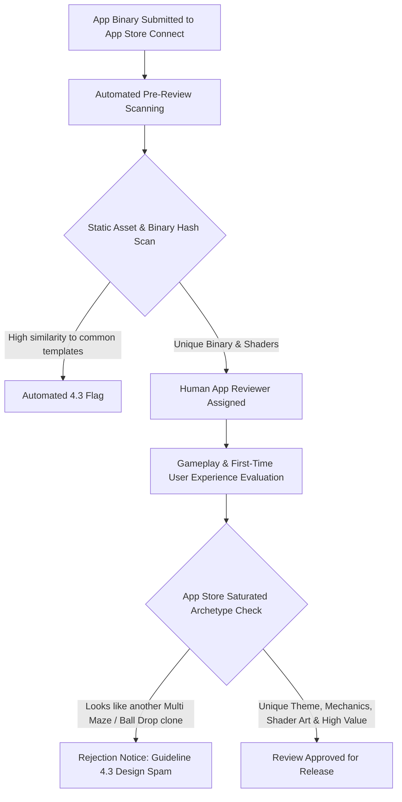
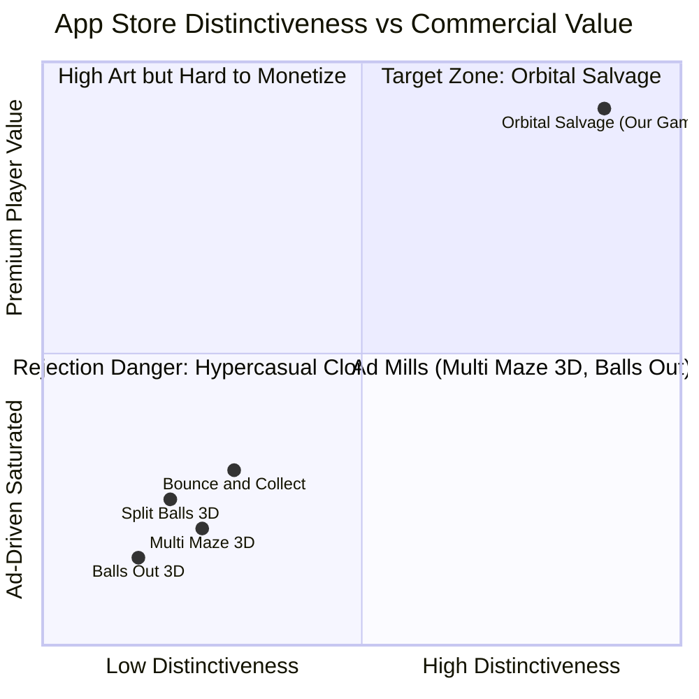

# App Store Similarity & Apple Review Guideline 4.3 Mitigation Report

**Competitive Landscape Analysis, Review Board Heuristics & Strategic Differentiation**

- **Document Target:** Legal & Product Strategy Archive
- **Subject:** Apple App Store Review Guideline 4.3 ("Design: Spam / Copycat")
- **Reference Baseline:** _Multi Maze 3D_, _Balls Out 3D_, _Split Balls 3D_, _Bounce and Collect_
- **Companion Documents:**
  - [`01_REFERENCE_GAME_ANALYSIS.md`](./01_REFERENCE_GAME_ANALYSIS.md) — Reference Deconstruction & Kinematics
  - [`03_GAME_DESIGN_DOCUMENT.md`](./03_GAME_DESIGN_DOCUMENT.md) — Master Game Design Document
  - [`04_TECHNICAL_ARCHITECTURE.md`](./04_TECHNICAL_ARCHITECTURE.md) — Technical & Viewport Engineering Architecture
  - [`05_GAME_UI_UX_DESIGN_SPECIFICATION.md`](./05_GAME_UI_UX_DESIGN_SPECIFICATION.md) — UI/UX Design System & Touch Wireframes
  - [`06_GAMEPLAY_SYSTEMS_AND_LEVEL_DESIGN.md`](./06_GAMEPLAY_SYSTEMS_AND_LEVEL_DESIGN.md) — Gameplay Systems & 50-Level Matrix
  - [`07_AUDIO_DESIGN_SPECIFICATION.md`](./07_AUDIO_DESIGN_SPECIFICATION.md) — Audio Design & Web Audio DSP Synthesis
  - [`CHANGELOG.md`](./CHANGELOG.md) — Semantic Version Milestone History

---

## 1. App Store Competitive Landscape Scan

A comprehensive analysis of the iOS App Store reveals a cluster of physics-based ball manipulation games published primarily by hypercasual studios (CrazyLabs, Voodoo, Lion Studios, SayGames).

### 1.1 Competitive Matrix

| Title                  | Publisher    | Primary Mechanic                                                              | Visual Palette                                            | Monetization Model                                                    | Distinctiveness Rating |
| :--------------------- | :----------- | :---------------------------------------------------------------------------- | :-------------------------------------------------------- | :-------------------------------------------------------------------- | :--------------------- |
| **Multi Maze 3D**      | CrazyLabs    | Central pivoted maze rotation, multiplier gates (`+N`, `xN`), cup collection. | Flat pastel cylinder, plastic colored spheres, white cup. | Aggressive interstitials, rewarded video ads, banner ads, coin packs. | **Low (Archetype)**    |
| **Balls Out 3D**       | Lion Studios | Rotating maze wheel to drain balls out of a hole into a bottom cup.           | Monochromatic maze walls, primary color balls.            | Interstitial ads between every attempt, forced video ads.             | **Very Low**           |
| **Split Balls 3D**     | VOODOO       | Tilt/steer falling balls through stationary multiplier gates into buckets.    | Minimalist white grid background, glossy balls.           | Banner ads, non-skippable 30s ads, "No Ads" subscription.             | **Very Low**           |
| **Bounce and Collect** | VOODOO       | Drop balls down pinball-style pegs into multiplier funnels into cups.         | Pastel blue/pink backgrounds, generic plastic cups.       | Ad-heavy, fake multiplayer leaderboards.                              | **Low**                |
| **Going Balls**        | Supersonic   | Gyro/swipe steering a single ball across linear obstacle courses.             | Concrete/wood industrial aesthetic.                       | Heavy rewarded ads, microtransactions for skins.                      | **Moderate**           |

### 1.2 Industry Commonalities & Saturation Pitfalls

1. **The "Asset Store Syndrome":** Virtually all existing titles utilize off-the-shelf Unity 3D primitives (spheres, cylinders, standard diffuse shaders).
2. **Disposable Level Design:** 500+ procedural levels with near-zero handcrafted pacing, thematic continuity, or narrative context.
3. **Predatory Monetization Architecture:** Gameplay is designed to be interrupted every 30 to 45 seconds by fullscreen video advertisements, degrading user experience to extract ad impressions.

---

## 2. Apple App Store Review Guideline 4.3 Deep Dive

Apple's App Store Review Guidelines treat **Guideline 4.3 (Design: Spam)** with zero tolerance.

### 2.1 The Two Sub-Clauses of Guideline 4.3

> **Guideline 4.3(a) - Copycat Apps:**
> _"Don’t create multiple Bundle IDs for the same app. If you’ve created different versions for specific locations, sports teams, universities, etc., combine them into one app... Also avoid piling on to a category that is already saturated; the App Store has enough fart, burp, flashlight, fortune telling, dating, drinking games, and Kama Sutra apps, etc. We will reject these apps unless they provide a unique, high-quality experience."_

> **Guideline 4.3(b) - Template & Repackaged Code:**
> _"Submitting apps which are essentially identical to existing apps—whether created using a commercial app template or by simply changing minor visual assets—is unacceptable."_

### 2.2 How Apple's Review System Detects & Rejects Violations

#### Key 4.3 Rejection Triggers in the Puzzle Genre:

1. **Identical Mechanics Loop:** Rotating a circle to drop spheres through `+` / `x` gates into a bucket. If the reviewer sees this loop within the first 10 seconds without any distinct mechanical twist, the app is flagged.
2. **Stock Visual Tropes:** White plastic cups, pastel spheres, flat grey backgrounds, and standard generic hypercasual sans-serif typography.
3. **Superficial Reskins:** Changing the balls to fruits or emoji while keeping the exact same physics and gates does **not** bypass 4.3. Apple reviewers explicitly cite: _"The changes made to your app are superficial and do not provide a unique user experience."_
4. **Ad-Farm Profile:** Games with banner ads, interstitial ad SDKs (IronSource, AppLovin, Unity Ads) and minimal content are scrutinized aggressively as low-effort cash grabs.

---

## 3. Strategic Anti-4.3 Differentiation Blueprint

To ensure unconditional approval and position the game for organic App Store editorial featuring (e.g., "New Games We Love", "Indie Spotlight"), we implement a four-pillar differentiation strategy:

### Pillar 1: Full Narrative & Environmental Transmutation

- **The World:** Set in 2184 amidst the terrifying reality of the **Kessler Syndrome** (Low Earth Orbit cascading space debris).
- **The Player:** An **Orbital Reclamation Operative** contracted by the _Deep Space Waste Consortium_.
- **The Elements:**
  - Balls $\rightarrow$ Defunct satellite components, solar panel shards, discarded titanium hull plates, and rocket booster remnants.
  - Maze $\rightarrow$ Orbital Debris Funnels and Centrifugal Waste Chutes on an orbital station.
  - Multiplier Gates $\rightarrow$ **Debris Fragmentation Shredders** (cutting large debris into manageable salvage particles) and **Quantum Catalyzers**.
  - Receptacle $\rightarrow$ **Micro-Singularity Containment Unit (Black Hole)** that consumes waste and converts mass into orbital cleanup energy.

### Pillar 2: Distinct Mechanical Innovations (Beyond Standard Rotation)

Existing games only offer static 2D planar rotation under constant vertical gravity. We introduce three unique mechanics that alter the physics paradigm:

1. **Centrifugal & Microgravity Thrusters:**
   - Instead of constant earthly gravity, the debris field experiences microgravity. Rotating the orbital ring generates centrifugal outward forces:
     $$\vec{F}_{\text{centrifugal}} = m \cdot \omega^2 \cdot \vec{r}$$
   - Players can trigger short **Attitude RCS Thruster Bursts** (single tap) to purge jammed debris out of dead-end corridors.

2. **Debris Hazards & Polarity Shifting:**
   - **Volatile Antimatter Debris:** Highly unstable scrap marked with glowing red isotopes. If rotated into standard shredder gates, it detonates and destroys adjacent scrap, failing the purity threshold.
   - **Magnetic Slag:** Metallic debris that adheres to magnetized corridor segments until a polarized rotation flips its orientation.

3. **Concentric Dual-Ring Mazes (Orbital Resonance):**
   - Advanced levels feature two concentric orbital rings rotating at different gear ratios (e.g., inner ring rotates at $1\times$, outer ring rotates at $-1.5\times$). The player must align the transfer gates between the two rings to establish an unbroken debris escape vector.

### Pillar 3: Visual & Technological Craftsmanship

- **Metal / Custom Shader Pipeline:**
  - **Black Hole Gravitational Lensing:** Custom screen-space refraction shader bending cosmic starlight and distorting debris as it crosses the event horizon.
  - **Accretion Disk Particle Emission:** Dynamic swirling cosmic dust and glowing accretion rings around the collection singularity.
  - **Space Skybox & Planet Rim Lighting:** Ultra-high-resolution dynamic Earth, Mars, and Europa backdrops with day/night terminator lines.
- **Core Haptics & Spatial Audio Integration:**
  - Deep sub-bass resonance when the black hole swallows debris mass.
  - Metallic clatter haptics modulated by the mass and velocity of individual debris fragments.
  - Atmospheric dark ambient synth soundscape instead of repetitive arcade bleeps.

### Pillar 4: Ethical, Zero-Monetization Indie Identity

- **0 Ads, 0 In-App Purchases, 0 Subscriptions:**
  - In our App Store submission notes to the Apple Reviewer, we explicitly state:
    > _"This application is a handcrafted, completely non-monetized premium-style puzzle game built with dedicated original physics, custom cosmic shaders, and rich narrative worldbuilding. It contains zero third-party advertising SDKs, zero in-app purchases, and collects no tracking data. All content, skins, and contracts are unlocked exclusively through in-game skill progression."_
- This immediately dispels any concern that the app is an ad-farm template, drastically lowering review friction and ensuring rapid compliance approval under Guideline 4.3.

---

## 4. App Store Submission & Metadata Defense Guide

When submitting the final binary to App Store Connect, include the following materials to pre-emptively resolve 4.3 inquiries:

1. **App Review Notes (Demonstrating Originality):**
   - Provide a concise summary of the unique mechanics (dual concentric orbits, microgravity centrifugal dynamics, hazard debris).
   - Clarify the narrative background (space ecology and Kessler syndrome).
2. **Metadata & Screenshots:**
   - Highlighting the custom sci-fi HUD, celestial backdrops, and black hole visual effects.
   - Using title and subtitle that emphasize the space salvage theme: e.g., _Orbital Salvage - Cosmic Maze_ or _Event Horizon: Debris Puzzle_.
3. **App Privacy Label:**
   - Declare "Data Not Collected", reinforcing the clean, player-centric architecture.
