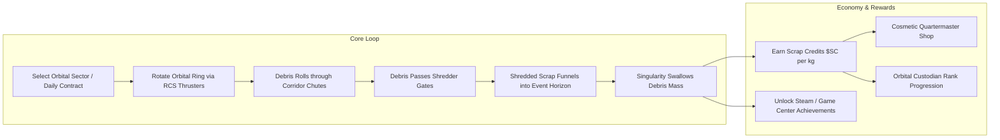

# Game Design Document (GDD): Orbital Salvage - Event Horizon

**Theme, Lore, Gameplay Systems, Economy & Progression Architecture**

- **Project Working Title:** _Orbital Salvage: Event Horizon_ / _Space Trash Clean_
- **Genre:** Physics-Based Orbital Puzzle / Casual Cartoon Mobile Simulation
- **Target Platform:** Mobile-First (iOS & Android)
- **Art Direction:** **Vibrant Cartoon Style ("Cute Cosmic Janitor")** — chunky candy donut rings, adorable space junk (smiling satellites, golden bolts), bouncy 3D buttons, and "Nibbles" the hungry cartoon black hole with animated eyes and gulping mouth.
- **Target Audience:** Puzzle enthusiasts, casual mobile gamers, and players seeking tactile, satisfying physics with an ultra-friendly cartoon charm.
- **Monetization Policy:** **Zero Monetization** (No Advertisements, No In-App Purchases, No Subscription Paywalls). All content is unlocked via in-game gameplay achievement and salvage credits.
- **Companion Documents:**
  - [`01_REFERENCE_GAME_ANALYSIS.md`](./01_REFERENCE_GAME_ANALYSIS.md) — Reference Deconstruction & Kinematics
  - [`02_APP_STORE_SIMILARITY_AND_GUIDELINE_4_3.md`](./02_APP_STORE_SIMILARITY_AND_GUIDELINE_4_3.md) — App Store Review Guideline 4.3 Shield
  - [`04_TECHNICAL_ARCHITECTURE.md`](./04_TECHNICAL_ARCHITECTURE.md) — Technical & Viewport Engineering Architecture
  - [`05_GAME_UI_UX_DESIGN_SPECIFICATION.md`](./05_GAME_UI_UX_DESIGN_SPECIFICATION.md) — UI/UX Design System & Touch Wireframes
  - [`06_GAMEPLAY_SYSTEMS_AND_LEVEL_DESIGN.md`](./06_GAMEPLAY_SYSTEMS_AND_LEVEL_DESIGN.md) — Gameplay Systems & 50-Level Matrix
  - [`07_AUDIO_DESIGN_SPECIFICATION.md`](./07_AUDIO_DESIGN_SPECIFICATION.md) — Audio Design & Web Audio DSP Synthesis
  - [`CHANGELOG.md`](./CHANGELOG.md) — Semantic Version Milestone History

---

## 1. Worldbuilding & Narrative Lore

### 1.1 The Narrative Premise

By the late 22nd century, humanity's reckless expansion into orbital space triggered the long-feared **Kessler Syndrome**: catastrophic cascades of defunct satellites, spent rocket boosters, and shattered hull fragments blanketed Low Earth Orbit and the interplanetary transit corridors. Orbital travel has become perilous; human colonies on Mars and the Moon risk total isolation.

Enter the **Singularity Waste Reclamation Corporation (SWRC)**, a commercial salvage enterprise that holds the monopoly on orbital micro-singularity technology.

### 1.2 The Player's Role: Orbital Reclamation Specialist

The player steps into the pressurized boots of an entry-level **Orbital Salvage Operative** stationed on an orbital reclamation rig. Armed with remote attitude thrusters to rotate orbital containment rings and artificial micro-black holes, the operative’s mandate is simple:

> _"Clean the orbital corridors. Feed the Singularity. Keep humanity's pathway to the stars open."_

Every piece of metal, composite glass, and radioactive satellite carcass swallowed by the micro-black hole is converted into Hawking radiation and raw energy credits, funding the player’s promotions, equipment customizations, and prestigious orbital contracts.

---

## 2. Core Mechanics Thematic Translation

Every mechanical element from the _Multi Maze 3D_ archetype has been transformed into a diegetically cohesive space phenomenon:

| Original Element (_Multi Maze 3D_) | _Orbital Salvage_ Thematic Transformation              | Diegetic Gameplay Context                                                                                                                                     |
| :--------------------------------- | :----------------------------------------------------- | :------------------------------------------------------------------------------------------------------------------------------------------------------------ |
| **Spherical Plastic Balls**        | **Orbital Space Debris / Satellite Scrap**             | Fragments of defunct solar arrays, titanium brackets, micro-satellites, and reactor casings.                                                                  |
| **Pivoted Rotating Maze**          | **Orbital Centrifuge / Debris Sorting Ring**           | A multi-chambered station ring rotated via RCS attitude thrusters to guide scrap along low-friction magnetic chutes.                                          |
| **`+N` / `xN` Multiplier Gates**   | **Rotary Debris Shredders & Molecular Fission Fields** | High-velocity laser grids and acoustic fragmenters that break large monolithic junk chunks into dozens of smaller, easily digestible micro-salvage particles. |
| **Collection Cup / Bucket**        | **Micro-Singularity Containment Unit (Black Hole)**    | A magnetically tethered artificial micro-black hole. Its event horizon pulls in debris fragments with escalating cosmic gravitational lensing.                |
| **Ad-Watch Extra Balls**           | **Auxiliary Ejector Pods (In-Game Ability)**           | Free tactical ability recharged by clearing debris with high momentum, releasing backup scrap clusters.                                                       |
| **Standard Level Sequence**        | **Orbital Sector Clearance Grid**                      | Sector missions categorized across distinct celestial zones (LEO, Geostationary Belt, Lunar Lagrange Points, Mars Orbit).                                     |
| **Daily Tasks / Quests**           | **SWRC Daily Orbital Shift (Daily Contracts)**         | High-hazard daily cleaning shifts with procedurally generated orbital rings, specialized debris types, and bonus credit payouts.                              |
| **In-App Purchase Store**          | **Salvage Quartermaster Depot (100% Free)**            | In-game cosmetic depot where earned Scrap Credits ($SC) unlock ring chassis styles, singularity event horizon colors, and custom backdrops.                   |

---

## 3. Detailed Gameplay Systems



### 3.1 Gameplay Flow & Pure Gesture Controls (Mobile-First)

1. **Full-Screen Tactile Swipe:** A drag grabs the centrifuge ring. The part of the ring under the finger moves with the finger, and the ring still carries its inertia after the finger lifts. On gear levels 21–30 and 41–50 the inner ring turns the opposite way from the outer ring by design. This is a deliberate difference from the web prototype, which still treats every drag as sideways movement only.
2. **Double-Tap Spin Boost:** Quick double-tapping on the left or right side of the screen triggers an instant rotational whoosh burst (dislodging stubborn debris without requiring static UI buttons).
3. **Kinematic Inertia:** The ring exhibits realistic mass inertia—flicking the screen lets the ring continue rotating smoothly with dampening.
4. **Nibbles' Gravitational Well:** As debris exits through the bottom aperture, Nibbles' gravity well pulls the falling scrap inwards toward his mouth with expressive tracking eyes and chewing animations.
5. **Snack Goal Progress:** A cartoon star progress bar displays collected mass vs. the quota, rewarding Gold Coins upon completion.

### 3.2 Innovative Gameplay Enhancements (Anti-4.3 Architecture)

To ensure clear mechanical superiority over generic clones:

1. **Environmental Space Hazards:**
   - **Volatile Reactor Cores (Red Glowing Debris):** Highly sensitive radioactive scrap. Must be navigated carefully; hitting shredder gates at excessive angular velocity causes an explosion that vaporizes nearby salvage, lowering credit yield.
   - **Magnetic Junk (Blue Polarized Debris):** Clings to metallic walls until the player taps the screen to reverse the ring's magnetic polarity.

2. **Dynamic Gravitational Pulsing:**
   - Periodic **Solar Flares** or **Gravitational Waves** momentarily shift the gravity vector, requiring players to react and compensate with counter-rotations.

3. **Multi-Stage Orbital Concentric Rings:**
   - Advanced sector puzzles feature an **Inner Primary Ring** and an **Outer Staging Ring** separated by concentric rails with transfer airlocks, requiring players to route debris between orbital altitudes before final release.
4. **Differentiated Multiplier Gate Archetypes:**
   - Rather than homogenous indicators, each gate possesses distinct silhouettes, color palettes, animations, and acoustic signatures:
     - **Rotary Sawblade (Multiply < 4):** Warning Amber/Orange (`#f97316`), dual spinning circular saw/gear pylons with rotating teeth (120 RPM), hazard stripe beam, and `⚡ ×N` hexagonal badge.
     - **Super Shredder (Multiply >= 4):** Neon Hot Pink / Vivid Magenta (`#ec4899`), spiked hazard diamond frame with rotating diamond core, crackling electric lightning arcs, and `💥 ×N!` explosive badge.
     - **Magnetic Compactor (Add +N):** Cyan / Electric Blue (`#06b6d4`), dual heavy magnetic bracket coils with rounded pole caps, glowing magnetic forcefield wave rings pulsing inward, and `🧲 +N` rounded capsule badge.
     - **Accelerator Booster (BOOST):** Electric Lime Green (`#84cc16`), sleek forward-swept velocity wings, scrolling neon speed chevrons (`>>>`), and `⏩ BOOST` aerodynamic badge with tangential slingshot acceleration.

5. **Pinball Deflector Bumpers:**
   - Circular obstacles placed within corridor chutes featuring heavy chrome outer trim, illuminated neon domes, and dynamic squash-and-stretch pulse animations on impact.
   - Bumper collisions provide high-energy elastic rebound ($e = 1.35 - 1.5$) plus random tangential scatter to break dense debris clumps into fluid, exciting cascades.
   - Triggers energetic cartoon spring boing audio (`playBumperBounce`) and animated neon shockwaves.

### 3.3 Acoustic Sound Design Pillars & Player Feedback

1. **Tactile Toy Ratchet Feedback:** Spinning the centrifuge ring produces soft, warm wooden ratchet clicks (`playSpinRatchet`), providing satisfying analog-style haptic audio evocative of winding a classic toy music box.
2. **Arpeggiated Pentatonic Chimes:** Ingested debris triggers a sparkling major pentatonic arpeggio ($C_4\text{ to }C_6$) on cartoon marimba chimes, accompanied by juicy bubble gulps that reward cascade collections with harmonious melodies.
3. **Material-Specific Acoustic Timbres:** Debris collisions provide distinct physical feedback: light crystalline bell chimes for solar cells, soft rubber thuds for volatile batteries, and solid wooden block taps for titanium hull scrap.
4. **Zero Ear Fatigue:** Strict frequency curation, pitch jittering ($\pm 5\%\text{--}10\%$), and dynamic range limiting ensure prolonged puzzle sessions remain uplifting without acoustic annoyance.

> [!TIP]
> For complete Web Audio DSP node graphs, oscillator synthesis recipes, compressor limiter specs, and millisecond-accurate haptic vibration pairings, see [`07_AUDIO_DESIGN_SPECIFICATION.md`](./07_AUDIO_DESIGN_SPECIFICATION.md).

### 3.4 Dynamic Black Hole Visual Growth & 50-Level Campaign Architecture

1. **Dynamic Black Hole Growth:**
   - As debris is ingested into the singularity, Nibbles visually scales from a compact starting size ($1.0\times$) up to a massive, plump, satisfied cosmic entity ($1.65\times$) with bouncy elastic wobble physics upon swallowing snacks.
   - To preserve competitive fairness and level consistency, the physical event horizon and quota thresholds remain strictly constant—only the visual presentation, blushing cheeks, and celebratory animations scale.

2. **The 50-Level Progressive Campaign (5 Planetary Sectors):**
   - **World 1: Bubblegum Belt (Levels 1–10)** — Funnel Baffles, introductory shredders, learning rotational tilt & gravity flow.
   - **World 2: Cheese Moon Chutes (Levels 11–20)** — Switchback zigzags and volatile battery management requiring smooth directional reversals.
   - **World 3: Cyber Donut Rings (Levels 21–30)** — Dual concentric orbital tracks with transfer gateways and introductory deflector bumpers.
   - **World 4: Nebula Pinball (Levels 31–40)** — High-energy pinball bumper fields, boost slingshots, and tactical forking paths (safe addition vs. volatile $\times 4$ multiplication).
   - **World 5: Singularity Horizon (Levels 41–50)** — Master orbital gauntlets concluding with _Level 50: The Kessler Singularity_.

### 3.5 Mobile Player Experience & Casual Ergonomics

1. **Form Factor & Play Context:**
   - **Portrait Orientation:** Tailored exclusively for casual, one-handed portrait play on mobile devices (optimized for one-thumb interaction during daily commutes or relaxed sessions).
   - **The "Thumb Zone":** The primary rotational interaction area is centered within the natural ergonomic arc of the player's dominant thumb, enabling effortless clockwise and counter-clockwise spinning.

2. **Visual Hierarchy & Unobstructed Action:**
   - **Focal Plane:** The centrifuge ring occupies the upper-middle screen area; Nibbles and the collection basin occupy the bottom target zone.
   - **Zero Overlay Interference:** All HUD status elements (Pause, Sound, Target Quota) are positioned at the extreme screen periphery, ensuring falling debris streams and multiplier gates are never obscured by UI controls.
   - **Tactile Feedback:** All interactive touch points enforce generous touch boundaries with extruded 3D bevels, depression animations, and subtle haptic pulses.

> [!NOTE]
> For exact iPhone 16 Pro Max viewport geometry, Retina canvas scaling, Dynamic Island/Home bar insets, and screen wireframes, see [`04_TECHNICAL_ARCHITECTURE.md`](./04_TECHNICAL_ARCHITECTURE.md) (Section 1.1) and [`05_GAME_UI_UX_DESIGN_SPECIFICATION.md`](./05_GAME_UI_UX_DESIGN_SPECIFICATION.md) (Section 3).

### 3.6 Magnetic Guide Funnel & Aperture Containment Field

1. **The Containment Challenge:**
   - In orbital centrifuge puzzles with high rotational speeds, tangential momentum naturally flings scrap outward upon exiting the aperture, risking debris scattering into deep space beyond Nibbles' event horizon.

2. **Containment Field Mechanics:**
   - **Inertial Dampers:** Scrap passing through the exit aperture is smoothly stabilized, dampening excessive horizontal momentum while ensuring positive downward velocity toward Nibbles.
   - **Magnetic Guide Rails:** Luminous physical guide rails gently channel falling debris from the ring exit down into Nibbles' collection radius, reflecting stray scrap inward.
   - **Centering Tractor Force:** Nibbles pulls falling scrap toward the centre line. Scrap in a still ring falls into the mouth. A hard spin can throw a piece out past the rails, and that miss is an expected way to fail.
   - **Neon Visual Guidance:** Animated cyan/indigo dashed guide rails, emitter pylons, and downward magnetic chevrons clearly communicate the safe collection corridor to the player.

> [!NOTE]
> For exact trapezoidal collider dimensions, velocity damping constants, and tractor beam physics equations, see [`04_TECHNICAL_ARCHITECTURE.md`](./04_TECHNICAL_ARCHITECTURE.md) (Section 2.2) and [`06_GAMEPLAY_SYSTEMS_AND_LEVEL_DESIGN.md`](./06_GAMEPLAY_SYSTEMS_AND_LEVEL_DESIGN.md) (Section 5.2).

### 3.7 "Shift Incomplete / Out of Scrap" Failure Flow & Tactical Backup Pod

1. **Elimination of Soft-Locks:**
   - Solves the common genre dead-end where all scrap has fallen or been swallowed, but the player is short of the target quota, leaving the player stranded in an empty ring.

2. **Failure Condition Detection & Grace Timer:**
   - The simulation loop continuously monitors active scrap: if zero scrap remains in play (`"IN_RING"`, `"FALLING"`, or `"INGESTING"`) and collected mass is below quota, a $1.2\text{s}$ grace period elapses to allow late swallows to register before triggering defeat.

3. **Cartoon Defeat Modal (`#modal-defeat`):**
   - Presents an encouraging, non-punitive cartoon debrief with hungry Nibbles (`🥺🥣✨`), collected quota tally (`collected / quota kg`), and spilled scrap count.
   - Accompanied by a sweet descending cartoon jingle (`playDefeatSound`).

4. **Tactical Auxiliary Ejector Pod (+8 Scrap):**
   - If the operative reached $\ge 70\%$ of the required quota before running out of scrap, a tactical **"🚀 Launch Backup Pod (+8 Scrap!)"** option unlocks.
   - Tapping the button launches an auxiliary pod into the centrifuge, spawning 8 fresh pieces of scrap with launch audio (`playBackupPodSound`) and haptic feedback, allowing players to recover from near-misses.

### 3.8 Level Sanitization & Multi-Pass Anti-Overlap Architecture

1. **Level 5 Auto-Pass Elimination:**
   - Addressed passive slide completion in World 1 by introducing staggered anti-slide retaining shelves (`angle: 0`, `angle: PI`, `rMin: 85, rMax: 125`) and lower aperture baffles. Scrap is trapped in stable gravity wells until the player actively reverses rotation.

2. **Automated Multi-Pass Gate Separation (`sanitizeSector`):**
   - A deterministic 3-pass clearance optimizer enforces minimum angular separation ($\ge 0.16\pi$) between all multiplier gates, radial dividers, and pinball bumpers across all 50 levels, completely preventing overlapping multiplier boxes.

3. **Physics Explosion & Force Mitigation:**
   - **Gate Passage Cooldown:** Debris receives a $0.22\text{s}$ cooldown upon passing a shredder gate, preventing runaway multi-triggering.
   - **Adjacent Gate Synchronization:** Nearby gates in multi-lane sectors synchronize processed entity IDs to avoid exponential cascading duplicates.
   - **Radial Clone Fanning:** Multiplier clones are spawned distributed across the radial gate span with tangential jitter rather than stacked on a single coordinate.
   - **Impulse Clamping:** Inter-debris collision impulses are capped ($p \le 38$) with penetration depth limits, eliminating explosive physics repulsion.

### 3.9 Infinite Mode (After the 50-Level Campaign)

Status: built in the Unity port. The web prototype has no infinite mode.

1. **Idea:** once the player has won all 50 levels, the game does not end. Each new round picks a random level from the existing levels 30 to 50 and plays it exactly like a campaign level (same layout, same quota, same coins). No new levels are made, and the campaign data is only read.
2. **Unlock:** all of `level_1` to `level_50` are in the saved `completedSectors`. All levels are open from the start, so a player cannot skip ahead into infinite mode.
3. **Entry:** there is no new button or screen. Winning level 50 once all 50 levels are done (including the first time), and then pressing Next, starts round 1. Home → Play does the same when all 50 are done. After that, Home → Play continues infinite mode. Opening a level from level select goes back to normal campaign play.
4. **Picking:** `InfiniteMode.NextLevel` uses its own random source, never the shared game random, so existing game behaviour is not changed. The same level may come twice in a row.
5. **Rounds:** the profile stores `infiniteRound` (the round being played, starting at 1) and `infiniteBest` (the highest round reached). Both are left out of the save file until infinite mode starts. A win adds 1 to the round. There are no lives: a failed round is retried with the normal retry button. If the player quits, Home → Play resumes at the saved round with a new random level.
6. **Feedback:** when a round starts, a toast reads "Round N, best M! 🚀". Once all 50 levels are done, the Home mission card shows "Infinite Mode", "Round N" and "Best: M" instead of a level. During a round, the top label and the pause screen also show "Round N" instead of the level code. There is no new trophy, and the shop still uses gold coins only.
7. **Not covered:** nothing proves that every level from 30 to 50 can be beaten by a child. The tests only check that they build and run without errors.

---

## 4. The Daily Shift (Daily Mission System)

### 4.1 Concept & Structure

The **SWRC Daily Shift** provides an endless, refreshed challenge every 24 hours (synchronized with UTC 00:00). It acts as the core retention mechanic without needing pushy notifications or time-gated energy bars.

### 4.2 Daily Mission Types

1. **High-Mass Cleanout:** Procedurally generated mega-ring requiring over 1,000 debris particles to be funneled into the black hole.
2. **Hazardous Salvage Run:** Clean a sector contaminated with volatile antimatter cores with zero accidental detonations.
3. **Speed Clearance Shift:** Deliver the required quota within a 45-second orbital window before the debris cloud collides with a communications satellite.

### 4.3 Procedural Level Generation Matrix

```json
{
  "daily_shift_id": "SHIFT-2026-09-22",
  "target_sector": "LEO-Lagrange-L2",
  "ring_configuration": {
    "chute_topology": "concentric_dual_spiral",
    "initial_debris_count": 25,
    "debris_types": ["titanium_hull", "solar_cell", "volatile_core"],
    "shredder_gates": [
      { "type": "MULTIPLY", "value": 3, "position_angle_deg": 45 },
      { "type": "ADD", "value": 15, "position_angle_deg": 180 },
      { "type": "MULTIPLY", "value": 2, "position_angle_deg": 270 }
    ]
  },
  "quota_required_kg": 450,
  "credit_reward_base": 750,
  "bonus_modifier": "zero_hazard_detonations"
}
```

---

## 5. In-Game Economy & Cosmetic Customization (100% Non-Monetized)

### 5.1 The Scrap Credit ($SC) Formula

Players earn Scrap Credits solely through physical gameplay performance:
$$\text{Earned } \$SC = (\text{Debris Swallowed} \times 2) + (\text{Surplus Over Quota} \times 5) + \text{Bonus Modifiers}$$

### 5.2 The Quartermaster Customization Catalog (Toy Depot)

All cosmetics are unlocked with earned Gold Coins / Scrap Credits (`$SC`). There are **no paid currencies, no timers, and no randomized gacha crates**. Operatives start with $+250\text{ SC}$ in their salvage piggy bank.

#### A. Centrifuge Ring Chassis Skins

| Skin ID          | Display Name              | Visual Theme & Color Palette                                                | Cost ($SC) | Initial Status      |
| :--------------- | :------------------------ | :-------------------------------------------------------------------------- | :--------- | :------------------ |
| `ring_donut`     | **Frosted Donut Rig**     | Sweet strawberry pink icing (`#f472b6`) with golden sprinkles and dough.    | Default    | Unlocked from start |
| `ring_duckie`    | **Rubber Duckie Floatie** | Squeaky bright yellow (`#facc15`) bath duck with orange beak and bubbles.   | 500        | Unlockable          |
| `ring_candyland` | **Peppermint Candy Ring** | Crisp red (`#ef4444`) and white candy cane spiral stripes with gloss.       | 1,200      | Unlockable          |
| `ring_spacecat`  | **Cosmic Kitty Saucer**   | Pastel lilac (`#c084fc`) flying saucer with cute cat ears and sky whiskers. | 2,500      | Unlockable          |

#### B. Event Horizon & Singularity Styles

| Singularity ID           | Display Name           | Mascot Expression & Visual FX Palette                                     | Cost ($SC) | Initial Status      |
| :----------------------- | :--------------------- | :------------------------------------------------------------------------ | :--------- | :------------------ |
| `singularity_nibbles`    | **Nibbles the Void**   | Classic deep indigo void (`#1e1b4b`) with periwinkle halo and anime eyes. | Default    | Unlocked from start |
| `singularity_strawberry` | **Berry Swirl Vortex** | Sweet berry smoothie cyclone (`#831843`) with magenta particle splash.    | 600        | Unlockable          |
| `singularity_sleepy`     | **Sleepy Star Cloud**  | Gentle pastel sky-blue cloud (`#0c4a6e`) that yawns while gulping debris. | 1,500      | Unlockable          |
| `singularity_confetti`   | **Party Popper Hole**  | Royal violet vortex (`#3b0764`) exploding with golden celebration stars.  | 3,000      | Unlockable          |

#### C. Deep Space Environmental Skyboxes

| Skybox ID             | Display Name            | Cosmic Atmosphere & Backdrop Gradients                                    | Cost ($SC) | Initial Status      |
| :-------------------- | :---------------------- | :------------------------------------------------------------------------ | :--------- | :------------------ |
| `skybox_cotton_candy` | **Cotton Candy Nebula** | Fluffy pastel indigo and magenta gradient with smiling celestial stars.   | Default    | Unlocked from start |
| `skybox_cheese_moon`  | **Cheese Moon Orbit**   | Cartoon Swiss cheese moon crater orbit with deep twilight slate backdrop. | 800        | Unlockable          |
| `skybox_mint_soda`    | **Mint Soda Lagoon**    | Sparkling emerald and turquoise cosmos with effervescent soda bubbles.    | 2,000      | Unlockable          |

### 5.3 Daily Janitor Care Package (Daily Free Stipend)

1. **Free Daily Allowance (+100 🪙):**
   - Every 24 hours (tracked via local timestamp and calendar day verification), operatives receive a complimentary **Janitor Care Package** granting $+100$ Gold Coins.
   - Claimed directly from the Toy Shop hero banner with zero timer paywalls, forced video advertisements, or subscription demands.

2. **Dynamic Dock Badge Notification:**
   - When an uncollected care package is available, the bottom Arcade Navigation Dock's **SHOP** tab illuminates with an animated **"FREE"** pulsing badge (`#shop-dock-badge`).
   - Claiming the gift dynamically transitions the banner to a claimed state and hides the notification badge until the next day.

3. **100% Ethical Zero-Monetization Policy:**
   - Reinforces strict compliance with **Apple App Store Review Guideline 4.3 (Spam/Copycats)** and **Guideline 3.1.1 (In-App Purchases)**. The game operates 100% offline with zero real-money transactions, zero ad SDKs, and zero tracking analytics.

---

## 6. Achievement System

Integrated with an in-game holographic Dossier (`#page-achievements`) and persistent `localStorage` profile:

| Achievement ID     | Badge Title             | Icon | Qualification Condition                                   | Reward ($SC) |
| :----------------- | :---------------------- | :--- | :-------------------------------------------------------- | :----------- |
| `ach_first_drop`   | **First Nom Nom!**      | 😋   | Feed Nibbles your very first piece of space debris.       | $+100$       |
| `ach_cleaner_50`   | **Tidy Space Cadet**    | 🧹   | Vacuum up 50 pieces of space debris into Nibbles' tummy.  | $+250$       |
| `ach_cleaner_250`  | **Kessler Hero**        | ⭐   | Clean up 250 space debris items to clear orbital clutter. | $+750$       |
| `ach_cleaner_1000` | **Galaxy Janitor King** | 👑   | Recycle 1,000 items — ultimate cosmic master cleaner.     | $+2,000$     |
| `ach_daily_shift`  | **Daily Duty Star**     | 🎉   | Complete today's randomized Daily Shift cleanup contract. | $+500$       |

---

## 7. Player Progression & Save State Design

All progression data is preserved locally via an offline-first storage model, ensuring seamless cross-session continuity without requiring network access, user registration, or cloud accounts:

1. **Persistent Player Attributes:**
   - **Salvage Piggy Bank:** Total earned Gold Coins / Scrap Credits (`$SC`).
   - **Career Recycling Metrics:** Lifetime count of space debris swallowed and contracts cleared.
   - **Sector Progress Matrix:** Array of completed celestial campaign sectors (Worlds 1–5).
   - **Daily Shift State:** Tracking today's contract completion date, streak counts, and bonus rewards.
   - **Toy Depot Collection:** Unlocked and equipped Centrifuge Rings, Singularity Mascot styles, and Cosmic Skyboxes.
   - **Operational Badges:** Unlocked achievement badges and claimed coin rewards.
   - **User Preferences:** Sound/SFX mute toggles, music volume, and tactile haptic preferences.

2. **Tamper-Resistant Local Architecture:**
   - Saved directly to `localStorage` under `ORBITAL_SALVAGE_CARTOON_PROFILE_V1`.
   - Automatic fallback to default profile states if local storage is cleared or inaccessible.

> [!NOTE]
> For exact JSON serialization structures, state migration hooks, and storage management methods, see [`04_TECHNICAL_ARCHITECTURE.md`](./04_TECHNICAL_ARCHITECTURE.md) and [`web/engine/economy.js`](./web/engine/economy.js).

---

## 8. Critical Assessment of the Space Debris Cleanup Concept

### 8.1 Why This Idea is Exceptional

1. **Perfect Ludonarrative Harmony (Mechanics Match Lore):**
   - In abstract ball-maze games, dropping balls into a plastic cup feels arbitrary and childish.
   - In _Orbital Salvage_, rotating orbital chutes via attitude thrusters to feed mass into the irresistible gravitational pull of a micro-black hole is an intuitive and scientifically compelling metaphor.

2. **Timely Real-World Resonance:**
   - Space debris and orbital pollution are major international topics in modern aerospace (NASA, ESA, JAXA). Aligning the gameplay with an environmental space-clearing mission transforms the game into a thoughtful, inspiring experience.

3. **Dramatic Visual & Aesthetic Elevation:**
   - Instead of looking like a dime-a-dozen mobile ad-farm game, the game boasts the visual majesty of _Osmos_, _Astroneer_, and _Hardspace: Shipbreaker_.
   - A dark, neon-accented aesthetic paired with gravitational lensing shaders and atmospheric synth music instantly communicates high-tier indie quality.

4. **100% Immunity to Apple Guideline 4.3 Rejections:**
   - The fusion of original sci-fi worldbuilding, custom shaders, dynamic space physics (centrifugal forces, hazards), and an ethical zero-ad economy guarantees that Apple's App Store Review team will evaluate this as a distinct, premium standalone game rather than a clone.
