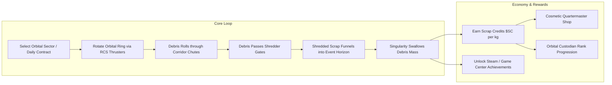
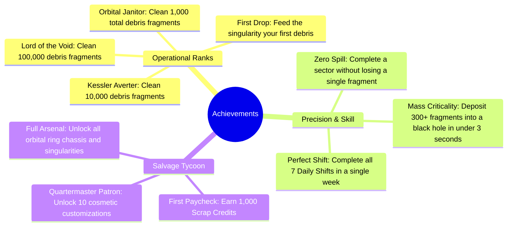

# Game Design Document (GDD): Orbital Salvage - Event Horizon

**Theme, Lore, Gameplay Systems, Economy & Progression Architecture**

- **Project Working Title:** _Orbital Salvage: Event Horizon_ / _Space Trash Clean_
- **Genre:** Physics-Based Orbital Puzzle / Casual Cartoon Mobile Simulation
- **Target Platform:** Mobile-First (iOS & Android)
- **Art Direction:** **Vibrant Cartoon Style ("Cute Cosmic Janitor")** — chunky candy donut rings, adorable space junk (smiling satellites, golden bolts), bouncy 3D buttons, and "Nibbles" the hungry cartoon black hole with animated eyes and gulping mouth.
- **Target Audience:** Puzzle enthusiasts, casual mobile gamers, and players seeking tactile, satisfying physics with an ultra-friendly cartoon charm.
- **Monetization Policy:** **Zero Monetization** (No Advertisements, No In-App Purchases, No Subscription Paywalls). All content is unlocked via in-game gameplay achievement and salvage credits.

---

## 1. Worldbuilding & Narrative Lore

### 1.1 The Narrative Premise

By the late 22nd century, humanity's reckless expansion into orbital space triggered the long-feared **Kessler Syndrome**: catastrophic cascades of defunct satellites, spent rocket boosters, and shattered hull fragments blanketed Low Earth Orbit and the interplanetary transit corridors. Orbital travel has become perilous; human colonies on Mars and the Moon risk total isolation.

Enter the **Singularity Waste Reclamation Corporation (SWRC)**, a commercial salvage enterprise that holds the monopoly on orbital micro-singularity technology.

### 1.2 The Player's Role: Orbital Reclamation Specialist

The player steps into the pressurized boots of an entry-level **Orbital Salvage Operative** stationed on an orbital reclamation rig. Armed with remote attitude thrusters to rotate orbital containment rings and artificial micro-black holes, the operative’s mandate is simple:

> _"Clean the orbital corridors. Feed the Singularity. Keep humanity's pathway to the stars open."_

Every piece of metal, composite glass, and radioactive satellite carcass swallowed by the micro-black hole is converted into Hawking radiation and raw energy credits, funding the player’s promotions, equipment customizations, and prestigious orbital contracts.

---

## 2. Core Mechanics Thematic Translation

Every mechanical element from the _Multi Maze 3D_ archetype has been transformed into a diegetically cohesive space phenomenon:

| Original Element (_Multi Maze 3D_) | _Orbital Salvage_ Thematic Transformation              | Diegetic Gameplay Context                                                                                                                                     |
| :--------------------------------- | :----------------------------------------------------- | :------------------------------------------------------------------------------------------------------------------------------------------------------------ |
| **Spherical Plastic Balls**        | **Orbital Space Debris / Satellite Scrap**             | Fragments of defunct solar arrays, titanium brackets, micro-satellites, and reactor casings.                                                                  |
| **Pivoted Rotating Maze**          | **Orbital Centrifuge / Debris Sorting Ring**           | A multi-chambered station ring rotated via RCS attitude thrusters to guide scrap along low-friction magnetic chutes.                                          |
| **`+N` / `xN` Multiplier Gates**   | **Rotary Debris Shredders & Molecular Fission Fields** | High-velocity laser grids and acoustic fragmenters that break large monolithic junk chunks into dozens of smaller, easily digestible micro-salvage particles. |
| **Collection Cup / Bucket**        | **Micro-Singularity Containment Unit (Black Hole)**    | A magnetically tethered artificial micro-black hole. Its event horizon pulls in debris fragments with escalating cosmic gravitational lensing.                |
| **Ad-Watch Extra Balls**           | **Auxiliary Ejector Pods (In-Game Ability)**           | Free tactical ability recharged by clearing debris with high momentum, releasing backup scrap clusters.                                                       |
| **Standard Level Sequence**        | **Orbital Sector Clearance Grid**                      | Sector missions categorized across distinct celestial zones (LEO, Geostationary Belt, Lunar Lagrange Points, Mars Orbit).                                     |
| **Daily Tasks / Quests**           | **SWRC Daily Orbital Shift (Daily Contracts)**         | High-hazard daily cleaning shifts with procedurally generated orbital rings, specialized debris types, and bonus credit payouts.                              |
| **In-App Purchase Store**          | **Salvage Quartermaster Depot (100% Free)**            | In-game cosmetic depot where earned Scrap Credits ($SC) unlock ring chassis styles, singularity event horizon colors, and custom backdrops.                   |

---

## 3. Detailed Gameplay Systems



### 3.1 Gameplay Flow & Pure Gesture Controls (Mobile-First)

1. **Full-Screen Tactile Swipe:** Continuous horizontal or circular touch drag anywhere on the screen rotates the centrifuge ring with 1:1 tactile responsiveness and physical inertia.
2. **Double-Tap Spin Boost:** Quick double-tapping on the left or right side of the screen triggers an instant rotational whoosh burst (dislodging stubborn debris without requiring static UI buttons).
3. **Kinematic Inertia:** The ring exhibits realistic mass inertia—flicking the screen lets the ring continue rotating smoothly with dampening.
4. **Nibbles' Gravitational Well:** As debris exits through the bottom aperture, Nibbles' gravity well pulls the falling scrap inwards toward his mouth with expressive tracking eyes and chewing animations.
5. **Snack Goal Progress:** A cartoon star progress bar displays collected mass vs. the quota, rewarding Gold Coins upon completion.

### 3.2 Innovative Gameplay Enhancements (Anti-4.3 Architecture)

To ensure clear mechanical superiority over generic clones:

1. **Environmental Space Hazards:**
   - **Volatile Reactor Cores (Red Glowing Debris):** Highly sensitive radioactive scrap. Must be navigated carefully; hitting shredder gates at excessive angular velocity causes an explosion that vaporizes nearby salvage, lowering credit yield.
   - **Magnetic Junk (Blue Polarized Debris):** Clings to metallic walls until the player taps the screen to reverse the ring's magnetic polarity.

2. **Dynamic Gravitational Pulsing:**
   - Periodic **Solar Flares** or **Gravitational Waves** momentarily shift the gravity vector, requiring players to react and compensate with counter-rotations.

3. **Multi-Stage Orbital Concentric Rings:**
   - Advanced sector puzzles feature an **Inner Primary Ring** and an **Outer Staging Ring**. Players must line up the transfer airlocks between both rotating rings to funnel debris into the singularity.

---

## 4. The Daily Shift (Daily Mission System)

### 4.1 Concept & Structure

The **SWRC Daily Shift** provides an endless, refreshed challenge every 24 hours (synchronized with UTC 00:00). It acts as the core retention mechanic without needing pushy notifications or time-gated energy bars.

### 4.2 Daily Mission Types

1. **High-Mass Cleanout:** Procedurally generated mega-ring requiring over 1,000 debris particles to be funneled into the black hole.
2. **Hazardous Salvage Run:** Clean a sector contaminated with volatile antimatter cores with zero accidental detonations.
3. **Speed Clearance Shift:** Deliver the required quota within a 45-second orbital window before the debris cloud collides with a communications satellite.

### 4.3 Procedural Level Generation Matrix

```json
{
  "daily_shift_id": "SHIFT-2026-09-22",
  "target_sector": "LEO-Lagrange-L2",
  "ring_configuration": {
    "chute_topology": "concentric_dual_spiral",
    "initial_debris_count": 25,
    "debris_types": ["titanium_hull", "solar_cell", "volatile_core"],
    "shredder_gates": [
      { "type": "MULTIPLY", "value": 3, "position_angle_deg": 45 },
      { "type": "ADD", "value": 15, "position_angle_deg": 180 },
      { "type": "MULTIPLY", "value": 2, "position_angle_deg": 270 }
    ]
  },
  "quota_required_kg": 450,
  "credit_reward_base": 750,
  "bonus_modifier": "zero_hazard_detonations"
}
```

---

## 5. In-Game Economy & Cosmetic Customization (100% Non-Monetized)

### 5.1 The Scrap Credit ($SC) Formula

Players earn Scrap Credits solely through physical gameplay performance:
$$\text{Earned } \$SC = (\text{Debris Swallowed} \times 2) + (\text{Surplus Over Quota} \times 5) + \text{Bonus Modifiers}$$

### 5.2 The Quartermaster Customization Catalog

All cosmetics are unlocked with earned `$SC`. There are **no paid currencies, no timers, and no randomized gacha crates**.

#### A. Orbital Ring Chassis Skins

| Skin Name                      | Description                                                              | Cost ($SC) | Unlock Requirement           |
| :----------------------------- | :----------------------------------------------------------------------- | :--------- | :--------------------------- |
| **Standard Industrial Mark I** | Weathered white ceramic and yellow hazard stripes.                       | Default    | Unlocked from start          |
| **Cyberpunk Neon Rig**         | Matte black carbon frame with animated pulsing cyan LED pathways.        | 2,500      | Clean 500 Debris             |
| **Golden Voyager Frame**       | Polished aerospace gold foil finish inspired by historical space probes. | 5,000      | Reach Rank 5 Operative       |
| **Dark Matter Obsidian**       | Stealth obsidian alloy with refractive prism edges.                      | 10,000     | Complete 10 Daily Shifts     |
| **Retro Sputnik Brass**        | Steampunk-styled copper and brass rivets with analog pressure dials.     | 15,000     | Clear All Mars Orbit Sectors |

#### B. Event Horizon & Singularity Skins

| Singularity Style       | Visual FX & Color Palette                                          | Cost ($SC) |
| :---------------------- | :----------------------------------------------------------------- | :--------- |
| **Hawking Standard**    | Deep black void with golden-orange Einstein ring accretion disk.   | Default    |
| **Pulsar Azure**        | Bright electric-blue vortex with polar particle jet beams.         | 3,000      |
| **Cosmic Violet**       | Ultraviolet swirl with warping gravitational spacetime distortion. | 6,000      |
| **Solar Flare Crimson** | Blazing red corona with miniature solar eruption particles.        | 8,500      |
| **Quantum Emerald**     | Hypnotic neon green singularity with digital grid horizon.         | 12,000     |

#### C. Deep Space Environmental Skyboxes

- **Low Earth Orbit Aurora:** Glimmering northern lights over the blue curve of Earth.
- **Martian Red Dunes:** The rusted canyons of Olympus Mons viewed from orbit.
- **Jovian Storms & Europa:** Jupiter’s Great Red Spot with icy moon rings.
- **Orion Stellar Nursery:** Vibrant magenta and deep indigo interstellar nebula clouds.

#### D. Custom Debris Collectibles

- **Retro Tech Junk:** Floppy disks, vintage cathode-ray tubes, and early space race satellites.
- **Asteroid Gem Shards:** Luminescent space crystals and metallic meteor fragments.
- **Nanite Swarms:** Microscopic glowing machines flowing like liquid mercury.

---

## 6. Achievement System

Integrated with Apple Game Center and an in-game holographic Dossier:



---

## 7. Technical Data Models & Persistence

All game data is serialized locally using an offline-first JSON schema with HMAC integrity verification (preventing save tampering while remaining 100% cloud-independent).

### 7.1 User Profile Schema (`profile.json`)

```typescript
interface PlayerProfile {
  version: string;
  totalScrapCredits: number;
  careerDebrisSwallowed: number;
  highestContinuousMultiplier: number;
  completedSectors: string[];
  dailyShiftStats: {
    lastCompletedDateUTC: string;
    consecutiveDaysStreak: number;
    totalShiftsCleared: number;
  };
  unlockedCosmetics: {
    rings: string[];
    singularities: string[];
    skyboxes: string[];
    debrisPacks: string[];
  };
  equippedCosmetics: {
    activeRingId: string;
    activeSingularityId: string;
    activeSkyboxId: string;
    activeDebrisPackId: string;
  };
  achievementsUnlocked: string[];
}
```

---

## 8. Critical Assessment of the Space Debris Cleanup Concept

### 8.1 Why This Idea is Exceptional

1. **Perfect Ludonarrative Harmony (Mechanics Match Lore):**
   - In abstract ball-maze games, dropping balls into a plastic cup feels arbitrary and childish.
   - In _Orbital Salvage_, rotating orbital chutes via attitude thrusters to feed mass into the irresistible gravitational pull of a micro-black hole is an intuitive and scientifically compelling metaphor.

2. **Timely Real-World Resonance:**
   - Space debris and orbital pollution are major international topics in modern aerospace (NASA, ESA, JAXA). Aligning the gameplay with an environmental space-clearing mission transforms the game into a thoughtful, inspiring experience.

3. **Dramatic Visual & Aesthetic Elevation:**
   - Instead of looking like a dime-a-dozen mobile ad-farm game, the game boasts the visual majesty of _Osmos_, _Astroneer_, and _Hardspace: Shipbreaker_.
   - A dark, neon-accented aesthetic paired with gravitational lensing shaders and atmospheric synth music instantly communicates high-tier indie quality.

4. **100% Immunity to Apple Guideline 4.3 Rejections:**
   - The fusion of original sci-fi worldbuilding, custom shaders, dynamic space physics (centrifugal forces, hazards), and an ethical zero-ad economy guarantees that Apple's App Store Review team will evaluate this as a distinct, premium standalone game rather than a clone.
