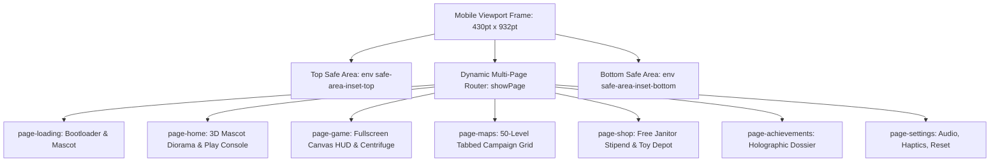
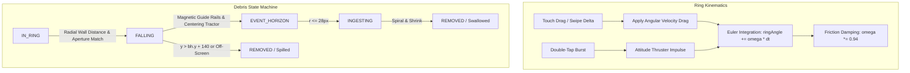

# Orbital Salvage: Technical Architecture Document

**Engineering Specification, Spatial Simulation Algorithms & Systems Pipeline**

- **Project:** _Orbital Salvage: Space Trash Clean_
- **Target Platform:** Mobile-First Web & Native iOS Container (WebKit / Capacitor / Cordova)
- **Viewport Specification:** iPhone 16 Pro Max Native Logical Points ($430\text{pt} \times 932\text{pt}$, aspect ratio $\sim 19.5:9$)
- **Core Technologies:** HTML5, CSS3, ES Modules, Canvas 2D API, Web Audio API
- **Milestone Version History:** See [`CHANGELOG.md`](./CHANGELOG.md)
- **Companion Documents:**
  - [`01_REFERENCE_GAME_ANALYSIS.md`](./01_REFERENCE_GAME_ANALYSIS.md) — Reference Deconstruction & Kinematics
  - [`02_APP_STORE_SIMILARITY_AND_GUIDELINE_4_3.md`](./02_APP_STORE_SIMILARITY_AND_GUIDELINE_4_3.md) — App Store Review Guideline 4.3 Shield
  - [`03_GAME_DESIGN_DOCUMENT.md`](./03_GAME_DESIGN_DOCUMENT.md) — Master Game Design Document
  - [`05_GAME_UI_UX_DESIGN_SPECIFICATION.md`](./05_GAME_UI_UX_DESIGN_SPECIFICATION.md) — UI/UX Design System & Touch Wireframes
  - [`06_GAMEPLAY_SYSTEMS_AND_LEVEL_DESIGN.md`](./06_GAMEPLAY_SYSTEMS_AND_LEVEL_DESIGN.md) — Gameplay Systems & 50-Level Matrix
  - [`07_AUDIO_DESIGN_SPECIFICATION.md`](./07_AUDIO_DESIGN_SPECIFICATION.md) — Audio Design & Web Audio DSP Synthesis

---

## 1. System & Viewport Architecture



### 1.1 Mobile Viewport Geometry (430pt × 932pt Standard)

- **Standard Dimensions:** Root container `#mobile-frame` is constrained to `max-width: 430px; max-height: 932px;` with `border-radius: 50px` on desktop viewports and full-screen expansion on mobile devices.
- **High-DPI Retina Rendering:** Canvas resolution is computed dynamically using:
  $$\text{canvas.width} = \text{round}(w \times \text{dpr}), \quad \text{canvas.height} = \text{round}(h \times \text{dpr})$$
  where $\text{dpr} = \min(\text{window.devicePixelRatio} \parallel 1, 3.0)$.
- **Dynamic Layout Balancing:**
  - Centrifuge Center: $x = w \times 0.5$, $y = \max(175, h \times 0.38)$.
  - Nibbles (Black Hole): $x = w \times 0.5$, $y = \min(h - 110, \max(\text{centerY} + 240, h \times 0.76))$.
- **Hardware Safe Area Ergonomics:**
  - Header controls (`.hud-top-mobile`, `.page-nav-header`) use `padding-top: calc(env(safe-area-inset-top, 0px) + 14px);` to avoid overlap with the iPhone Dynamic Island / camera notch.
  - Bottom navigation dock (`.home-arcade-dock`) uses `padding-bottom: calc(env(safe-area-inset-bottom, 0px) + 6px);` and `height: calc(68px + env(safe-area-inset-bottom, 0px));` to clear the iOS Home indicator bar.
  - Interactive touch buttons strictly enforce a minimum dimension of $44\text{pt} \times 44\text{pt}$ (Apple Human Interface Guidelines).

---

## 2. Physics & Spatial Simulation Pipeline



### 2.1 Aperture Inertial Dampers & Velocity Clamping

- When debris exits the centrifuge ring aperture into the void:
  ```javascript
  if (d.state !== "FALLING") {
    d.state = "FALLING";
    d.vx *= 0.35; // 65% horizontal tangential damper
    d.vy = Math.max(d.vy, 95); // Ensure downward momentum into funnel
  }
  ```
- **Velocity Soft Cap:** Debris linear speed is capped at $460\text{px/s}$ to prevent runaway explosive ejection.

### 2.2 Physical Magnetic Containment Funnel

- **Geometry:** Trapezoidal funnel extending from $topY = \text{center.y} + \text{ringRadius} - 15$ down to $bottomY = \text{blackHole.y}$.
- **Half-Width Formula:**
  $$halfWidth(y) = 95 \times (1 - t) + 46 \times t, \quad t = \frac{y - topY}{bottomY - topY}$$
- **Centering spring** (critically damped, a deliberate balance choice): $k = 15$, $c = 2\sqrt{15}$.
  $$v_x \mathrel{+}= \big((\text{blackHole.x} - d.x) \times 15 - v_x \times 2\sqrt{15}\big) \times dt$$
  Idle scrap stays in the funnel. A hard spin can spill a piece. Rails, aperture dampers, gravity, and the black hole are unchanged.
- **Elastic Wall Collisions:** When $d.x$ breaches the funnel boundaries, it is pushed back inside and its normal velocity is reflected ($v_x = -v_x \times 0.45$).
- **Boundary Check Gating:** `resolveRingCollisions()` strictly executes only when `d.state === "IN_RING"`, eliminating boundary bounce-back after exit.

### 2.3 Multiplier Gate Stability & Physics Explosion Mitigation

- **Gate Cooldown:** Passing a gate applies `d.gateCooldown = 0.22s` to the triggering scrap.
- **Adjacent Gate Synchronization (`syncAdjacentGates`):** Multi-lane gates within angular distance $< 0.16\pi$ share processed entity IDs to prevent geometric multi-duplication loops.
- **Radial Clone Fanning:** Multiplier clones spawn distributed radially along the gate length ($span = \min(24, (r_{max} - r_{min}) \times 0.35)$) with tangential jitter rather than co-located coordinates.
- **Impulse Clamping:** Inter-debris collisions clamp the impulse exchange to $p \le 38$ with penetration overlap limited to $75\%$ radius, preventing explosive repulsion.

---

## 3. Failure Condition & Recovery Architecture

### 3.1 Out-of-Scrap State Detection

- The game loop inspects whether any debris remains in active play:
  ```javascript
  const hasDebrisInPlay = this.physics.debrisList.some(
    (d) =>
      d.state === "IN_RING" || d.state === "FALLING" || d.state === "INGESTING",
  );
  ```
- If `!hasDebrisInPlay` and `collectedMass < quota`, an accumulator `failureCheckTimer += dt` counts up.
- **Grace Window:** Once `failureCheckTimer >= 1.2s`, `handleLevelFailure()` is triggered, ensuring all in-flight swallows and scoring cascades are fully credited before showing defeat.

### 3.2 Defeat State Presentation & UI Invocation

- Upon failure confirmation, the engine invokes `handleLevelFailure()`:
  1. Suspends physics world integration (`engine.timing.timeScale = 0`).
  2. Emits defeat acoustic event (`audio.playDefeatSound()`).
  3. Populates DOM modal elements (`#defeat-collected-mass`, `#defeat-spilled-mass`) with final run telemetry.
  4. Removes the `.hidden` class from `#modal-defeat`, presenting the recovery interface.

> [!NOTE]
> For complete defeat screen layout wireframes, cartoon copy specifications, and button touch target sizing, see [`05_GAME_UI_UX_DESIGN_SPECIFICATION.md`](./05_GAME_UI_UX_DESIGN_SPECIFICATION.md) (Section 5.3).

### 3.3 Tactical Auxiliary Ejector Pod

- If progress reaches $\ge 70\%$ of quota before scrap exhaustion, the modal reveals the **"🚀 Launch Backup Pod (+8 Scrap!)"** action.
- Tapping the button:
  1. Hides the defeat modal and marks `usedBackupPod = true`.
  2. Injects 8 titanium/solar debris pieces into the centrifuge hub with randomized inward velocity.
  3. Plays procedural rocket thruster deploy audio (`playBackupPodSound`).
  4. Resumes gameplay seamlessly without restarting the stage.

---

## 4. Level Sanitization & Multi-Pass Anti-Overlap Architecture

### 4.1 Level 5 Auto-Pass Elimination

- In World 1 (Bubblegum Belt), scrap previously slipped to the right due to gentle gravity and auto-passed Level 5 without player interaction.
- **Solution:** Replaced smooth continuous corridors with staggered anti-slide retaining shelves:
  - Right Shelf: $r \in [85, 125]$, $\theta = 0\text{ rad}$ (catches and holds rightward sliding debris).
  - Left Shelf: $r \in [85, 125]$, $\theta = \pi\text{ rad}$ (catches and holds leftward sliding debris).
  - Lower Aperture Baffles: $r \in [115, 155]$ at $\theta \approx 0.32\pi$ and $0.68\pi$.
  - Players must actively counter-rotate the ring to navigate scrap through the labyrinth.

### 4.2 Deterministic Multi-Pass Gate Separation (`sanitizeSector`)

- A 3-pass spatial optimizer iterates over all gates, dividers, and flappers:
  1. **Gate-to-Divider Clearance:** Tests angular separation against radial overlap; rotates gates away from walls until clearance $\ge 0.16\pi$.
  2. **Gate-to-Gate Separation:** Checks pairwise radial overlaps among all gates; applies directional angular shifts if distance $< 0.16\pi$.
  3. **Gate-to-Pin Clearance:** Adjusts pinball bumper angles to ensure clean rolling clearance.
- **Verification:** Audited across all 50 levels; verified 0 gate-gate overlaps and 0 gate-divider overlaps.

---

## 5. Procedural Web Audio Architecture

- **Synthesis Engine:** Pure Web Audio API oscillators, biquad filters, and dynamics compressor (zero external audio files).
- **Master Dynamics Compressor:**
  - Threshold: $-14\text{ dB}$, Knee: $10\text{ dB}$, Ratio: $8:1$.
  - Attack: $0.003\text{s}$, Release: $0.12\text{s}$.
  - Guarantees clean, distortion-free output during 100+ particle cascade events.
- **Acoustic Signatures:**
  - **Spin Ratchet:** Wood-block triangle wave click with pitch scaling ($800\text{ Hz}$).
  - **Swallow Chimes:** Arpeggiated C-major pentatonic scale (C4 to C6) with bubble gulp modulation.
  - **Victory Fanfare:** Upbeat ascending sequence (C5 - E5 - G5 - C6).
  - **Defeat Jingle:** Whimsical descending cartoon notes (G4 - E4 - D4 - C4 with pitch bend down to A3).
  - **Backup Pod Launch:** Energetic ascending sine sweep (C4 - G4 - C5 - E5).

> [!TIP]
> **Comprehensive Audio Specification:** For complete DSP signal chain schematics, node routing topologies, the full 12-cue acoustic recipe catalog, and millisecond-accurate haptic vibration patterns, see [`07_AUDIO_DESIGN_SPECIFICATION.md`](./07_AUDIO_DESIGN_SPECIFICATION.md).
