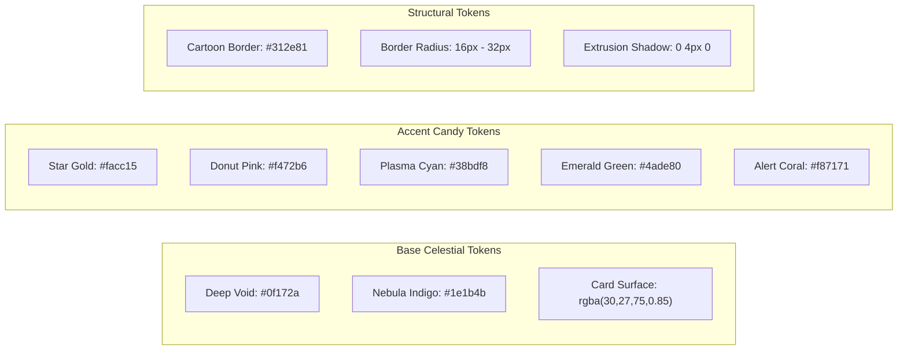
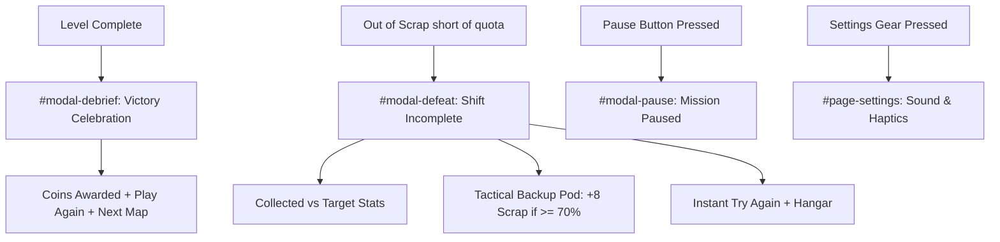

# Orbital Salvage: Game UI/UX Design Specification

**Mobile-First Ergonomics, Design System, Screen Wireframes & Interaction Architecture**

- **Project:** _Orbital Salvage: Space Trash Clean_
- **Target Platform:** Mobile-First iOS (WebKit / Native App Wrapper) & Modern Mobile Browsers
- **Standard Viewport:** Apple iPhone 16 Pro Max Native Logical Resolution ($430\text{pt} \times 932\text{pt}$, $\sim 19.5:9$)
- **Art Direction:** **"Cute Cosmic Janitor"** — Chunky 3D tactile skeuomorphism, candy donut palettes, expressive mascot reactions, and clean arcade readability.
- **Companion Documents:**
  - [`01_REFERENCE_GAME_ANALYSIS.md`](./01_REFERENCE_GAME_ANALYSIS.md) — Reference Deconstruction & Kinematics
  - [`02_APP_STORE_SIMILARITY_AND_GUIDELINE_4_3.md`](./02_APP_STORE_SIMILARITY_AND_GUIDELINE_4_3.md) — App Store Review Guideline 4.3 Shield
  - [`03_GAME_DESIGN_DOCUMENT.md`](./03_GAME_DESIGN_DOCUMENT.md) — Master Game Design Document
  - [`04_TECHNICAL_ARCHITECTURE.md`](./04_TECHNICAL_ARCHITECTURE.md) — Technical & Viewport Engineering Architecture
  - [`06_GAMEPLAY_SYSTEMS_AND_LEVEL_DESIGN.md`](./06_GAMEPLAY_SYSTEMS_AND_LEVEL_DESIGN.md) — Gameplay Systems & 50-Level Matrix
  - [`07_AUDIO_DESIGN_SPECIFICATION.md`](./07_AUDIO_DESIGN_SPECIFICATION.md) — Audio Design & Web Audio DSP Synthesis
  - [`CHANGELOG.md`](./CHANGELOG.md) — Semantic Version Milestone History

---

## 1. Design Philosophy & Visual Language

### 1.1 "Cute Cosmic Janitor" Aesthetics

1. **Chunky Tactile 3D Skeuomorphism:**
   - Every interactive element (buttons, capsules, tiles, badges) possesses a tangible cartoon volume created by thick, dark contrast borders ($2.5\text{px}\text{--}4\text{px}$) and solid vertical extrusion drop-shadows (`box-shadow: 0 4px 0 var(--border)`).
   - Pressing a button translates it vertically by $+2\text{px}$ to $+3\text{px}$ while compressing its shadow, providing instant tactile physical feedback.
2. **Playful Cosmic Color Theory:**
   - Deep indigo and midnight navy backdrops (`#0f172a`, `#1e1b4b`) create dramatic celestial contrast while remaining soft on the eyes.
   - High-luminance candy accents (Donut Pink `#f472b6`, Star Gold `#facc15`, Plasma Cyan `#38bdf8`, Electric Emerald `#4ade80`, Coral Red `#f87171`) make gameplay elements instantly readable at a glance.
3. **Expressive Mascot Personality ("Nibbles"):**
   - The central character is not an abstract hole, but an adorable cartoon micro-singularity with animated blinking eyes, blushing cheeks, interactive touch reactions, and elastic chewing animations.

---

## 2. Design Tokens & Color Matrix



### 2.1 Complete Token Palette

| Token Identifier | Hex / CSS Value          | Semantic Role               | Usage Examples                                      |
| :--------------- | :----------------------- | :-------------------------- | :-------------------------------------------------- |
| `--bg-deep`      | `#0f172a`                | Deep Space Background       | Mobile container, starfield backplate               |
| `--bg-card`      | `rgba(30, 27, 75, 0.85)` | Elevated Surface            | Sector cards, shop listings, modal cards            |
| `--yellow-main`  | `#facc15`                | High-Value Accent / Primary | Primary action buttons, star badges, coins          |
| `--pink-main`    | `#f472b6`                | Playful Accent / Brand      | Mascot accents, donut frosting, cosmetic highlights |
| `--blue-plasma`  | `#38bdf8`                | High-Tech / Velocity        | Booster arrows, magnetic forcefields, level badges  |
| `--green-main`   | `#4ade80`                | Success / Completion        | Quota complete fill, unlock checkmarks              |
| `--red-alert`    | `#f87171`                | Warning / Defeat            | Shift incomplete banner, volatile batteries         |
| `--border-dark`  | `#312e81`                | Cartoon Contour             | Outlines on all cards, buttons, and HUD capsules    |

---

## 3. Mobile Ergonomics & Viewport Standard (iOS 430pt × 932pt)

```mermaid
graph TD
    subgraph Viewport Layout (430pt x 932pt)
        T[Top Safe Area: env(safe-area-inset-top) + 14px<br/>Dynamic Island & Notch Clearance]
        H[Top HUD / Header Controls: 44pt Touch Targets]
        C[Primary Interaction Canvas / Content Scroll Area]
        D[Bottom Arcade Dock: 68pt + env(safe-area-inset-bottom)<br/>Thumb Ergonomic Zone]
        B[Bottom Safe Area: env(safe-area-inset-bottom) + 6px<br/>Home Indicator Bar Clearance]

        T --> H --> C --> D --> B
    end
```

### 3.1 Thumb-Zone Ergonomics

- **Natural Reach Zone:** The bottom $35\%$ of the screen houses the Unified Arcade Dock, Primary Launch Button, and direct rotational swipe canvas area.
- **Comfortable Stretch Zone:** The middle $45\%$ contains the rotating centrifuge, shredder gates, and falling debris chutes.
- **Infrequent / Safety Zone:** The top $20\%$ houses non-urgent navigational buttons (Pause, Restart, Sound Toggle) to prevent accidental mis-taps during intense gameplay.

### 3.2 Apple Human Interface Guidelines (HIG) Compliance

1. **Minimum Touch Targets:** Every interactive button adheres strictly to a minimum bounding box of $44\text{pt} \times 44\text{pt}$ (HUD Pause, Restart, Sound buttons are sized at $44\text{px} \times 44\text{px}$ with circular hitboxes).
2. **Safe Area Insets:**
   - Header top padding: `padding-top: calc(env(safe-area-inset-top, 0px) + 14px);`
   - Bottom dock padding: `padding-bottom: calc(env(safe-area-inset-bottom, 0px) + 6px);`
   - Total dock height: `height: calc(68px + env(safe-area-inset-bottom, 0px));`
3. **Zero Browser Distractions:** Enforces `overscroll-behavior: none; touch-action: none; user-select: none;` preventing unwanted pull-to-refresh or text selection during rotational swipes.

---

## 4. Screen-by-Screen UI Specifications

### 4.1 Screen 1: Boot Sequence & Loading (`#page-loading`)

- **Visuals:** Animated bouncing donut mascot (`🍩`) with soft pulsing drop shadow.
- **Title Block:** Heavy display header `ORBITAL SALVAGE` with subtitle `Cute Cosmic Janitor`.
- **Loading Bar:** Pill track with candy gradient fill (`linear-gradient(90deg, #facc15, #f472b6)`).
- **Procedural Tips:** Rotating cosmic humorous tips (e.g., _"Waking up Nibbles for breakfast..."_, _"Sprinkling candy on orbital rings..."_).

### 4.2 Screen 2: Game Homepage & 3D Hero Diorama (`#page-home`)

- **Top Utility Header:** Audio quick-toggle (`🔊`) and Settings gear (`⚙️`).
- **Interactive Mascot Stage:**
  - Full interactive 3D hero stage featuring Nibbles floating with animated breathing wobble.
  - Tapping Nibbles triggers squash-and-stretch physics, a happy eye wink (`🥰`), joyful chime audio, and spawns floating heart/star particles (`❤️`, `✨`, `⭐`).
- **Integrated Launch Console:**
  - Mission Meta Pill: Displays current sector code (`World 1`), active level name, and mass goal (`Goal: 20 kg`).
  - Hero Play Button (`#btn-home-play`): Large 3D gold pill button with animated neon pulse border and bold `▶ PLAY MISSION` label.
- **Arcade Navigation Dock:**
  - 4 persistent tabs: **MAPS** (`🗺️`), **DAILY** (`📅` with `HOT` badge), **SHOP** (`🎁` with dynamic `FREE` badge), and **TROPHIES** (`🏆`).

### 4.3 Screen 3: Active Gameplay View (`#page-game`)

- **Streamlined Top HUD:**
  - Left: Circular Pause Button (`⏸️`, $44\text{pt} \times 44\text{pt}$).
  - Center: Quota Capsule displaying Level Code (`⭐ LVL 1`), real-time progress bar fill, and numerical mass (`X / Y kg`).
  - Right: Circular Quick-Restart Button (`🔄`, $44\text{pt} \times 44\text{pt}$).
- **Gameplay Canvas:**
  - Centrifuge ring positioned at $y = 38\%$ of screen height.
  - Nibbles positioned at $y = 76\%$ of screen height.
  - Luminous magnetic guide rails bridging the aperture to Nibbles with downward flowing dashed neon rails and directional chevrons.
- **Gesture Hint Overlay:** Animated hand swipe tutorial prompt dislodging after initial interaction or auto-dismissing after $3.5\text{s}$.

### 4.4 Screen 4: Dedicated Maps Page (`#page-maps`)

- **Navigation Bar:** Back button (`← Back`), Title (`SECTOR MISSIONS`), and Gold Coin Counter (`🪙 250`).
- **World Filter Tabs:** Horizontal scrollable tabs for Worlds 1–5 (`🍭 W1`, `🧀 W2`, `🍩 W3`, `⚡ W4`, `🌀 W5`) plus `📅 Daily Shift`.
- **World Banner:** Thematic planetary icon, sector title, tagline, and level range (`Levels 1–10`).
- **Level Grid (50 Sectors):** 2-column chunky card grid featuring Level Badge, completion status (`⭐ PLAY`, `✅`, `▶`), Title, and Quota.

### 4.5 Screen 5: Dedicated Toy Shop Page (`#page-shop`)

- **Daily Janitor Care Package Banner:**
  - Hero gift banner granting $+100$ Gold Coins every 24 hours with zero ads or paywalls.
  - Dynamically switches to a claimed state once collected.
- **Cosmetic Category Tabs:** **Hats** (`🎩`), **Rings** (`🍩`), **Singularities** (`🌀`), and **Skies** (`🌌`).
- **Item Cards:** 3D item cards displaying item icon, preview box, status pill (`EQUIPPED`, `EQUIP`, or `BUY 🪙 500`), and interactive buy/equip actions.

### 4.6 Screen 6: Dedicated Trophies Page (`#page-achievements`)

- **Holographic Dossier:** Tracks Operational Ranks, Precision Feats, and Salvage Tycoon milestones.
- **Cards:** Icon badge, title, achievement description, reward bounty (`+100 🪙 Prize`), and unlock status (`✓ UNLOCKED` or `LOCKED`).

---

## 5. Modal Overlays & Debrief Specifications



### 5.1 Mission Debrief Modal (Victory `#modal-debrief`)

- **Header:** Warm yellow banner with `🎉 NIBBLES IS FULL! YAY!`.
- **Hero Graphic:** Celebrating emojis `🍩😋✨` with confetti particle burst.
- **Stats Grid:**
  - Snacks Eaten: Highlighting total mass ingested in kg.
  - Coins Won: Highlighting base reward plus surplus bonus coins (`+250 🪙`).
- **Action Buttons:** `Play Again` (secondary button) and `Next Map ▶` (primary button).

### 5.2 Shift Incomplete Modal (Defeat `#modal-defeat`)

- **Header:** Soft strawberry red banner with `🥺 SHIFT INCOMPLETE!`.
- **Hero Graphic:** Hungry Nibbles with empty bowl `🥺🥣✨`.
- **Encouraging Messaging:** _"Nibbles is still hungry! Out of orbital scrap!"_
- **Stats Grid:**
  - Snacks Collected: Displayed in yellow (`15 / 20 kg`).
  - Lost in Void: Displayed in soft coral (`4 kg`).
- **Tactical Backup Pod Container (`#defeat-backup-container`):**
  - Unlocked automatically if the player reached $\ge 70\%$ of the required quota.
  - Displays high-tech cyan button: `🚀 Launch Backup Pod (+8 Scrap!)`.
  - Tapping spawns 8 fresh debris pieces and resumes the run immediately.
- **Bottom Actions:** `🏠 Hangar` (returns to map selection) and `🔁 Try Again` (instant level restart).

---

## 6. Micro-Interactions, Feedback & Haptics

### 6.1 Haptic Vibration Feedback Table

Tactile pulses are generated via the Web Vibration API (`navigator.vibrate`) and synchronized millisecond-for-millisecond with the procedural audio transients specified in [`07_AUDIO_DESIGN_SPECIFICATION.md`](./07_AUDIO_DESIGN_SPECIFICATION.md):

| Interaction Event           | Haptic Pattern (`navigator.vibrate`) | Sensory Purpose & Haptic Feel           | Paired Acoustic Cue                    |
| :-------------------------- | :----------------------------------- | :-------------------------------------- | :------------------------------------- |
| **Touch Button Tap**        | `[10]` (10ms light pulse)            | Physical button depression confirmation | `sfx_ui_tap`                           |
| **Wheel Ratchet Click**     | `[10]` (10ms micro-tap)              | Mechanical gear detent tooth click      | `playSpinRatchet` (800 Hz click)       |
| **Titanium Ball Collision** | `[12]` (12ms soft tap)               | Solid wooden block kinetic impact       | `playDebrisCollision` (460 Hz tap)     |
| **Rubber Bumper Bounce**    | `[20]` (20ms springy boing)          | High-energy elastic rebound feel        | `playBumperBounce` (720 Hz bell)       |
| **Gate Multiplier Pass**    | `[15, 25, 15]` (Dual buzz)           | Electric blade / fission field slicing  | `playShredderPass` (Sawtooth sweep)    |
| **Compactor Addition**      | `[35]` (Deep heavy pulse)            | Heavy magnetic mass compression         | `playCompactorPass` (140 Hz sub-bass)  |
| **Nibbles Swallow Gulp**    | `[18]` (Snappy bubble pop)           | Tactile digestion & vacuum swallow      | `playDebrisSwallowed` (Bubble + Chime) |
| **Backup Pod Deployment**   | `[25, 40, 25]` (Pulsed burst)        | Satisfying emergency rescue deployment  | `playBackupPodSound` (Ascending chime) |
| **Level Victory Fanfare**   | `[30, 40, 30, 40, 80]` (Celebration) | Triumphant celebration pattern          | `playVictoryFanfare` (Major fanfare)   |

### 6.2 Visual Micro-VFX

- **Chewing Nibbles:** Eating debris triggers a $0.35\text{s}$ chew timer where Nibbles' mouth morphs into a wide gulping smile (`0 = smiling, 1 = wide NOM`) and cheeks glow with rosy blush.
- **Floating Text Pops:** Ingestion triggers dynamic floating comic labels (`"NOM! 😋"`, `"YUM! ✨"`, `"GULP! 🍩"`) drifting upward and fading gracefully.
- **Celebratory Confetti:** Completing a level or passing high-multiplier gates emits multi-colored pastel confetti particles with randomized gravity and rotation.
