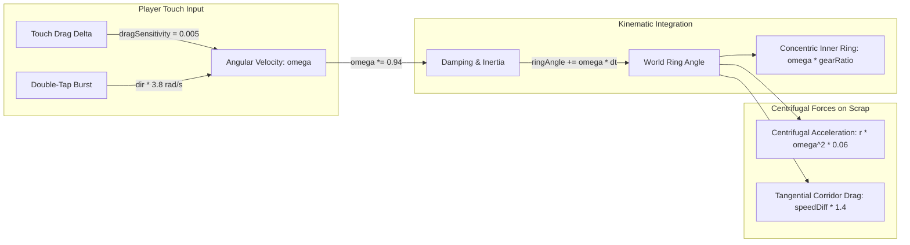
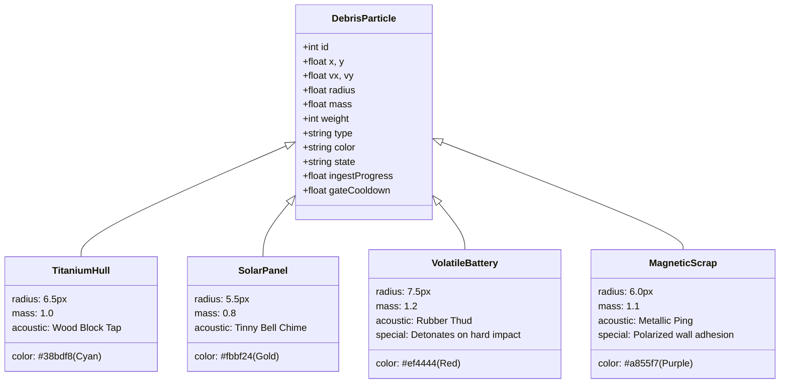
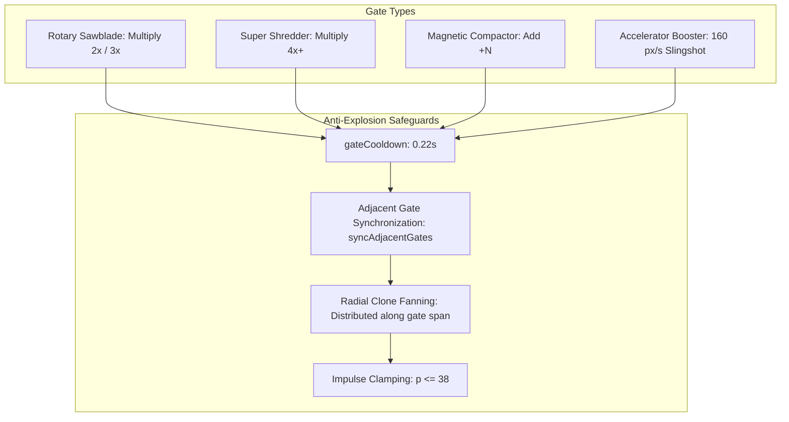
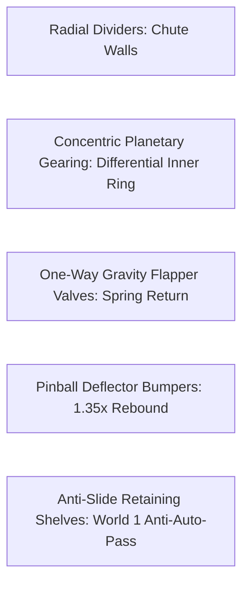
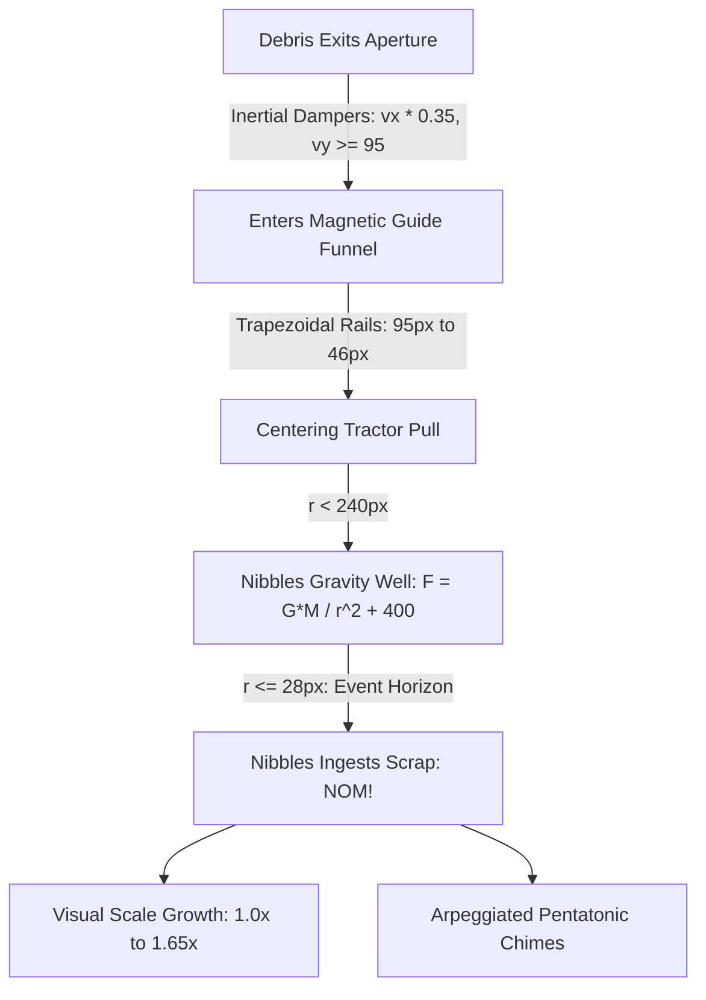
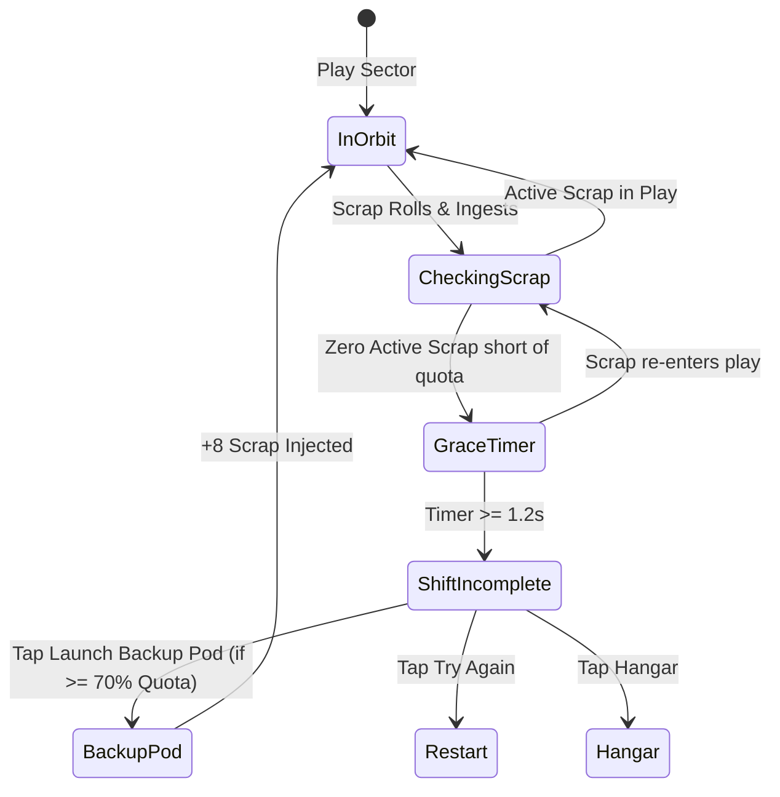
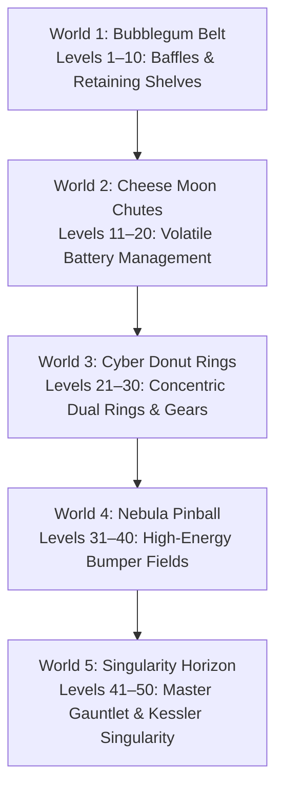

# Orbital Salvage: Gameplay Systems & Level Design Specification

**Physics Pipeline, Material Rigid Bodies, Obstacle Catalog & 50-Level Campaign Matrix**

- **Project:** _Orbital Salvage: Space Trash Clean_
- **Target Platform:** Mobile-First iOS & Modern Mobile Web
- **Core Loop:** Rotate Centrifuge Ring $\rightarrow$ Navigate Chutes & Multipliers $\rightarrow$ Funnel Scrap into Nibbles $\rightarrow$ Clean Orbit & Earn Gold Coins
- **Milestone Version:** 0.6.0 (See [`CHANGELOG.md`](./CHANGELOG.md))
- **Companion Documents:**
  - [`01_REFERENCE_GAME_ANALYSIS.md`](./01_REFERENCE_GAME_ANALYSIS.md) — Reference Deconstruction & Kinematics
  - [`02_APP_STORE_SIMILARITY_AND_GUIDELINE_4_3.md`](./02_APP_STORE_SIMILARITY_AND_GUIDELINE_4_3.md) — App Store Review Guideline 4.3 Shield
  - [`03_GAME_DESIGN_DOCUMENT.md`](./03_GAME_DESIGN_DOCUMENT.md) — Master Game Design Document
  - [`04_TECHNICAL_ARCHITECTURE.md`](./04_TECHNICAL_ARCHITECTURE.md) — Technical & Viewport Engineering Architecture
  - [`05_GAME_UI_UX_DESIGN_SPECIFICATION.md`](./05_GAME_UI_UX_DESIGN_SPECIFICATION.md) — UI/UX Design System & Touch Wireframes
  - [`07_AUDIO_DESIGN_SPECIFICATION.md`](./07_AUDIO_DESIGN_SPECIFICATION.md) — Audio Design & Web Audio DSP Synthesis
  - [`CHANGELOG.md`](./CHANGELOG.md) — Semantic Version Milestone History

---

## 1. Centrifuge Kinematics & Rotation Physics

### 1.1 Rotation Equations & Dynamics

1. **Drag Sensitivity:** Touch movement across the screen applies angular velocity:
   $$\Delta \omega = \Delta x \times 0.005$$
   capped between $[-12.0, 12.0]\text{ rad/s}$.
2. **Kinematic Integration & Friction Damping:**
   $$\theta_{ring}(t + \Delta t) = \theta_{ring}(t) + \omega(t) \cdot \Delta t$$
   $$\omega(t + \Delta t) = \omega(t) \times (0.94)^{\Delta t \times 60}$$
3. **Double-Tap Quick Spin Burst:**
   - Double-tapping the left or right screen half within $280\text{ms}$ applies an instantaneous RCS thruster burst:
     $$\omega \mathrel{+}= \text{direction} \times 3.8\text{ rad/s}$$
   - Triggers thruster smoke puffs, spark particles, and acoustic ratchet whoosh.
4. **Forces on Contained Scrap:**
   - **Environmental Gravity:** Constant gentle downward drift ($g_y = 360\text{px/s}^2$).
   - **Centrifugal Acceleration:** Outward push proportional to radius:
     $$a_c = r \cdot \omega^2 \cdot 0.06$$
   - **Tangential Wall Drag:** Moving corridor walls impart surface friction to scrap:
     $$F_t = (\text{surfaceSpeed} - \text{debrisTangSpeed}) \times 1.4$$

---

## 2. Debris Rigid Body & Material System

### 2.1 Material Specifications

| Material Archetype      | Radius         | Mass  | Color              | Acoustic Profile        | Unique Physical Trait                                                   |
| :---------------------- | :------------- | :---- | :----------------- | :---------------------- | :---------------------------------------------------------------------- |
| **Titanium Hull Scrap** | $6.5\text{px}$ | $1.0$ | `#38bdf8` (Cyan)   | Crisp wooden block tap  | Standard baseline rigid body with predictable roll.                     |
| **Defunct Solar Cells** | $5.5\text{px}$ | $0.8$ | `#fbbf24` (Gold)   | Bright tinny bell chime | Lightweight and bouncy; easily funneled through tight gaps.             |
| **Volatile Batteries**  | $7.5\text{px}$ | $1.2$ | `#ef4444` (Red)    | Heavy rubber thud       | High impact velocity ($> 110\text{px/s}$) triggers confetti detonation. |
| **Polarized Alloy**     | $6.0\text{px}$ | $1.1$ | `#a855f7` (Purple) | Resonant metallic ping  | Clings to inner metallic dividers until counter-rotated.                |

---

## 3. Rotary Shredder & Multiplier Gate Architecture

### 3.1 Differentiated Gate Archetypes

1. **Rotary Sawblade (`MULTIPLY` $< 4$):**
   - Palette: Warning Amber / Bright Orange (`#f97316`).
   - Visual: Dual circular rotating sawblades ($120\text{ RPM}$) with hazard-striped energy beam.
   - Effect: Splits passing scrap into 2 or 3 smaller pieces.
2. **Super Shredder (`MULTIPLY` $\ge 4$):**
   - Palette: Neon Hot Pink / Vivid Magenta (`#ec4899`).
   - Visual: Diamond hazard spiked casing with rotating diamond core and crackling electric lightning arcs.
   - Effect: High-risk, high-reward shredder multiplying scrap into 4+ pieces.
3. **Magnetic Compactor (`ADD` $+N$):**
   - Palette: Electric Cyan / Sky Blue (`#06b6d4`).
   - Visual: Dual rounded magnetic coil brackets with pulsing magnetic compression waves.
   - Effect: Spawns a discrete bonus cluster of $+N$ particles ($+3, +5, +15$).
4. **Accelerator Booster (`BOOST`):**
   - Palette: Electric Lime Green (`#84cc16`).
   - Visual: Sleek forward-swept velocity wings with scrolling speed chevrons (`>>>`).
   - Effect: Imparts a sudden $+160\text{px/s}$ slingshot impulse along the tangential track direction.

### 3.2 Anti-Explosion & Stability Measures

- **Gate Cooldown:** Passing scrap is assigned `d.gateCooldown = 0.22s` to prevent instantaneous multi-triggers.
- **Adjacent Gate Synchronization:** Gates within angular distance $< 0.16\pi$ share processed entity IDs via `syncAdjacentGates(id)`.
- **Radial Clone Fanning:** Clones are generated distributed across the radial span ($span = \min(24, (r_{max} - r_{min}) \cdot 0.35)$) with slight tangential jitter, avoiding co-located overlapping rigid bodies.
- **Impulse Clamping:** Inter-debris momentum exchange is clamped to $p \le 38$, preventing explosive scatter during mass cascades.

---

## 4. Obstacle Catalog & Chute Topology

### 4.1 Obstacle Specifications

1. **Concentric Dual-Ring Gearing:**
   - Multi-lane sectors feature an Inner Ring ($r \le 130\text{px}$) rotating with differential speed:
     $$\omega_{inner} = \omega_{outer} \times \text{gearRatio} \quad (\text{typically } -1.0\text{ or } 1.5)$$
   - Creates counter-rotating orbital sorting challenges requiring precise timing.
2. **One-Way Gravity Flapper Valves:**
   - Spring-loaded swinging gate valves ($r_{min} \to r_{max}$) with stopper at $0\text{ rad}$ and maximum swing of $0.35\pi\text{ rad}$.
   - Allows scrap to pass in the forward direction while slamming shut against backflow with acoustic click feedback.
3. **Pachinko Deflector Bumpers:**
   - Circular obstacles ($r = 9\text{px}$) with chrome borders and neon domes.
   - Applies high-energy elastic restitution ($e = 1.35$) with random tangential scatter to disperse dense scrap clusters.
4. **Anti-Slide Retaining Shelves:**
   - Staggered horizontal baffles at $\theta = 0\text{ rad}$ and $\theta = \pi\text{ rad}$ ($r \in [85, 125]$) that trap and retain sliding scrap, completely preventing passive auto-clears.

---

## 5. Nibbles' Gravitational Dynamics & Containment Field

### 5.1 Black Hole Gravitational Suction

- **Gravitational Attraction Radius:** $r = 240\text{px}$.
- **Inverse-Square Force Equation:**
  $$F_g = \frac{480{,}000}{r^2 + 400} \cdot m_{debris} \cdot \Delta t$$
- **Event Horizon Capture Radius:** $r = 28\text{px}$.
- **Ingestion State (`INGESTING`):**
  - Scrap spirals inwards with angular and radial velocity:
    $$\Delta x = (\Delta x_{bh} \cdot 8.5 - \Delta y_{bh} \cdot 4.5) \cdot \Delta t$$
    $$\Delta y = (\Delta y_{bh} \cdot 8.5 + \Delta x_{bh} \cdot 4.5) \cdot \Delta t$$
  - Particle radius shrinks down to $0.5\text{px}$ before despawning into raw Scrap Credits.

### 5.2 Physical Magnetic Containment Funnel

- **Mouth Half-Width:** $95\text{px}$ at aperture ($y \approx 499$).
- **Base Half-Width:** $46\text{px}$ at Nibbles ($y \approx 708$).
- **Aperture Dampers:** Upon exit, horizontal velocity is clamped by $65\%$ (`d.vx *= 0.35`) and downward momentum is ensured (`d.vy = Math.max(d.vy, 95)`).
- **Centering Tractor Beam:**
  $$a_x = (\text{bh.x} - d.x) \times 16$$
- **Off-Screen Despawn:** Particles past $y > \text{bh.y} + 140$ are cleanly despawned and tallied via `onDebrisSpilled`.

---

## 6. Failure Condition & Tactical Recovery Flow

1. **Defeat Trigger Criteria:**
   - Level is not cleared (`!isLevelCleared`).
   - Zero scrap particles exist with `state === "IN_RING" || "FALLING" || "INGESTING"`.
   - Collected mass is short of sector quota (`collectedMass < quota`).
2. **Grace Timer ($1.2\text{s}$):**
   - Accumulates when zero scrap is detected; resets if a late particle re-enters play.
   - Ensures late swallows and scoring cascades are fully credited before showing defeat.
3. **Tactical Auxiliary Ejector Pod (+8 Scrap):**
   - Available once per level if progress reached $\ge 70\%$ of the required quota.
   - Deploys 8 fresh pieces of titanium scrap into the centrifuge with procedural launch sound (`playBackupPodSound`) and haptic burst.

---

## 7. The 50-Level Campaign Matrix (Worlds 1–5)

### 7.1 Complete World Progression Matrix

| World       | Celestial Sector        | Level Range  | Primary Mechanical Features                                              | Quota Curve                 | Hazard Multipliers                           |
| :---------- | :---------------------- | :----------- | :----------------------------------------------------------------------- | :-------------------------- | :------------------------------------------- |
| **World 1** | **Bubblegum Belt**      | Levels 1–10  | Anti-slide retaining shelves, introductory sawblades, aperture baffles   | $20\text{--}45\text{ kg}$   | Standard Titanium Hull scrap                 |
| **World 2** | **Cheese Moon Chutes**  | Levels 11–20 | Switchback zigzags, Volatile Battery Cores, tilt deceleration            | $45\text{--}75\text{ kg}$   | Explosive batteries ($> 110\text{px/s}$ pop) |
| **World 3** | **Cyber Donut Rings**   | Levels 21–30 | Concentric dual tracks, planetary gears ($-1.0\times$), flapper valves   | $75\text{--}120\text{ kg}$  | Dual-direction counter-spin                  |
| **World 4** | **Nebula Pinball**      | Levels 31–40 | High-density deflector bumpers ($e=1.35$), velocity booster pads         | $120\text{--}180\text{ kg}$ | Pinball rebounds & high velocity             |
| **World 5** | **Singularity Horizon** | Levels 41–50 | Multi-stage gauntlets, concentric super shredders, _Kessler Singularity_ | $180\text{--}300\text{ kg}$ | Extreme density ($300+\text{ scrap}$)        |

### 7.2 SWRC Daily Shift Procedural Generation

- **UTC 00:00 Cycle:** Seeded with the current calendar date (`YYYY-MM-DD`).
- **Dynamic Topology:** Procedurally combines concentric tracks, randomized bumper constellations, and high-multiplier shredders ($\times 3, \times 4$).
- **Daily Bounty:** $+500\text{--}+1{,}000$ Gold Coins upon successful clearance.

### 7.3 Automated QA Clearance Verification

All 50 campaign sectors were validated through an automated headless simulation audit (`scratch/audit_clean.mjs` and `sanitizeSector` spatial tests):

- **Gate Overlap Audit:** 0 overlaps detected across all 50 levels (pairwise angular clearance $\ge 0.16\pi$).
- **Divider Clearance Audit:** 0 gates clipping radial divider walls.
- **Passability Verification:** Ensured every sector contains at least one viable physical route to the exit aperture capable of satisfying the target quota without requiring the auxiliary backup pod.
