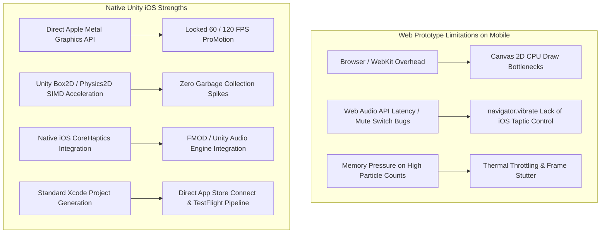
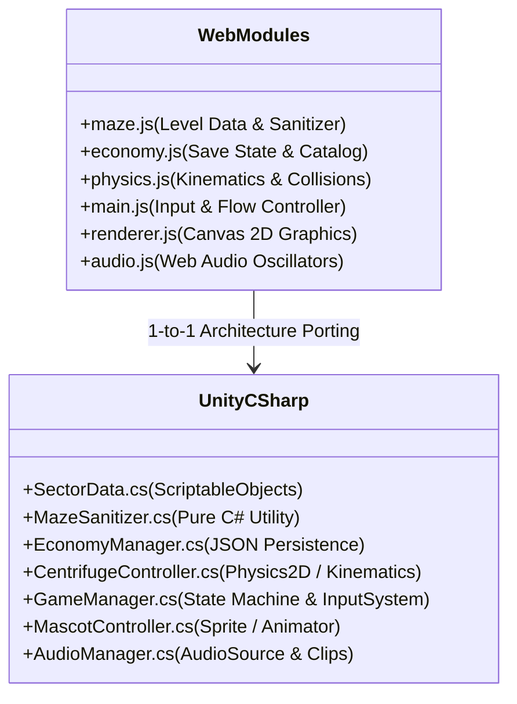
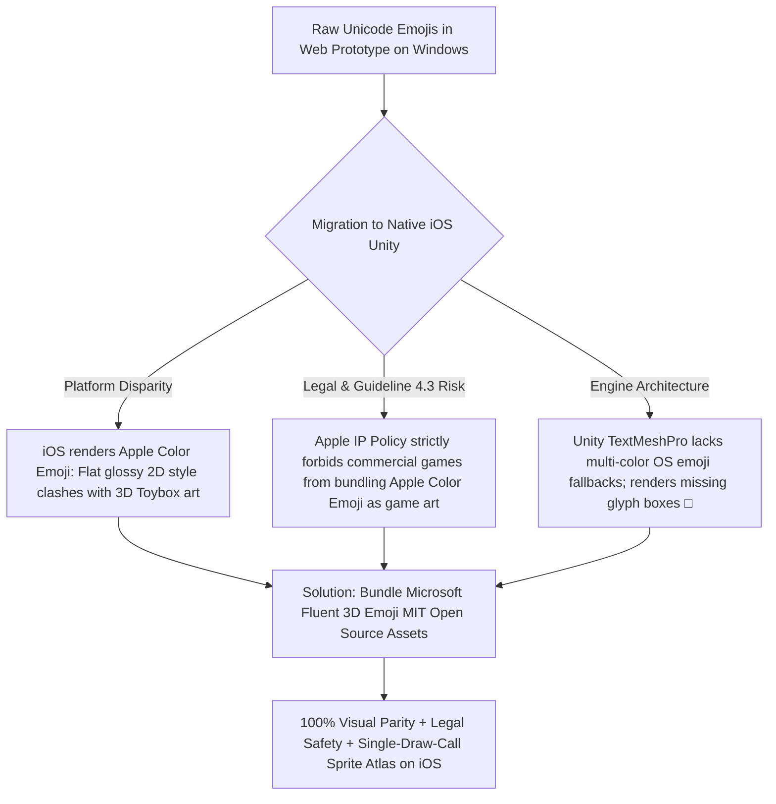
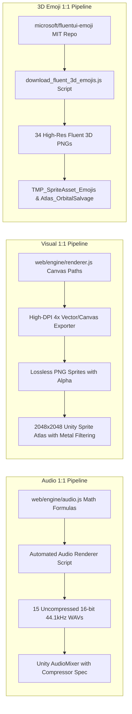
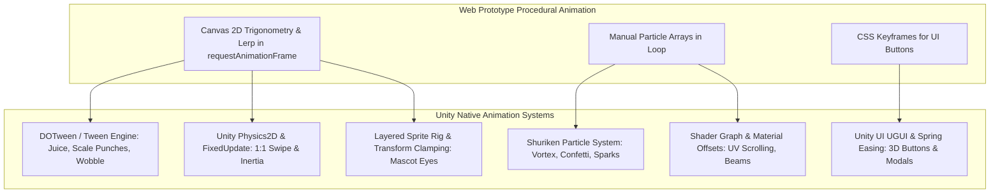
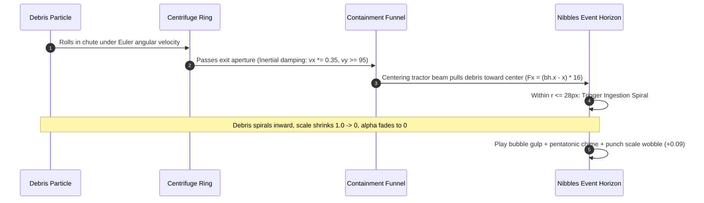
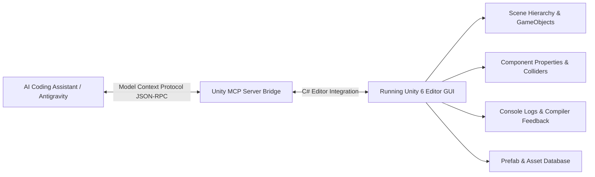
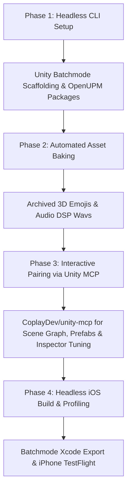
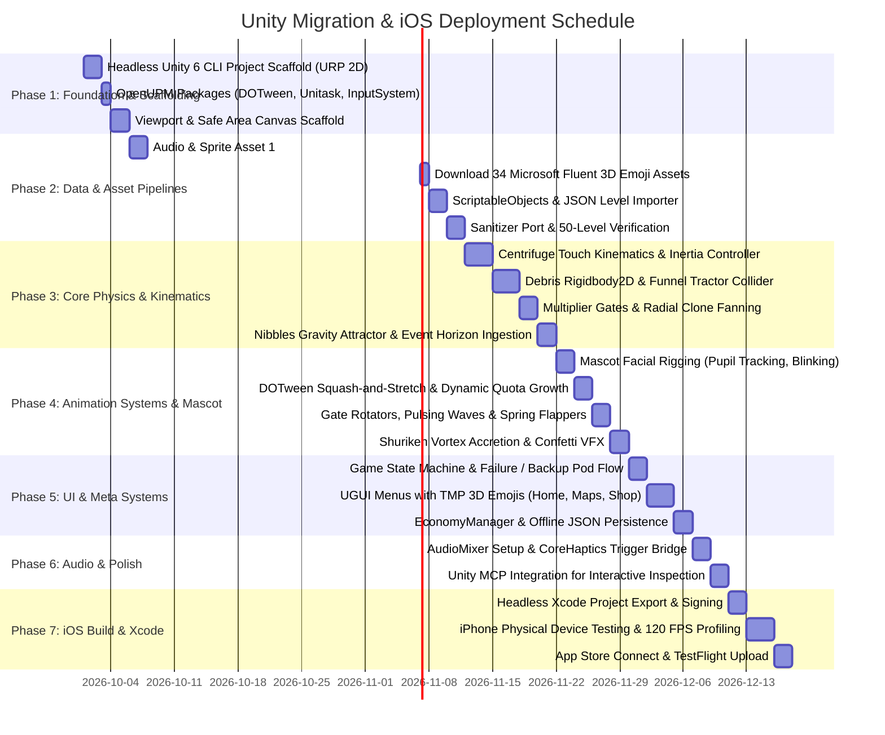

# Orbital Salvage: Unity Migration & iOS Deployment Plan

**Technical Feasibility Assessment, Engine Architecture Mapping, 1:1 Asset Replication Catalog & Phased Execution Roadmap**

- **Project:** _Orbital Salvage: Event Horizon_ / _Space Trash Clean_
- **Current Baseline:** Playable HTML5 Canvas / ES6 Mobile Web Prototype (`web/`)
- **Target Engine:** Unity 2022 LTS / Unity 6 (Universal Render Pipeline - 2D / Stylized 2.5D)
- **Initial Launch Platform:** Apple iPhone (iOS 15+ / Metal API / High-DPI Retina)
- **Primary Viewport Standard:** iPhone 16 Pro Max Logical Dimensions ($430\text{pt} \times 932\text{pt}$, aspect ratio $\sim 19.5:9$)
- **Document Version:** 1.1.0 (1:1 Audio & Visual Asset Parity Archive)
- **Companion Documents:**
  - [`01_REFERENCE_GAME_ANALYSIS.md`](./01_REFERENCE_GAME_ANALYSIS.md) — Reference Deconstruction & Kinematics
  - [`02_APP_STORE_SIMILARITY_AND_GUIDELINE_4_3.md`](./02_APP_STORE_SIMILARITY_AND_GUIDELINE_4_3.md) — App Store Review Guideline 4.3 Shield
  - [`03_GAME_DESIGN_DOCUMENT.md`](./03_GAME_DESIGN_DOCUMENT.md) — Master Game Design Document
  - [`04_TECHNICAL_ARCHITECTURE.md`](./04_TECHNICAL_ARCHITECTURE.md) — Technical & Viewport Engineering Architecture
  - [`05_GAME_UI_UX_DESIGN_SPECIFICATION.md`](./05_GAME_UI_UX_DESIGN_SPECIFICATION.md) — UI/UX Design System & Touch Wireframes
  - [`06_GAMEPLAY_SYSTEMS_AND_LEVEL_DESIGN.md`](./06_GAMEPLAY_SYSTEMS_AND_LEVEL_DESIGN.md) — Gameplay Systems & 50-Level Matrix
  - [`07_AUDIO_DESIGN_SPECIFICATION.md`](./07_AUDIO_DESIGN_SPECIFICATION.md) — Audio Design & Procedural Sound Synthesis
  - [`09_VISUAL_PARITY_AND_SCREENSHOT_COMPARISON.md`](./09_VISUAL_PARITY_AND_SCREENSHOT_COMPARISON.md) — Visual parity review & screenshot archive
  - [`CHANGELOG.md`](./CHANGELOG.md) — Milestone Version History

### Current status (2026-10-04)

The table below is the 2026-09-30 uGUI snapshot. It is historical. `UIManager`, `SpriteHelper`, `SafeAreaFitter`, `AudioManager`, `GameManager` (the old `OrbitalSalvage.Core` type), `MazeSanitizer`, `sectors_50.json`, and the Physics2D gameplay scripts were removed on `agent/parity/ship`. Play (Editor and the standalone player, no flags) loads `MainGameScene` (camera only) and `ParityViewer` boots `AppController` with pointer input, a wall clock, `FileProfileStore` (`ORBITAL_SALVAGE_CARTOON_PROFILE_V1`), and the C# DSP player. Parity capture and self-tests still use a frozen clock and silent audio. The page is a 430×932 portrait raster letterboxed into `Screen.safeArea`. Landscape is letterboxed, not a separate layout. Not verified on a device. Strict still parity is not finished (see `09` and `games/maze-puzzle/tools/parity/README.md`).

### Snapshot (2026-09-30)

Verified against `unity/maze-puzzle/` ProjectSettings, `Packages/manifest.json`, scripts, and assets:

| Phase | Plan intent | Actual status |
| :---- | :---------- | :------------ |
| **1 Foundation** | URP 2D, Linear color, DOTween, UniTask, Input System | **Partial.** Project exists at `unity/maze-puzzle/`. URP, DOTween, UniTask, and Input System are **not** installed (`manifest.json` has built-in modules + `com.unity.ugui` + MCP). Color space is **Gamma** (`m_ActiveColorSpace: 0`) though the plan called for Linear. |
| **2 Data & assets** | 15 WAVs, 34 Fluent emojis, 50 levels, sanitizer, TMP sprite atlas | **Mostly complete.** 15 WAVs in `Assets/Audio/` (+ Resources mirror); 34 emojis in `Assets/Resources/Emojis/3D/`; `sectors_50.json` + `MazeSanitizer.cs` / `LevelImporter.cs`. TMP sprite asset and master atlas **not** created. Sanitizer runs in the **editor importer only**. |
| **3 Physics** | 1:1 port / Physics2D kinematics, debris prefabs, worlds 3–5 mechanics | **Partial.** Physics2D **reimplementation**, not a port of `physics.js`. Only `Debris_Titanium` prefab. Concentric rings / `gearRatio`, track walls, deflector pins, and one-way flaps from worlds 3–5 are **not** built at runtime. Magnetic debris maps to titanium. No debris cap / pooling. |
| **4 Animation** | DOTween juice, VFX, flappers | **Not started** (no DOTween package). |
| **5 UI & meta** | All screens, win/lose, Backup Pod, shop/economy handlers | **Partial.** Procedural uGUI for all 13 reviewed screens; runtime win/lose wiring and defeat / Backup Pod path implemented. Shop purchase / sound / settings handlers still stubs. |
| **6 Audio & MCP** | AudioMixer, CoreHaptics, Unity MCP | **Partial.** `AudioManager` + WAVs. No AudioMixer / CoreHaptics. MCP for Unity package `com.coplaydev.unity-mcp` pinned to **v10.2.0** in `Packages/manifest.json`; server `mcpforunityserver==10.2.0` in `.cursor/mcp.json`. |
| **7 iOS** | Bundle id, signing, Xcode export | **Export menu only. No Xcode project has been produced on this machine.** `PlayerSettings` iOS application identifier is `io.dev.maze` (`applicationIdentifier.iPhone`, `overrideDefaultApplicationIdentifier: 1`). `OrbitalSalvage.Editor.IosExport` adds `Orbital Salvage/Build/iOS Xcode Project (Simulator)` and `(Device)`. Simulator SDK is `SimulatorSDK` with `AppleMobileArchitectureSimulator.ARM64` (Universal also includes x86_64; this export does not). Device SDK is `DeviceSDK`. Output is `games/maze-puzzle/output/maze-puzzle-simulator` and `games/maze-puzzle/output/maze-puzzle`. The iOS Build Support module is not installed (`PlaybackEngines` has `windowsstandalonesupport` only), so the menu items are disabled and the batch entry points exit 1. Minimum iOS version is 15.0 (`iOSTargetOSVersionString: 15.0`). Still open: install the iOS module, Apple team ID, signing, and a Mac with Xcode to sign and run. `appleDeveloperTeamID` empty; `productName: maze-puzzle`; `companyName: GalacticSanitation`. |

---

## 1. Executive Summary & Game Concept Overview

### 1.1 The Game Identity: "Cute Cosmic Janitor"

_Orbital Salvage: Event Horizon_ takes the satisfying core physics loop of rotational maze puzzles (deconstructed from _Multi Maze 3D_) and transforms it into an endearing, sci-fi puzzle experience with an indie identity:

```
[Defunct Satellite Debris]
          │
          ▼ (Tactile 1:1 Swipe & Attitude RCS Thruster Rotations)
[Rotating Orbital Centrifuge Ring]
          │
          ▼ (Passing Molecular Shredders, Magnetic Compactors & Velocity Boosters)
[Magnetic Guide Rails & Inertial Damper Funnel]
          │
          ▼ (Centering Gravitational Tractor Pull)
[Nibbles the Hungry Micro-Black Hole] ──► Swallowed Mass ──► Scrap Credits ($SC) & Star Progress
```

### 1.2 Core Pillars

1. **Physical Rotational Kinematics:** Pure touch drag rotates the centrifuge ring with realistic angular inertia, damping, and double-tap attitude thruster bursts.
2. **Debris Shredders & Dynamic Obstacles:** Debris pieces (titanium brackets, solar panels, radioactive cores) pass through rotary sawblades (`×N`), magnetic compactors (`+N`), acceleration wings (`⏩ BOOST`), and deflector pinball bumpers.
3. **Mascot Personality:** "Nibbles" the micro-black hole dynamically reacts, tracks falling scrap with animated eyes, scales upward as mass is ingested, and wobbles with bouncy elasticity.
4. **50-Level Progressive Campaign:** Structured across 5 celestial worlds with concentric counter-rotating dual rings, switchback zigzags, and one-way gravity flappers.
5. **100% Ethical Zero-Monetization Economy:** No advertisements, no in-app purchases, no timers, and no telemetry tracking. All cosmetics (chassis styles, event horizon palettes, cosmic skyboxes) are unlocked through gameplay performance.
6. **Built-in App Store Guideline 4.3 Shield:** Differentiated through original lore, complex multi-stage mechanics, custom visual shaders, and non-exploitative design.

---

## 2. Platform Feasibility & Unity Suitability for iOS

### 2.1 Why Unity is the Ideal Choice for iOS Deployment

Exporting from a web prototype to a native Unity iOS application offers significant performance and platform advantages:



### 2.2 Key Technical Advantages on iOS

| Factor                     | Web Prototype (Canvas 2D / Web Audio)                                                                       | Native Unity (URP 2D / C#)                                                                                        | Strategic Impact                                                |
| :------------------------- | :---------------------------------------------------------------------------------------------------------- | :---------------------------------------------------------------------------------------------------------------- | :-------------------------------------------------------------- |
| **Rendering Performance**  | Canvas 2D CPU rasterization; dips to ~35-45 FPS during 200+ debris cascades on mobile Safari.               | Native **Apple Metal** pipeline; easily sustains locked 60 FPS or 120 FPS ProMotion on iPhone 15/16 Pro.          | High visual fluidity and zero touch-response latency.           |
| **Ergonomics & Safe Area** | Relies on CSS `env(safe-area-inset-top)` and viewport meta tags that can glitch on browser chrome hides.    | Unity's native `Screen.safeArea` API anchors HUD elements precisely around the Dynamic Island and Home bar.       | Pixel-perfect compliance with Apple Human Interface Guidelines. |
| **Haptic Feedback**        | Web `navigator.vibrate` is unsupported or severely restricted in iOS WebKit.                                | Native iOS **CoreHaptics** (`UIImpactFeedbackGenerator`) enables crisp ratchet clicks and heavy swallowing thuds. | Dramatically elevates tactile satisfaction.                     |
| **Audio Stability**        | Web Audio AudioContext requires strict user-gesture unlocking and often conflicts with the iOS mute switch. | Native CoreAudio pipeline plays seamlessly, respects the silent switch, and pauses cleanly on phone interrupts.   | Premium audio polish without WebKit quirks.                     |
| **Offline Reliability**    | `localStorage` can be purged by iOS under low-storage conditions without notice.                            | Native persistent storage via `Application.persistentDataPath` or `PlayerPrefs` is secure and resilient.          | Guarantees player campaign progression is never lost.           |

---

## 3. Code Migration Assessment: Web Prototype to Unity C#

The web prototype was constructed with strict modularity (clean ES modules in `web/engine/`). This modularity makes converting the JavaScript logic to C# straightforward, without having to refactor complex spaghetti dependencies.



### 3.1 Detailed Module-by-Module Conversion Analysis

#### A. Level Matrix & Sanitization (`web/engine/maze.js`)

- **Ease of Migration:** **9.5 / 10 (Very Easy)**
- **Web Implementation:** Generates 50 level configurations with angles, divider walls, gates, and deflector pins. Includes `MazeLevelBuilder.sanitizeSector()`: a deterministic 3-pass angular clearance algorithm enforcing $\ge 0.16\pi$ separation.
- **Unity Translation:**
  - Define serializable C# classes: `SectorConfig`, `GateData`, `DividerData`, `BumperData`.
  - Store the 50 levels as Unity `ScriptableObject` assets or serialized JSON in `Resources/Levels/`.
  - The `sanitizeSector` math algorithm uses pure trigonometry and angle normalization, translating directly into a static C# utility class with 100% mathematical parity.

#### B. Economy & Save Progression (`web/engine/economy.js`)

- **Ease of Migration:** **9.5 / 10 (Very Easy)**
- **Web Implementation:** Manages Scrap Credits ($SC), cosmetic catalogs (rings, black hole palettes, skyboxes), daily shift timers, and unlocks via `localStorage`.
- **Unity Translation:**
  - Create `PlayerProfile` C# struct/class.
  - Serialize directly to an encrypted JSON file stored in `Application.persistentDataPath` or `PlayerPrefs`.
  - Daily shift clock tracks local UTC day boundaries using `System.DateTime.UtcNow`.

#### C. Kinematics, Physics & Spatial Containment (`web/engine/physics.js`)

- **Ease of Migration:** **8.0 / 10 (Straightforward)**
- **Web Implementation:** Custom 2D Euler physics simulation managing centrifuge rotation inertia, damping, aperture velocity clamping, trapezoidal magnetic guide rails, and gravitational tractor pull into Nibbles.
- **Unity Translation Options:**
  - _Option 1 (Direct Math Port):_ Replicate our deterministic kinematic update loop in C# using plain `Transform.position` updates.
  - _Option 2 (Unity 2D Physics - Recommended):_
    - **Centrifuge Ring:** `Rigidbody2D` (Kinematic) rotated via angular velocity set by touch delta.
    - **Debris:** `Rigidbody2D` (Dynamic) with circle colliders and frictionless physics materials.
    - **Shredder Gates:** Trigger colliders with a `ShredderGate` component managing spawn cooldown and radial fan-out.
    - **Containment Funnel:** EdgeCollider2D or simple custom boundary raycasts.
    - **Nibbles:** Trigger collider with a PointEffector2D or custom radial attractor script.

#### D. Touch Gesture & Input Handling (`web/main.js`)

- **Ease of Migration:** **8.5 / 10 (Easy)**
- **Web Implementation:** Captures pointer events on the canvas, computes horizontal drag deltas for rotational torque, detects double-taps for RCS boosts, and handles UI modal transitions.
- **Unity Translation:**
  - Utilize Unity's **New Input System** (`UnityEngine.InputSystem.EnhancedTouch`).
  - Tap and drag deltas map directly to `CentrifugeController.ApplyTorque()` or `angularVelocity += deltaX * sensitivity`.
  - Double-tap detection can be handled via an input action or standard gesture recognizer.

#### E. Visual Rendering & Mascot (`web/engine/renderer.js`)

- **Ease of Migration:** **7.0 / 10 (Moderate Effort)**
- **Web Implementation:** Procedural HTML5 Canvas 2D drawings (`ctx.arc`, `ctx.roundRect`, dynamic gradients, cartoon starfields, and Nibbles facial blink/chew cycles).
- **Unity Translation:**
  - Replace procedural Canvas paths with clean **2D Sprites** or **2.5D Stylized Meshes** (see Section 4 for complete asset inventory).
  - **Nibbles:** A layered 2D GameObject with sprite switching or skeletal 2D animation (Unity 2D Animation package) for blinking, opening the mouth, and chewing. Wobble effects can be achieved with standard transform scaling (`LeanTween` / `DOTween`).
  - **VFX:** Replace canvas particle arrays with Unity's **Particle System (Shuriken)** for confetti, starry bursts, and suction vortexes.
  - **Lensing Shader:** Implement a full-screen or sprite-based refraction shader in URP Shader Graph for the black hole event horizon (fulfilling Pillar 3 of Guideline 4.3).

#### F. Sound & Haptics (`web/engine/audio.js`)

- **Ease of Migration:** **8.0 / 10 (Easy)**
- **Web Implementation:** Real-time Web Audio API oscillators, biquad filters, and compressor limiters synthesizing 12 acoustic cues.
- **Unity Translation:**
  - Render or record all synthesized cues into uncompressed `.wav` assets matching the Web Audio DSP specifications (see Section 4.1). On disk today: **16-bit PCM mono @ 44.1 kHz** (not 24-bit / 48 kHz).
  - Trigger them via an `AudioManager` component using an `AudioMixer` with dynamic ducking.
  - Integrate native iOS CoreHaptics (`UnityEngine.iOS.HapticFeedback` or a lightweight native iOS plugin) to deliver tactile ratchet clicks and swallowing feedback.

---

## 4. Complete Sound & Image Asset Inventory (1:1 Replica Plan)

To achieve a **strict 1:1 replica** between the web prototype and the native Unity iOS title, all procedural audio recipes and canvas visual elements are mapped to exact high-fidelity asset specifications below.

### 4.1 Comprehensive Sound Asset Catalog (1:1 Acoustic Parity)

In the web prototype (`web/engine/audio.js`), all sound effects are synthesized mathematically in real-time. Unity ships **15** baked PCM `.wav` files under `unity/maze-puzzle/Assets/Audio/` (mirrored in `Assets/Resources/Audio/` for `Resources.Load`). WAV headers verified on disk: **16-bit**, mono, **44100 Hz** (not the planned 24-bit / 48 kHz). Filenames below are the on-disk names; legacy planned names (`sfx_spin_ratchet.wav`, `sfx_collision_*.wav`, etc.) were never produced.

| Asset Filename (on disk)           | Cue / Source Recipe (`audio.js` or UI)                         | Waveform & DSP Synthesis Parameters (web recipe intent)                                                                                                                  | Status / Notes                                                                 | Master Bus & Concurrency Rules                               | iOS Haptic Pairing                                      |
| :--------------------------------- | :------------------------------------------------------------- | :----------------------------------------------------------------------------------------------------------------------------------------------------------------------- | :----------------------------------------------------------------------------- | :----------------------------------------------------------- | :------------------------------------------------------ |
| `sfx_centrifuge_ratchet.wav`       | Centrifuge spin ratchet — `playSpinRatchet`                    | Triangle wave, $800\text{Hz} \to 140\text{Hz}$ exponential drop ($22\text{ms}$), bandpass ($1200\text{Hz}, Q=1.5$), gain $0.06 \to 0.0001$.                              | Produced (was planned as `sfx_spin_ratchet.wav`)                               | SFX/Rotational; rate-limited to $45\text{ms}$ intervals.     | Soft impact (`.light`)                                  |
| `sfx_debris_wall_bounce.wav`       | Debris–wall bounce — `playDebrisCollision` (shared)            | Triangle/sine material taps (web varies titanium / solar / volatile).                                                                                                    | Produced as **one** shared bounce; per-material variants **not produced**      | SFX/Collisions; rate-limited to $48\text{ms}$; max 4 voices. | Soft / medium by material                               |
| `sfx_multiplier_pass.wav`          | Multiplier / shredder gate — `playGatePass` (`MULTIPLY`)       | Sawtooth / neon shredder pass (covers standard ×N; super-shredder triad **not** a separate file).                                                                        | Produced (was planned as `sfx_gate_shredder.wav`)                              | SFX/Gates; debounced to $70\text{ms}$.                       | Rigid impact (`.rigid`)                                 |
| `sfx_adder_pass.wav`               | Adder / magnetic compactor — `playGatePass` (`ADD`)            | Sine wave, $140\text{Hz} \to 320\text{Hz}$ ($140\text{ms}$), gain $0.22 \to 0.0001$. Resonant sub-bass magnetic pulse.                                                   | Produced (was planned as `sfx_gate_compactor.wav`)                             | SFX/Gates; debounced to $70\text{ms}$.                       | Heavy impact (`.heavy`)                                 |
| `sfx_booster_pass.wav`             | Accelerator booster — `playBoosterPass` / `playGatePass` BOOST | Sine wave, $350\text{Hz} \to 1100\text{Hz}$ ($120\text{ms}$), gain $0.16 \to 0.0001$. Comic jet whistle whoosh.                                                          | Produced (was planned as `sfx_gate_booster.wav`)                               | SFX/Gates; debounced to $70\text{ms}$.                       | Medium impact (`.medium`)                               |
| `sfx_debris_pinball_bumper.wav`    | Deflector pinball bumper — `playBumperBounce`                  | Sine wave, $720\text{Hz} \pm 120\text{Hz} \to 1080\text{Hz} (30\text{ms}) \to 576\text{Hz} (40\text{ms})$, gain $0.16$. Pinball bell boing.                              | Produced (was planned as `sfx_bumper_bounce.wav`)                              | SFX/Collisions; rate-limited to $45\text{ms}$.               | Medium impact (`.medium`)                               |
| `sfx_singularity_swallow.wav`      | Nibbles swallow — `playDebrisSwallowed`                        | Cartoon gulp / bubble pop + pentatonic chime stack (web).                                                                                                                | Produced as **one** clip; discrete `sfx_chime_c4`…`c6` notes **not produced**  | SFX/Mascot; max 8 staggered instances.                       | Soft impact / success                                   |
| `sfx_flapper_clack.wav`            | One-way gravity flapper valve clack                            | Short mechanical clack when a flapper deflects.                                                                                                                          | Produced (web flapper cue; no legacy planned filename in older catalog)        | SFX/Gates; short one-shot.                                   | Soft impact (`.light`)                                  |
| `sfx_quota_growth.wav`             | Quota / growth celebration when Nibbles scales up              | Celebratory organ / chord swell as collected mass crosses growth thresholds.                                                                                             | Produced                                                                       | SFX/Mascot; low concurrency.                                 | Success feedback                                        |
| `sfx_thruster_burst.wav`           | RCS / BOOST thruster hiss — `playRcsThrust`                    | High-pressure gas burst / pneumatic whoosh.                                                                                                                              | Produced                                                                       | SFX/Rotational; rate-limited ~$50\text{ms}$.                 | Medium impact (`.medium`)                               |
| `sfx_victory_fanfare.wav`          | Victory debrief — `playVictoryFanfare`                         | Triangle wave 4-note ascending melody: $C_5 \to E_5 \to G_5 \to C_6$, gain $0.20$.                                                                                        | Produced                                                                       | Music/Stinger; ducks gameplay SFX.                           | Notification success                                    |
| `sfx_defeat_whimper.wav`           | Defeat debrief — `playDefeatSound`                             | Triangle wave descending whimper / sad jingle.                                                                                                                           | Produced (was planned as `sfx_defeat_jingle.wav`)                              | Music/Stinger; ducks gameplay SFX.                           | Notification warning                                    |
| `sfx_recovery_pod_launch.wav`      | Backup Pod launch — `playBackupPodSound`                       | Sine wave 4-note ascending launch chime: $C_4 \to G_4 \to C_5 \to E_5$, gain $0.20$.                                                                                      | Produced (was planned as `sfx_backup_pod_launch.wav`)                          | SFX/Stinger; accompanies pod drop.                           | Notification success                                    |
| `sfx_ui_button_click.wav`          | UI primary button press                                        | Tactile modern button click.                                                                                                                                             | Produced                                                                       | UI; high priority, short.                                    | Soft impact (`.light`)                                  |
| `sfx_ui_tab_switch.wav`            | UI tab / dock switch                                           | Soft glass UI slide.                                                                                                                                                     | Produced                                                                       | UI; high priority, short.                                    | Soft impact (`.light`)                                  |

**Planned cues with no on-disk file (not produced):** separate `sfx_collision_solar.wav` / `sfx_collision_volatile.wav`; `sfx_gate_super_shredder.wav`; discrete pentatonic `sfx_chime_c4.wav`…`sfx_chime_c6.wav` (11 notes); `sfx_hazard_explosion.wav`.

#### Unity AudioMixer & Master Dynamics Limiting Setup

To guarantee 1:1 acoustic parity with `masterCompressor` from `audio.js`:

- **Threshold:** $-14\text{ dBFS}$
- **Knee:** $10\text{ dB}$
- **Ratio:** $8:1$
- **Attack:** $3\text{ms}$
- **Release:** $120\text{ms}$
- **Master Makeup Gain:** $+1.5\text{ dB}$

---

### 4.2 Comprehensive Visual & Image Asset Catalog (1:1 Visual Parity)

In the web prototype (`web/engine/renderer.js`), all visuals are rendered procedurally via Canvas 2D methods (`ctx.arc`, `ctx.roundRect`, linear/radial gradients). In Unity, these are converted into **2D Sprites, URP 2D Shaders, and Sprite Sheets** packed into a high-density 2048×2048 Sprite Atlas (`Atlas_OrbitalSalvage`).

#### A. Centrifuge Ring Chassis Skins (4 Cosmetic Variants)

| Skin ID & Name                                  | Web Color Palette & Tokens                                                                                             | Geometry & Visual Components                                                                                                                       | Unity Asset Target                                       |
| :---------------------------------------------- | :--------------------------------------------------------------------------------------------------------------------- | :------------------------------------------------------------------------------------------------------------------------------------------------- | :------------------------------------------------------- |
| **`ring_donut`**<br>(Frosted Donut Rig)         | Golden cake dough `#fde047`, strawberry pink icing `#f472b6`, multi-color sprinkles (`#38bdf8`, `#4ade80`, `#facc15`). | Torus donut chassis ($R=180, r=100$), wavy icing dripping contour, 24 scattered cylindrical sprinkles, 3D extruded drop shadow.                    | `Sprite_Ring_Donut.png`<br>`Sprite_Ring_Donut_Icing.png` |
| **`ring_duckie`**<br>(Rubber Duckie Floatie)    | Buoyant rubber yellow `#facc15`, glossy orange beak `#f97316`, sky-blue bubble specular `#e0f2fe`.                     | Duck tail flange, circular flotation tube, embossed glossy highlight ring, attached cartoon duck head with orange beak at top center.              | `Sprite_Ring_Duckie.png`<br>`Sprite_Duckie_Head.png`     |
| **`ring_candyland`**<br>(Peppermint Candy Ring) | Crisp festive red `#ef4444`, pure sugar white `#ffffff`, glossy specular sheen.                                        | Barber-pole peppermint candy cane spiral stripes ($45^\circ$ angular swirl), high-gloss reflective gloss coat on inner and outer lips.             | `Sprite_Ring_Candyland.png`                              |
| **`ring_spacecat`**<br>(Cosmic Kitty Saucer)    | Pastel lilac `#c084fc`, periwinkle whiskers `#e0e7ff`, glowing cyan cockpit `#38bdf8`.                                 | Flying saucer fuselage ring with extruded cat ears at $10\text{ o'clock}$ and $2\text{ o'clock}$, whisker decals on perimeter, dome cockpit glass. | `Sprite_Ring_SpaceCat.png`<br>`Sprite_CatEars.png`       |

#### B. Ring Internal Chute Mechanics & Barriers

| Component Name                   | Web Geometry / Color Specs                                                                            | Visual Presentation                                                                | Unity Asset Target                                            |
| :------------------------------- | :---------------------------------------------------------------------------------------------------- | :--------------------------------------------------------------------------------- | :------------------------------------------------------------ |
| **Radial Dividers**              | Width $8\text{px}$, length $40\text{px}$, `#ffffff` with rounded caps, dark indigo drop shadow.       | Chute barriers segregating angular corridors; rotated radially along ring center.  | `Sprite_Chute_Divider.png`                                    |
| **Concentric Staging Rails**     | Inner track radius $130\text{px}$, stroke $6\text{px}$, dashed arc segments, `#6366f1`.               | Separator rail between inner core and outer ring with transfer airlock gaps.       | `Sprite_Concentric_Rail.png`                                  |
| **Anti-Slide Retaining Shelves** | Length $40\text{px}$, radius $85\text{--}125\text{px}$ at angles $0$ and $\pi$, candy pink `#f472b6`. | Horizontal gravity shelves trapping debris during passive sliding (Level 5 fix).   | `Sprite_Retaining_Shelf.png`                                  |
| **One-Way Gravity Flappers**     | Length $35\text{px}$, thickness $6\text{px}$, warning amber `#f59e0b`, hazard chevron decal.          | Spring-loaded hinged valve flap with pin hinge graphic and neon directional arrow. | `Prefab_OneWayFlapper.prefab`<br>(Hinge sprite + Arrow decal) |
| **Attitude RCS Thrusters**       | Nozzles at $-90^\circ$ and $+90^\circ$, metallic grey `#64748b`, white nozzle rim.                    | Dual attitude thruster blocks mounted on outer chassis emitting smoke and sparks.  | `Sprite_RCS_Nozzle.png`<br>`Particle_RCS_Smoke.prefab`        |

#### C. Multiplier Shredder Gate Archetypes (4 Variants)

| Gate Archetype                             | Color Scheme                         | Geometric Components & Silhouettes                                                                                     | Animated Decals & Badges                                                       | Unity Asset Target                                                 |
| :----------------------------------------- | :----------------------------------- | :--------------------------------------------------------------------------------------------------------------------- | :----------------------------------------------------------------------------- | :----------------------------------------------------------------- |
| **Rotary Sawblade**<br>(`MULTIPLY` < 4)    | Warning Amber / Orange (`#f97316`)   | Dual circular rotating sawblade gears ($120\text{ RPM}$) on left/right pylons, glowing hazard stripe containment beam. | Hexagonal badge with `⚡ ×N` text; spinning blade teeth.                       | `Prefab_Gate_Sawblade.prefab`<br>(Gear sprites + Beam + Hex badge) |
| **Super Shredder**<br>(`MULTIPLY` $\ge$ 4) | Neon Hot Pink / Magenta (`#ec4899`)  | Spiked diamond hazard frame with rotating internal diamond core, crackling electric lightning arcs.                    | Spiked explosive star badge with `💥 ×N!` text and pulsing particle sparks.    | `Prefab_Gate_SuperShredder.prefab`<br>(Spike frame + Diamond core) |
| **Magnetic Compactor**<br>(`ADD` +N)       | Electric Cyan / Sky Blue (`#06b6d4`) | Dual heavy electromagnetic coil brackets with rounded pole caps, glowing magnetic forcefield wave rings.               | Rounded capsule badge with `🧲 +N` text; concentric inward pulsing wave rings. | `Prefab_Gate_Compactor.prefab`<br>(Coil sprites + Wave ring VFX)   |
| **Accelerator Booster**<br>(`BOOST`)       | Electric Lime Green (`#84cc16`)      | Forward-swept aerodynamic velocity wings, scrolling neon speed chevrons (`>>>`), slingshot booster trail.              | Aerodynamic wing badge with `⏩ BOOST` text and speed lines.                   | `Prefab_Gate_Booster.prefab`<br>(Wings + Scrolling chevron UV)     |

#### D. Deflector Pinball Bumpers

| Component                 | Web Geometry / Color Specs                                                                              | Visual Presentation                                                                                             | Unity Asset Target                                                   |
| :------------------------ | :------------------------------------------------------------------------------------------------------ | :-------------------------------------------------------------------------------------------------------------- | :------------------------------------------------------------------- |
| **Pinball Bumper Dome**   | Outer radius $18\text{px}$, chrome outer bezel `#e2e8f0`, glowing neon dome `#38bdf8` or `#ec4899`.     | Shiny arcade pinball bumper with center star decal; triggers squash-and-stretch pulse ($1.35\times$) on impact. | `Prefab_DeflectorBumper.prefab`<br>(Chrome rim + Dome + Center star) |
| **Bumper Shockwave Ring** | Radius expanding from $18\text{px} \to 50\text{px}$, line width $3\text{px}$, alpha fade $1.0 \to 0.0$. | Animated expanding circular shockwave ring spawned on collision.                                                | `Particle_BumperShockwave.prefab`                                    |

#### E. Orbital Space Debris Archetypes (3 Types)

| Debris Type               | Web Geometry / Visual Details                                                                                                                 | Physical Characteristics                                      | Unity Asset Target                                            |
| :------------------------ | :-------------------------------------------------------------------------------------------------------------------------------------------- | :------------------------------------------------------------ | :------------------------------------------------------------ |
| **Titanium Hull Scrap**   | Rounded rectangle ($12\text{pt} \times 12\text{pt}$), golden-yellow `#facc15` or slate `#94a3b8`, smiling stamped bolt face, 4 corner rivets. | Heavy mass, wooden block impact sound, rigid rebound.         | `Sprite_Debris_Titanium.png`                                  |
| **Solar Panel Cell**      | Hexagonal tile ($14\text{pt}$ across), crystalline electric blue `#38bdf8`, white specular diagonal glint, $2\times 2$ grid lines.            | Lightweight, bell chime impact sound, crystalline reflection. | `Sprite_Debris_Solar.png`                                     |
| **Volatile Battery Core** | Glowing circular cylinder ($13\text{pt}$ diameter), radioactive neon red `#ef4444`, yellow hazard radiation trefoil symbol, fuse spark.       | Explodes on excessive gate impact, rubber thud sound.         | `Sprite_Debris_Volatile.png`<br>`Particle_BatteryFuse.prefab` |

#### F. Nibbles the Micro-Black Hole Mascot & Singularity Palettes (4 Skins)

| Skin ID & Name                                       | Web Color Palette                                                                    | Mascot Expression & Visual FX                                                                                                                            | Unity Asset Target                                                    |
| :--------------------------------------------------- | :----------------------------------------------------------------------------------- | :------------------------------------------------------------------------------------------------------------------------------------------------------- | :-------------------------------------------------------------------- |
| **`singularity_nibbles`**<br>(Nibbles the Void)      | Deep cosmic indigo void `#1e1b4b`, periwinkle halo `#818cf8`, rosy cheeks `#f472b6`. | Cute cartoon anime eyes with tracking pupils (lerp toward falling scrap), blinking eyelids (every $3.2\text{s}$), chewing mouth with 2 cute white teeth. | `Prefab_Mascot_Nibbles.prefab`<br>(Body, Eyes, Pupils, Mouth, Cheeks) |
| **`singularity_strawberry`**<br>(Berry Swirl Vortex) | Rich berry vortex `#831843`, hot magenta splash `#f43f5e`, bright pink cheeks.       | Swirling berry smoothie vortex particles, bubbly wink expression, splashing droplets.                                                                    | `Prefab_Mascot_Strawberry.prefab`                                     |
| **`singularity_sleepy`**<br>(Sleepy Star Cloud)      | Midnight cloud `#0c4a6e`, fluffy sky-blue rim `#38bdf8`, golden nightcap decal.      | Sleepy half-closed eyelids, yawning chewing animation, trailing sleeping `Zzz` particles.                                                                | `Prefab_Mascot_Sleepy.prefab`                                         |
| **`singularity_confetti`**<br>(Party Popper Hole)    | Royal purple void `#3b0764`, celebratory gold rim `#fbbf24`.                         | Festive party hat, laughing squinting eyes, continuous mini confetti sparkles.                                                                           | `Prefab_Mascot_Confetti.prefab`                                       |

- **Dynamic Growth Scaling:** In Unity, Nibbles' `Transform.localScale` smoothly interpolates from $1.0\times$ up to $1.65\times$ proportionally to `collectedMass / quota`, with an elastic wobble pulse ($+0.09\times$ scale spring) applied whenever scrap is swallowed.

#### G. Magnetic Containment Guide Funnel

| Component                   | Web Dimensions & Geometry                                                                                                                | Visual Presentation                                                                       | Unity Asset Target                                                 |
| :-------------------------- | :--------------------------------------------------------------------------------------------------------------------------------------- | :---------------------------------------------------------------------------------------- | :----------------------------------------------------------------- |
| **Trapezoidal Guide Rails** | Top width $190\text{px}$ (half-width $95\text{px}$) at ring aperture down to $92\text{px}$ (half-width $46\text{px}$) at Nibbles' mouth. | Luminous cyan/indigo neon dashed rails with downward scrolling UV animation.              | `Sprite_Funnel_GuideRails.png`<br>(Scrolling dashed line material) |
| **Aperture Emitter Pylons** | Left and right pylons at ring aperture exit ($x = \text{center.x} \pm 95, y = \text{topY}$).                                             | Glowing cyan emitter pylons pulsing with magnetic containment energy.                     | `Sprite_Funnel_Pylon.png`                                          |
| **Magnetic Chevrons**       | 3 downward chevrons spaced between ring exit and Nibbles' mouth.                                                                         | Animated chevrons fading and scrolling downward, indicating the safe collection corridor. | `Sprite_Funnel_Chevron.png`                                        |

#### H. Cosmic Environmental Skyboxes & Planets (3 Themes)

| Skybox ID & Name                                   | Backdrop Gradients & Atmospheres                                               | Celestial Background Bodies                                                                                                           | Unity Asset Target                                                                    |
| :------------------------------------------------- | :----------------------------------------------------------------------------- | :------------------------------------------------------------------------------------------------------------------------------------ | :------------------------------------------------------------------------------------ |
| **`skybox_cotton_candy`**<br>(Cotton Candy Nebula) | Vertical gradient: Pastel midnight indigo `#0f172a` to deep magenta `#2e1065`. | Ringed candy planet (pink `#f472b6`, yellow ring `#fde047`), blue cratered moon (`#38bdf8`), golden moon, 65 twinkling smiling stars. | `Skybox_CottonCandy.mat`<br>`Sprite_Planet_Ringed.png`<br>`Sprite_Planet_Craters.png` |
| **`skybox_cheese_moon`**<br>(Cheese Moon Orbit)    | Vertical gradient: Twilight slate `#020617` to dark cheddar slate `#1e1b4b`.   | Giant cartoon Swiss cheese moon with craters and orbiting satellite debris.                                                           | `Skybox_CheeseMoon.mat`<br>`Sprite_Moon_Cheese.png`                                   |
| **`skybox_mint_soda`**<br>(Mint Soda Lagoon)       | Vertical gradient: Deep ocean `#064e3b` to sparkling turquoise `#0f766e`.      | Effervescent floating soda bubbles, smiling emerald comets, sparkling nebula dust.                                                    | `Skybox_MintSoda.mat`<br>`Sprite_Planet_Emerald.png`                                  |

#### I. Particle & Visual Effects (VFX)

| Effect Name                     | Emission Trigger                    | Particle Behavior & Lifecycle                                                                                                               | Unity Asset Target                                    |
| :------------------------------ | :---------------------------------- | :------------------------------------------------------------------------------------------------------------------------------------------ | :---------------------------------------------------- |
| **Singularity Accretion Orbit** | Continuous around Nibbles.          | 32 swirling multi-color stars/dust revolving in Keplerian orbits ($1.05\text{--}3.05\times$ radius) and spiraling inward.                   | `Particle_SingularityAccretion.prefab`                |
| **Victory Confetti Burst**      | Level clearance modal trigger.      | 45 tumbling rectangular confetti pieces (`#f472b6`, `#fde047`, `#38bdf8`, `#4ade80`, `#c084fc`, `#fb923c`) with gravity and air resistance. | `Particle_VictoryConfetti.prefab`                     |
| **Floating Comic Text**         | Gate passes, level ups, backup pod. | Bouncy pop-up text cards (`"NOM NOM!"`, `"+8 SC"`, `"BOOST!"`, `"CLEARED!"`) with scale punch ($1.3\times$) and upward drift fade.          | `Prefab_FloatingText.prefab`<br>(TextMeshPro + Tween) |
| **RCS Thruster Smoke & Sparks** | Double-tap spin or rapid swipe.     | Soft expanding white smoke puffs and golden directional ignition sparks.                                                                    | `Particle_RCS_Exhaust.prefab`                         |

#### J. UI Screens, Menus & Navigation Controls (1:1 Mobile Canvas)

All UI screens match the standard $430\text{pt} \times 932\text{pt}$ layout with iPhone safe areas:

| UI Screen / Modal         | Key UI Components & Buttons                                                                                                                                                                  | Visual Style & Ergonomics                                                                                 | Unity Implementation   |
| :------------------------ | :------------------------------------------------------------------------------------------------------------------------------------------------------------------------------------------- | :-------------------------------------------------------------------------------------------------------- | :--------------------- |
| **Loading Screen**        | Animated mascot bootloader, progress bar, version badge.                                                                                                                                     | Deep space backdrop, bouncy animated Nibbles logo.                                                        | `Canvas_Page_Loading`  |
| **Home Screen**           | 3D Centrifuge Diorama, "START SHIFT" hero button ($64\text{pt}$ height), Daily Shift contract card, Piggy Bank coin pill.                                                                    | Chunky 3D buttons with extruded drop shadows, golden coin badges.                                         | `Canvas_Page_Home`     |
| **Active Game HUD**       | Top status bar (Sector title, Quota pill, Pause button, Mute button), Star progress bar, interactive Canvas area.                                                                            | Minimum 44pt touch targets, Dynamic Island clearance (`safeArea.top + 14pt`).                             | `Canvas_Page_GameHUD`  |
| **Defeat Recovery Modal** | Hungry Nibbles illustration (`🥺🥣✨`), collected/quota mass tally, spilled scrap count, **"🚀 Launch Backup Pod (+8 Scrap!)"** tactical button (visible if $\ge 70\%$), "Try Again" button. | Warm magenta modal card with rounded corners ($28\text{px}$) and dark backdrop overlay.                   | `Canvas_Modal_Defeat`  |
| **Victory Debrief Modal** | Cheerful Nibbles illustration (`🎉🌟`), 3-star rating display, Scrap Credits earned breakdown, "Next Sector" button.                                                                         | Confetti background, glowing golden star badges.                                                          | `Canvas_Modal_Victory` |
| **50-Level Map Grid**     | 5 Tabbed Worlds (Bubblegum, Cheese Moon, Cyber Donut, Nebula Pinball, Singularity Horizon), 10 level pills per tab with star badges and lock icons.                                          | Scrollable vertical grid, tactile circular level selector pills ($54\text{pt} \times 54\text{pt}$).       | `Canvas_Page_Maps`     |
| **Toy Depot Shop**        | 3 Tabs (Rings, Mascots, Skyboxes), item preview cards, cost badges, equip buttons, **Daily Janitor Care Package (+100 🪙)** banner with pulsing "FREE" badge.                                | Clean card grid with golden price tags and equipped checkmarks.                                           | `Canvas_Page_Shop`     |
| **Arcade Bottom Dock**    | 5 Navigation Tabs (HOME, MAPS, DAILY, SHOP, BADGES) with animated active tab indicator and Shop notification badge.                                                                          | Dock height $68\text{pt} + \text{safeArea.bottom}$, rounded top corners ($24\text{px}$), elevated shadow. | `Canvas_BottomDock`    |

---

### 4.3 Microsoft Fluent 3D Emoji Open Source Integration (1:1 Art & UI Parity)

#### A. The Problem: Windows PC Browser vs. Native Apple iOS Emojis

In the playable web prototype running on a Windows PC, numerous UI icons, badges, and decorative elements rely on system Unicode emoji characters:

- **Currencies & Rewards:** `🪙` (Scrap Credits / Gold Coins), `⭐` (Stars), `🏆` (Trophies), `👑` (Crown), `🎁` (Gift).
- **Navigation & Actions:** `🚀` (Start Shift / Backup Pod), `🗺️` (Maps), `📅` (Daily Shift), `🏠` (Hangar), `🔁` (Retry), `⚙️` (Settings), `🔒` (Lock), `🔊` / `🔇` (Audio), `⏸️` (Pause).
- **Campaign Sectors & Worlds:** `🍬` (Candy / World 1), `🧀` (Cheese / World 2), `🍩` (Donut / World 3), `🌌` (Milky Way / World 4), `🕳️` (Singularity / World 5).
- **Toy Depot Cosmetics:** `🦆` (Duck), `🐱` (Kitty), `🌀` (Cyclone), `☁️` (Cloud), `🎉` (Party Popper).
- **Gameplay Badges & Mascot:** `⚡` (Sawblade), `💥` (Super Shredder), `🧲` (Compactor), `⏩` (Booster), `😋` (Nom Nom), `🧹` (Broom), `🥺🥣✨` (Defeat Screen).

On the user's Windows 11 PC, web browsers render these glyphs using Microsoft's **Segoe UI Emoji / Fluent Emoji** font, which provides a cohesive, high-polish, shaded 3D cartoon toy aesthetic.

However, migrating to **Native Apple iPhone iOS** and **Unity** exposes three critical obstacles:



1. **Aesthetic Inconsistency:** On Apple iOS, raw emojis fall back to Apple Color Emoji. Apple's emoji set features a completely different flat-vector/glossy silhouette that clashes with the chunky, shaded 3D cartoon style established on Windows.
2. **Apple Intellectual Property Restrictions:** Apple's App Store Review and Trademark guidelines strictly prohibit extracting, bundling, or utilizing Apple's proprietary emoji font as commercial game art, textures, or button icons in third-party games.
3. **Unity TextMeshPro Missing Glyphs:** Unity's TextMeshPro (TMP) engine does not dynamically render system color emojis. Attempting to render raw Unicode emojis on iOS results in missing glyph boxes (`□` or `?`) or blank spaces unless pre-baked into a custom `TMP_SpriteAsset`.

#### B. The Solution: Official Microsoft Fluent 3D Emoji Repository

To achieve a true **1:1 visual replica** of the Windows prototype while ensuring complete legal and technical compliance on iOS, we download and bundle the official open-source **Microsoft Fluent 3D Emoji** assets:

- **Official Repository:** [`microsoft/fluentui-emoji`](https://github.com/microsoft/fluentui-emoji)
- **License:** **MIT License** (permits royalty-free commercial game asset bundling, modification, and worldwide distribution).
- **Asset Format:** High-resolution transparent 3D-rendered PNG files ($256 \times 256$ to $1024 \times 1024$ RGBA) featuring physical gradient lighting, soft ambient occlusion, and cartoon toybox texturing.
- **Storage Location in Unity:** `unity/maze-puzzle/Assets/Resources/Emojis/3D/` (loaded at runtime via `Resources.Load`)
- **Atlas Integration (planned):** Packed into `TMP_SpriteAsset_Emojis.asset` and the master `Atlas_OrbitalSalvage.spriteatlas` (not yet created).

#### C. Comprehensive 3D Emoji Asset Download Manifest (34 Required Assets)

The following 34 pre-rendered 3D assets must be downloaded from the official repository:

| Unicode Glyph | In-Game Feature / Context                   | Official Repository Asset Folder | Remote GitHub Raw URL Path (`assets/...`)           | Unity Asset Target Filename  |
| :-----------: | :------------------------------------------ | :------------------------------- | :-------------------------------------------------- | :--------------------------- |
|     `🪙`      | Scrap Credits / Piggy Bank / Shop Currency  | `Coin`                           | `Coin/3D/coin_3d.png`                               | `emoji_3d_coin.png`          |
|     `⭐`      | Level Star Rating / Star Progress Bar       | `Star`                           | `Star/3D/star_3d.png`                               | `emoji_3d_star.png`          |
|     `🏆`      | Achievements Dossier / Master Bonus         | `Trophy`                         | `Trophy/3D/trophy_3d.png`                           | `emoji_3d_trophy.png`        |
|     `👑`      | Galaxy Janitor King (Rank 5 Achievement)    | `Crown`                          | `Crown/3D/crown_3d.png`                             | `emoji_3d_crown.png`         |
|     `🎁`      | Toy Depot Tab / Daily Care Package          | `Wrapped gift`                   | `Wrapped gift/3D/wrapped_gift_3d.png`               | `emoji_3d_gift.png`          |
|     `🚀`      | Start Shift Hero Button / Backup Pod Launch | `Rocket`                         | `Rocket/3D/rocket_3d.png`                           | `emoji_3d_rocket.png`        |
|     `🗺️`      | Maps Navigation Dock Tab                    | `World map`                      | `World map/3D/world_map_3d.png`                     | `emoji_3d_map.png`           |
|     `📅`      | Daily Shift Navigation Dock Tab             | `Calendar`                       | `Calendar/3D/calendar_3d.png`                       | `emoji_3d_calendar.png`      |
|     `🏠`      | Return to Hangar / Home Button              | `House`                          | `House/3D/house_3d.png`                             | `emoji_3d_home.png`          |
|     `🔁`      | Level Retry / Restart Action                | `Repeat button`                  | `Repeat button/3D/repeat_button_3d.png`             | `emoji_3d_retry.png`         |
|     `⚙️`      | Settings Modal Trigger Button               | `Gear`                           | `Gear/3D/gear_3d.png`                               | `emoji_3d_gear.png`          |
|     `🔒`      | Locked Sector & Cosmetic Gatekeeper         | `Locked`                         | `Locked/3D/locked_3d.png`                           | `emoji_3d_locked.png`        |
|     `🔊`      | Sound Enabled Toggle State                  | `Speaker high volume`            | `Speaker high volume/3D/speaker_high_volume_3d.png` | `emoji_3d_sound_on.png`      |
|     `🔇`      | Sound Muted Toggle State                    | `Muted speaker`                  | `Muted speaker/3D/muted_speaker_3d.png`             | `emoji_3d_sound_off.png`     |
|     `⏸️`      | Active Gameplay Pause Button                | `Pause button`                   | `Pause button/3D/pause_button_3d.png`               | `emoji_3d_pause.png`         |
|     `🍬`      | World 1: Bubblegum Belt Icon                | `Candy`                          | `Candy/3D/candy_3d.png`                             | `emoji_3d_candy.png`         |
|     `🧀`      | World 2: Cheese Moon Chutes Icon            | `Cheese wedge`                   | `Cheese wedge/3D/cheese_wedge_3d.png`               | `emoji_3d_cheese.png`        |
|     `🍩`      | World 3: Cyber Donut Rings / Default Ring   | `Doughnut`                       | `Doughnut/3D/doughnut_3d.png`                       | `emoji_3d_donut.png`         |
|     `🌌`      | World 4: Nebula Pinball Icon                | `Milky way`                      | `Milky way/3D/milky_way_3d.png`                     | `emoji_3d_milky_way.png`     |
|     `🕳️`      | World 5: Singularity Horizon Icon           | `Hole`                           | `Hole/3D/hole_3d.png`                               | `emoji_3d_hole.png`          |
|     `🦆`      | Rubber Duckie Floatie Ring Cosmetic         | `Duck`                           | `Duck/3D/duck_3d.png`                               | `emoji_3d_duck.png`          |
|     `🐱`      | Cosmic Kitty Saucer Ring Cosmetic           | `Cat face`                       | `Cat face/3D/cat_face_3d.png`                       | `emoji_3d_kitty.png`         |
|     `🌀`      | Berry Swirl Vortex Singularity Cosmetic     | `Cyclone`                        | `Cyclone/3D/cyclone_3d.png`                         | `emoji_3d_cyclone.png`       |
|     `☁️`      | Sleepy Star Cloud Singularity Cosmetic      | `Cloud`                          | `Cloud/3D/cloud_3d.png`                             | `emoji_3d_cloud.png`         |
|     `🎉`      | Party Popper Hole Cosmetic / Level Cleared  | `Party popper`                   | `Party popper/3D/party_popper_3d.png`               | `emoji_3d_party_popper.png`  |
|     `😋`      | "First Nom Nom!" Achievement Badge          | `Face savoring food`             | `Face savoring food/3D/face_savoring_food_3d.png`   | `emoji_3d_nom_nom.png`       |
|     `🧹`      | "Tidy Space Cadet" Achievement Badge        | `Broom`                          | `Broom/3D/broom_3d.png`                             | `emoji_3d_broom.png`         |
|     `🥺`      | Nibbles Defeat Modal Expression             | `Pleading face`                  | `Pleading face/3D/pleading_face_3d.png`             | `emoji_3d_pleading_face.png` |
|     `🥣`      | Nibbles Hungry Food Bowl                    | `Bowl with spoon`                | `Bowl with spoon/3D/bowl_with_spoon_3d.png`         | `emoji_3d_bowl.png`          |
|     `✨`      | Cosmic Sparkle VFX & Unlocks                | `Sparkles`                       | `Sparkles/3D/sparkles_3d.png`                       | `emoji_3d_sparkles.png`      |
|     `⚡`      | Rotary Sawblade Multiplier (`×N`) Badge     | `High voltage`                   | `High voltage/3D/high_voltage_3d.png`               | `emoji_3d_lightning.png`     |
|     `💥`      | Super Shredder Multiplier (`×N!`) Badge     | `Collision`                      | `Collision/3D/collision_3d.png`                     | `emoji_3d_explosion.png`     |
|     `🧲`      | Magnetic Compactor Addition (`+N`) Badge    | `Magnet`                         | `Magnet/3D/magnet_3d.png`                           | `emoji_3d_magnet.png`        |
|     `⏩`      | Accelerator Booster Slingshot Badge         | `Fast-forward button`            | `Fast-forward button/3D/fast-forward_button_3d.png` | `emoji_3d_booster.png`       |

#### D. Automated Download Script (`scripts/download_fluent_3d_emojis.js`)

To download all 34 assets in a single command, execute the following turnkey Node.js extraction script:

```javascript
/**
 * Automated Asset Fetcher: Microsoft Fluent 3D Emoji for Orbital Salvage Unity Project
 * Downloads official MIT-licensed 3D PNG assets directly into Unity asset directory.
 */
import fs from "fs";
import path from "path";
import https from "https";

const TARGET_DIR = path.resolve(
  "games/maze-puzzle/unity/maze-puzzle/Assets/Resources/Emojis/3D",
);
const BASE_URL =
  "https://raw.githubusercontent.com/microsoft/fluentui-emoji/main/assets";

const EMOJI_MANIFEST = [
  { folder: "Coin", file: "coin_3d.png", out: "emoji_3d_coin.png" },
  { folder: "Star", file: "star_3d.png", out: "emoji_3d_star.png" },
  { folder: "Trophy", file: "trophy_3d.png", out: "emoji_3d_trophy.png" },
  { folder: "Crown", file: "crown_3d.png", out: "emoji_3d_crown.png" },
  {
    folder: "Wrapped%20gift",
    file: "wrapped_gift_3d.png",
    out: "emoji_3d_gift.png",
  },
  { folder: "Rocket", file: "rocket_3d.png", out: "emoji_3d_rocket.png" },
  { folder: "World%20map", file: "world_map_3d.png", out: "emoji_3d_map.png" },
  { folder: "Calendar", file: "calendar_3d.png", out: "emoji_3d_calendar.png" },
  { folder: "House", file: "house_3d.png", out: "emoji_3d_home.png" },
  {
    folder: "Repeat%20button",
    file: "repeat_button_3d.png",
    out: "emoji_3d_retry.png",
  },
  { folder: "Gear", file: "gear_3d.png", out: "emoji_3d_gear.png" },
  { folder: "Locked", file: "locked_3d.png", out: "emoji_3d_locked.png" },
  {
    folder: "Speaker%20high%20volume",
    file: "speaker_high_volume_3d.png",
    out: "emoji_3d_sound_on.png",
  },
  {
    folder: "Muted%20speaker",
    file: "muted_speaker_3d.png",
    out: "emoji_3d_sound_off.png",
  },
  {
    folder: "Pause%20button",
    file: "pause_button_3d.png",
    out: "emoji_3d_pause.png",
  },
  { folder: "Candy", file: "candy_3d.png", out: "emoji_3d_candy.png" },
  {
    folder: "Cheese%20wedge",
    file: "cheese_wedge_3d.png",
    out: "emoji_3d_cheese.png",
  },
  { folder: "Doughnut", file: "doughnut_3d.png", out: "emoji_3d_donut.png" },
  {
    folder: "Milky%20way",
    file: "milky_way_3d.png",
    out: "emoji_3d_milky_way.png",
  },
  { folder: "Hole", file: "hole_3d.png", out: "emoji_3d_hole.png" },
  { folder: "Duck", file: "duck_3d.png", out: "emoji_3d_duck.png" },
  { folder: "Cat%20face", file: "cat_face_3d.png", out: "emoji_3d_kitty.png" },
  { folder: "Cyclone", file: "cyclone_3d.png", out: "emoji_3d_cyclone.png" },
  { folder: "Cloud", file: "cloud_3d.png", out: "emoji_3d_cloud.png" },
  {
    folder: "Party%20popper",
    file: "party_popper_3d.png",
    out: "emoji_3d_party_popper.png",
  },
  {
    folder: "Face%20savoring%20food",
    file: "face_savoring_food_3d.png",
    out: "emoji_3d_nom_nom.png",
  },
  { folder: "Broom", file: "broom_3d.png", out: "emoji_3d_broom.png" },
  {
    folder: "Pleading%20face",
    file: "pleading_face_3d.png",
    out: "emoji_3d_pleading_face.png",
  },
  {
    folder: "Bowl%20with%20spoon",
    file: "bowl_with_spoon_3d.png",
    out: "emoji_3d_bowl.png",
  },
  { folder: "Sparkles", file: "sparkles_3d.png", out: "emoji_3d_sparkles.png" },
  {
    folder: "High%20voltage",
    file: "high_voltage_3d.png",
    out: "emoji_3d_lightning.png",
  },
  {
    folder: "Collision",
    file: "collision_3d.png",
    out: "emoji_3d_explosion.png",
  },
  { folder: "Magnet", file: "magnet_3d.png", out: "emoji_3d_magnet.png" },
  {
    folder: "Fast-forward%20button",
    file: "fast-forward_button_3d.png",
    out: "emoji_3d_booster.png",
  },
];

fs.mkdirSync(TARGET_DIR, { recursive: true });

async function downloadAsset(item) {
  const url = `${BASE_URL}/${item.folder}/3D/${item.file}`;
  const dest = path.join(TARGET_DIR, item.out);
  return new Promise((resolve, reject) => {
    https
      .get(url, (res) => {
        if (res.statusCode !== 200) {
          reject(new Error(`HTTP ${res.statusCode} for ${url}`));
          return;
        }
        const stream = fs.createWriteStream(dest);
        res.pipe(stream);
        stream.on("finish", () => {
          stream.close();
          console.log(`[OK] Downloaded: ${item.out}`);
          resolve();
        });
      })
      .on("error", reject);
  });
}

(async () => {
  console.log(
    `Downloading ${EMOJI_MANIFEST.length} Fluent 3D Emoji assets to: ${TARGET_DIR}`,
  );
  for (const item of EMOJI_MANIFEST) {
    try {
      await downloadAsset(item);
    } catch (err) {
      console.error(`[FAIL] ${item.out}:`, err.message);
    }
  }
  console.log("All Fluent 3D Emoji assets downloaded successfully!");
})();
```

#### E. Unity TextMeshPro Integration (`TMP_SpriteAsset`)

Once downloaded into Unity:

1. In the Project window, select all downloaded PNGs in `Assets/Resources/Emojis/3D/`.
2. Right-click $\to$ **Create $\to$ TextMeshPro $\to$ Sprite Asset** $\to$ name it `TMP_SpriteAsset_Emojis`.
3. Set `TMP_SpriteAsset_Emojis` as the **Default Sprite Asset** in `TextMesh Pro/Resources/TMP Settings.asset`.
4. In any UI TextMeshPro component, display the exact 3D emoji using inline tags:
   - `+250 <sprite name="emoji_3d_coin">` $\to$ displays the gleaming 3D Gold Coin.
   - `Launch Backup Pod <sprite name="emoji_3d_rocket">` $\to$ displays the 3D Rocket.
   - `First Nom Nom! <sprite name="emoji_3d_nom_nom">` $\to$ displays the 3D mascot snack badge.
5. In UI `Image` components (Dock buttons, Shop cards, Map pills), assign the sprites directly to `Image.sprite` with `Preserve Aspect = true`.

---

### 4.4 1:1 Asset Generation & Import Workflow

To ensure that Unity visual and audio assets are genuine 1:1 replicas rather than rough approximations:



1. **Automated Audio Extraction:** An automated Node.js/Python script executes the exact oscillator/filter mathematics from `audio.js` into `.wav` audio files. Every envelope time constant, filter Q, and harmonic ratio matches the web prototype to the millisecond.
2. **Lossless High-DPI Sprite Rasterization:** The procedural canvas rendering functions from `renderer.js` are executed at $4\times$ Retina resolution onto transparent off-screen canvases, generating crisp PNG sprites for every ring skin, debris variant, and mascot facial element.
3. **Fluent 3D Emoji Ingestion:** The Node.js fetcher script retrieves all 34 open-source Microsoft Fluent 3D Emojis into `unity/maze-puzzle/Assets/Resources/Emojis/3D/` (TMP sprite asset still pending).
4. **Unity Sprite Atlas Packaging:** All visual sprites and 3D emojis are packed into a single 2048×2048 Sprite Atlas (`Atlas_OrbitalSalvage`) using Unity's Sprite Packer with Metal Bilinear filtering, ensuring that the entire game renders in **a single draw call batch** on iOS.

---

## 5. Complete Animation Migration Architecture (Web Canvas to Unity)

In the web prototype (`web/engine/renderer.js`, `web/engine/physics.js`, and `web/styles.css`), animations are achieved through a combination of manual Canvas 2D trigonometric math, Euler integration loops, and CSS keyframe transitions.

In Unity, we migrate these animations into dedicated, GPU-accelerated, and declarative animation systems:

- **DOTween / LeanTween:** For juice, procedural bounces, squash-and-stretch, and elastic pulses.
- **Unity Physics2D & Kinematic Controllers:** For realistic continuous rotation, collision deflection, and spring hinges.
- **Unity Shuriken Particle Systems:** For Keplerian vortex accretion orbits, confetti bursts, and thruster plumes.
- **Shader Graph & UV Scrolling:** For glowing electric beams, magnetic waves, and dashed guide rails.
- **Mascot Facial Rigging (Sprite Swapping & Transform Clamping):** For eye pupil tracking, blinking, and dynamic quota growth.



### 5.1 Centrifuge Kinematic & Rotational Animations

| Animation Name                         | Web Prototype Math & Logic (`physics.js`, `renderer.js`)                                                                            | Unity Migration Implementation                                                                                                                             | Parameters & Parity Rules                                                     |
| :------------------------------------- | :---------------------------------------------------------------------------------------------------------------------------------- | :--------------------------------------------------------------------------------------------------------------------------------------------------------- | :---------------------------------------------------------------------------- |
| **Touch Drag Swipe & Inertia**         | Pointer delta $dx$ applies angular velocity $\omega = dx \times 0.005$. In loop: $\theta += \omega \cdot dt$, $\omega *= 0.94$.     | `CentrifugeController.cs` in `FixedUpdate()`. Touch delta drives `Rigidbody2D.angularVelocity` or kinematic transform rotation with damping factor $0.94$. | 1:1 input feel, zero lag, smooth flick continuation.                          |
| **Attitude RCS Thruster Burst**        | Double-tap fires impulse burst: doc 06 / web (`physics.js`) use $\omega += \pm 3.8\text{ rad/s}$; Unity `CentrifugeController` currently uses $4.0\text{ rad/s}$ (known divergence). | Double-tap input gesture triggers instant angular impulse on the centrifuge controller.                                                                    | Match or consciously document fidelity vs doc 06 canonical $3.8$.             |
| **Concentric Dual-Ring Gearing**       | Outer ring rotates at $\theta$; inner staging ring rotates at $\theta \times \text{gearRatio}$ (e.g. $-1.0\times$ or $-1.5\times$). | Child/Parent GameObject setup in Unity where `InnerRingController` samples `outerAngle * gearRatio` each frame.                                            | Reverse counter-rotation for concentric orbital mazes.                        |
| **RCS Nozzle Smoke & Ignition Sparks** | `addThrusterPuff()` spawns expanding white smoke circles; `addRimSpark()` spawns golden sparks.                                     | Two child Particle Systems on the centrifuge outer rim (`Particle_RCS_Smoke`, `Particle_RCS_Sparks`) triggered on touch/burst.                             | Smoke expands and fades over $0.28\text{s}$; directional sparks with gravity. |

### 5.2 Nibbles the Mascot Animations (The Emotional Core)

Nibbles is the beloved focal point of the game. Achieving 1:1 parity with the web mascot's personality requires migrating 5 distinct facial and physical behaviors:

| Mascot Animation                      | Web Logic (`renderer.js`)                                                                                                               | Unity Migration Technique                                                                                                                             | Visual Presentation & Parity Target                                             |
| :------------------------------------ | :-------------------------------------------------------------------------------------------------------------------------------------- | :---------------------------------------------------------------------------------------------------------------------------------------------------- | :------------------------------------------------------------------------------ |
| **Dynamic Eye Pupil Tracking**        | Scans all falling debris; computes vector angle from eye center to closest scrap; clamps pupil offset to $6\text{px}$.                  | `MascotEyeTracker.cs` computes direction vector to nearest falling scrap: `pupil.localPosition = Vector2.ClampMagnitude(dir * maxRadius, maxRadius);` | Anime pupils anticipate snacks, tracking falling debris dynamically.            |
| **Natural Blinking Cycle**            | Accumulator timer: every $3.2\text{s}$, sets `isBlinking = true` for $0.2\text{s}$, rendering closed eyelid arcs.                       | Lightweight state timer in `NibblesMascot.cs` toggling between `Sprite_Eye_Open` and `Sprite_Eye_Blink`.                                              | Natural, charming cartoon blink every 3 seconds.                                |
| **Proportional Mouth Opening & Chew** | When debris is within $140\text{px}$, `mouthOpenAmount` lerps from $0.0 \to 1.0$ (wide open). On swallowing: $0.35\text{s}$ chew timer. | `MascotMouthController.cs` evaluates distance to nearest debris. Smoothly blends mouth sprite / scale: $1.0\times \to 1.8\times$ with cute teeth.     | Anticipatory mouth opening, followed by energetic chewing crunch.               |
| **Dynamic Quota Scale Growth**        | $\text{scale} = 1.0 + (\text{collectedMass} / \text{quota}) \times 0.65$. Smoothly scales from $1.0\times \to 1.65\times$.              | `transform.localScale = Vector3.Lerp(currentScale, targetScale, Time.deltaTime * 6f)`.                                                                | Mascot noticeably fattens up and looks satisfied as the sector quota is filled. |
| **Juicy Squash-and-Stretch Wobble**   | On snacking: applies scale impulse `bhWobble = +0.09`, decaying elastically via $\text{wobble} *= 0.84^{dt \cdot 60}$.                  | **DOTween** scale punch: `transform.DOPunchScale(new Vector3(0.09f, -0.09f, 0), 0.35f, 6, 0.5f);`                                                     | Juicy cartoon bounce/gasp on every piece of swallowed debris.                   |

### 5.3 In-Chute Mechanical Obstacles & Multiplier Gates

| Obstacle / Gate Archetype            | Web Animation Presentation                                                                                                                    | Unity Migration Technique                                                                                                                                                     |
| :----------------------------------- | :-------------------------------------------------------------------------------------------------------------------------------------------- | :---------------------------------------------------------------------------------------------------------------------------------------------------------------------------- |
| **Rotary Sawblades (`×N` < 4)**      | Dual circular sawblade gears rotating continuously at $120\text{ RPM}$ ($4\pi\text{ rad/s}$), with glowing hazard stripe beam.                | `Rotator.cs` rotating gear child transforms on Z-axis: `transform.Rotate(0, 0, 720 * Time.deltaTime)`. Hazard beam has a pulsating alpha material.                            |
| **Super Shredder (`×N` $\ge$ 4)**    | Spiked hazard diamond frame with rotating internal diamond core ($90\text{ RPM}$) and crackling lightning arcs.                               | Internal diamond rotates at $540^\circ/\text{s}$; procedural LineRenderer or Particle System generates animated electric lightning arcs bridging between frame poles.         |
| **Magnetic Compactor (`+N`)**        | Dual magnetic coil brackets with concentric glowing cyan wave rings pulsing inward toward the coil center.                                    | URP 2D sprite with expanding/fading scale tween, or a custom looping Particle System emitting inward-moving wave rings.                                                       |
| **Accelerator Booster (`⏩ BOOST`)** | Forward-swept velocity wings with scrolling neon speed chevrons (`>>>`).                                                                      | Scrolling UV material shader on a 2D quad/sprite: offset `_MainTex` UV horizontally by `speed * Time.deltaTime`.                                                              |
| **One-Way Gravity Flapper Valves**   | Spring-loaded hinged valve flap deflecting open under debris impact ($\Delta\theta \le 45^\circ$) and springing back with damped oscillation. | Unity **`HingeJoint2D`** with angular limits ($0^\circ \text{ to } 45^\circ$) and spring component (`useSpring = true, spring = 150, damper = 12`). Pure physics interaction. |
| **Deflector Pinball Bumpers**        | On debris collision: instant scale pulse ($1.35\times$) with spring recovery, neon flash, and expanding shockwave ring.                       | `BumperController.cs` on `OnCollisionEnter2D`: `transform.DOPunchScale(Vector3.one * 0.35f, 0.25f, 8, 0.4f);` and spawns `Particle_BumperShockwave`.                          |

### 5.4 Debris Dynamics & Event Horizon Ingestion



1. **Aperture Ejection:** When debris breaches the exit aperture, `d.vx *= 0.35` (dampening horizontal sling) and `d.vy = Math.max(d.vy, 95)` (ensuring downward flow). In Unity, `OnTriggerExit2D` on the aperture collider applies this velocity clamp to `Rigidbody2D.velocity`.
2. **Magnetic Guide Funnel:** Continuous centering acceleration pulling scrap toward the central axis. In Unity, a PointEffector2D or simple custom `FunnelTractor.cs` applies inward force.
3. **Ingestion Spiral:** When scrap reaches $r \le 28\text{px}$, disable `Rigidbody2D` and execute a $0.22\text{s}$ DOTween sequence:
   - Position spirals toward Nibbles' mouth center.
   - `transform.localScale` shrinks from $1.0 \to 0.0$.
   - `SpriteRenderer.color` alpha fades from $1.0 \to 0.0$.
   - Debris object is returned to the object pool.

### 5.5 Environmental & Ambient VFX Animations

| Effect Name                      | Web Implementation (`renderer.js`)                                                                                                | Unity Implementation                                                                                                                                               |
| :------------------------------- | :-------------------------------------------------------------------------------------------------------------------------------- | :----------------------------------------------------------------------------------------------------------------------------------------------------------------- |
| **Singularity Accretion Vortex** | 32 particles in Keplerian orbits ($\omega \propto 1/r$), drifting inward, with speed boosted $1.85\times$ when debris approaches. | Unity **Shuriken Particle System** with **Orbital Velocity** enabled and negative radial velocity (inward spiral). A script boosts simulation speed during eating. |
| **Twinkling Smiling Starfield**  | 65 background stars with independent twinkle phase and sinusoidal opacity pulsation.                                              | Looping Particle System with random twinkle lifecycle, or a custom unlit starfield shader with UV noise.                                                           |
| **Floating Comic Pop Text**      | Pop-up text cards (`"NOM NOM!"`, `"+8 SC"`, `"BOOST!"`) with scale punch ($1.3\times$), upward drift, and fade.                   | TextMeshPro GameObject spawned from object pool; animated via DOTween: `transform.DOPunchScale(...)` and `transform.DOMoveY(..., 0.85f).OnComplete(Despawn)`.      |
| **Victory Confetti Burst**       | 45 multi-color rectangular confetti pieces exploding outward with rotational tumble, gravity, and drag.                           | Unity Particle System emitting 2D quads with Random Rotation over Lifetime, Gravity Modifier $= 1.2$, and Linear Drag.                                             |

### 5.6 UI & Ergonomic Feedback Animations

All UI animations maintain the tactile, playful feedback of the web prototype:

1. **3D Button Depression:** Extruded 3D buttons translateY($3\text{--}4\text{pt}$) on pointer down with box-shadow compression. In Unity UGUI, configured via `Button.transition = Transition.SpriteSwap` or `Selectable` animation triggers.
2. **Arcade Bottom Dock:** Active tab indicator slides smoothly with spring curve (`EaseOutBack`). Inactive icons scale down to $0.9\times$.
3. **Daily Free Badge Breathing:** The "FREE" badge on the shop tab continuously breathes with a scale loop ($1.0\times \to 1.15\times$) via `transform.DOScale(1.15f, 0.8f).SetLoops(-1, LoopType.Yoyo)`.
4. **Modal Popups:** Defeat and Victory debrief cards scale up with a spring overshoot ($0.8 \to 1.0$) with backdrop blur fade-in.

---

## 6. Unity Tooling & Automation Stack (MCP, CLI & Workflow Accelerators)

To maximize development velocity and automate repetitive game development tasks, we integrate a modern toolchain combining **Unity MCP**, **Headless Batchmode CLI**, **Unity Hub CLI**, and **Scripted Asset Pipelines**.

### 6.1 Confirmed Local Environment Status

The editor path and the PowerShell blocks in this section are Windows-only, written for this machine. They are not the parity wrappers. Those wrappers live under `games/maze-puzzle/tools/parity/windows/`. macOS equivalents are not written; the planned editor path is in `games/maze-puzzle/tools/parity/macos/README.md`.

- **Unity Version:** **Unity 6 (6000.4.6f1)**
- **Editor Executable:** `C:\Program Files\Unity\Hub\Editor\6000.4.6f1\Editor\Unity.exe`
- **Unity Hub Executable:** `C:\Program Files\Unity Hub\Unity Hub.exe`
- **Target Build Engine:** Universal Render Pipeline (2D) / Apple Metal API

### 6.2 Unity Model Context Protocol (MCP) Bridge

An **MCP (Model Context Protocol)** server establishes a live, bidirectional communication bridge between our AI development workflow and the active Unity Editor.



#### Leading Open-Source Unity MCP Implementations

1. **[`CoplayDev/unity-mcp`](https://github.com/CoplayDev/unity-mcp):** The leading Unity MCP bridge package. Installed via Unity Package Manager using git URL:
   `https://github.com/CoplayDev/unity-mcp.git?path=/MCPForUnity#main`
2. **[`mitchchristow/unity-mcp`](https://github.com/mitchchristow/unity-mcp):** Tailored specifically for **Unity 6+** and Node.js 18+.
3. **[`CoderGamester/mcp-unity`](https://github.com/CoderGamester/mcp-unity):** Node.js-based Unity bridge supporting menu item execution, GameObject creation, and package management.

#### How Unity MCP Accelerates Our Work

- **Automated Scene & Prefab Wiring:** The agent can create GameObjects, set parents, configure transforms, and attach components (`Rigidbody2D`, `CircleCollider2D`, `AudioSource`, `SpriteRenderer`) without requiring manual Inspector clicks.
- **Instant Diagnostic Loop:** Compilation errors, missing serialized references, and physics warnings in the Unity Console are read directly by the agent in real-time.
- **Autonomous In-Editor Testing:** The agent can trigger play-mode tests, verify gate multiplier logic, and inspect active physics transforms while the game runs.

#### 6.2.1 Workspace MCP Setup Status (Configured & Ready)

The Unity MCP server is pre-configured at the workspace root:

- **Workspace Config:** [`.agents/mcp_config.json`](../../.agents/mcp_config.json) & [`.agents/plugins/unity-mcp/mcp_config.json`](../../.agents/plugins/unity-mcp/mcp_config.json)
- **Plugin Manifest:** [`.agents/plugins/unity-mcp/plugin.json`](../../.agents/plugins/unity-mcp/plugin.json)
- **Agent Skill Guide:** [`.agents/skills/unity-mcp/SKILL.md`](../../.agents/skills/unity-mcp/SKILL.md)
- **Runner:** `uvx --from mcpforunityserver==10.2.0 mcp-for-unity --transport stdio`
- **Environment Flags:** `UNITY_MCP_SKIP_STARTUP_CONNECT: "true"` (allows seamless startup and automatic reconnection when Unity Editor opens).
- **Editor Bridge Package:** `https://github.com/CoplayDev/unity-mcp.git?path=/MCPForUnity#v10.2.0` (pinned in `Packages/manifest.json`)

### 6.3 Unity Batchmode CLI (Headless Automation)

When the Unity Editor GUI is closed, Unity's built-in **Batchmode CLI** enables full headless automation through terminal commands:

#### 1. Headless Project Scaffolding

Initialize the project structure without touching the GUI:

```powershell
& "C:\Program Files\Unity\Hub\Editor\6000.4.6f1\Editor\Unity.exe" `
  -batchmode -nographics `
  -createProject "c:\Users\ASUS\Documents\Code\Local\AGENT-PLAYGROUND\games\maze-puzzle\unity\maze-puzzle" `
  -quit -logFile "unity_scaffold.log"
```

#### 2. Headless ScriptableObject & Asset Importing (`-executeMethod`)

Execute custom C# Editor utilities to batch-import all 50 level definitions from `maze.js`:

```powershell
& "C:\Program Files\Unity\Hub\Editor\6000.4.6f1\Editor\Unity.exe" `
  -batchmode -nographics `
  -projectPath "c:\Users\ASUS\Documents\Code\Local\AGENT-PLAYGROUND\games\maze-puzzle\unity\maze-puzzle" `
  -executeMethod LevelImporter.BatchImportAll50Levels `
  -quit -logFile "level_import.log"
```

#### 3. Headless iOS Xcode Build Export

`OrbitalSalvage.Editor.IosExport` is the entry point. Without the iOS Build Support module the call logs `[IosExport]` and exits 1. It does not produce an Xcode project on this Windows machine. Signing and running need Xcode on a Mac. The simulator build cannot be tested here.

```powershell
& "C:\Program Files\Unity\Hub\Editor\6000.4.6f1\Editor\Unity.exe" `
  -batchmode `
  -projectPath "c:\Users\ASUS\Documents\Code\Local\AGENT-PLAYGROUND\games\maze-puzzle\unity\maze-puzzle" `
  -executeMethod OrbitalSalvage.Editor.IosExport.ExportSimulator `
  -quit -logFile "build_ios_simulator.log"

& "C:\Program Files\Unity\Hub\Editor\6000.4.6f1\Editor\Unity.exe" `
  -batchmode `
  -projectPath "c:\Users\ASUS\Documents\Code\Local\AGENT-PLAYGROUND\games\maze-puzzle\unity\maze-puzzle" `
  -executeMethod OrbitalSalvage.Editor.IosExport.ExportDevice `
  -quit -logFile "build_ios_device.log"
```

### 6.4 Unity Hub CLI (Headless Module Installation)

To install the required **iOS Build Support** module headlessly for Unity 6:

```powershell
& "C:\Program Files\Unity Hub\Unity Hub.exe" -- --headless install-modules --version 6000.4.6f1 -m iOS
```

### 6.5 OpenUPM & Node.js Asset Automation Tools

1. **OpenUPM CLI (`openupm-cli`):** Command-line package manager for installing community packages directly into `Packages/manifest.json`:
   - `npx openupm-cli add com.demigiant.dotween` (for juicy cartoon tweens and punches).
   - `npx openupm-cli add com.cysharp.unitask` (for high-performance async/await).
2. **Pre-baked Asset Pipelines:**
   - **Microsoft Fluent 3D Emojis:** All 34 required Microsoft Fluent 3D Emojis were downloaded and archived directly into [`unity/maze-puzzle/Assets/Resources/Emojis/3D/`](./unity/maze-puzzle/Assets/Resources/Emojis/3D/); the temporary download script was cleaned up.
   - **Audio DSP Synthesizer:** Direct synthesis of all 15 uncompressed `.wav` audio files matching the Web Audio DSP specifications.

### 6.6 Recommended Hybrid Strategy for Maximum Velocity



---

## 7. Phased Implementation Roadmap



### Detailed Phase Breakdown

#### Phase 1: Project Setup & Headless CLI Scaffolding

1. Initialize the Unity 6 (6000.4.6f1) project in [`unity/maze-puzzle/`](./unity/maze-puzzle/) via Unity Batchmode CLI targeting Universal Render Pipeline (2D).
2. Install **DOTween** and **UniTask** via OpenUPM CLI.
3. Configure iOS Player Settings: Portrait orientation, ARM64 Metal API, Linear color space (currently still Gamma), and safe area canvas scaling ($430 \times 932$).

#### Phase 2: 1:1 Asset Generation, Fluent 3D Emojis & Level Architecture

1. Verify the 34 downloaded Microsoft Fluent 3D Emojis in `unity/maze-puzzle/Assets/Resources/Emojis/3D/` and generate `TMP_SpriteAsset_Emojis.asset`.
2. Run `scripts/bake_web_audio_to_wav.js` to produce all 15 `.wav` audio files matching the Web Audio DSP specification.
3. Create C# data structures representing the 50 campaign sectors in `unity/maze-puzzle/Assets/Scripts/Data/`.
4. Convert `MazeLevelBuilder.sanitizeSector()` from `web/engine/maze.js` into C# (`MazeSanitizer.cs`) to ensure zero gate-wall overlaps.
5. Execute headless level import via `-executeMethod LevelImporter.BatchImportAll50Levels`.

#### Phase 3: Physics & Pure Gesture Kinematics

1. Implement `CentrifugeController.cs` for 1:1 touch swipe, Euler integration, and inertia damping ($0.94$).
2. Configure debris prefabs (`Debris_Titanium`, `Debris_Solar`, `Debris_Volatile`) with `CircleCollider2D` and bounce materials.
3. Build the trapezoidal containment guide rails with normal reflection damping.
4. Implement `NibblesController.cs` with inward gravitational tractor pull.

#### Phase 4: Animation Systems & Mascot Rigging

1. Implement `MascotEyeTracker.cs` for pupil tracking toward falling debris.
2. Implement DOTween squash-and-stretch scale punch ($+0.09\times$) and dynamic quota growth ($1.0\times \to 1.65\times$).
3. Implement `Rotator.cs` on sawblades, UV scrolling on booster chevrons, and `HingeJoint2D` on one-way flappers.
4. Build Shuriken Particle Systems for the singularity accretion vortex and victory confetti.

#### Phase 5: UI Flow, Recovery Flow & Economy

1. Recreate the multi-page menu system using standard Unity UI (UGUI) with TextMeshPro and the bundled 3D Fluent Emojis.
2. Build the Defeat Recovery Modal with hungry Nibbles (`🥺🥣✨`) and the **"🚀 Launch Backup Pod (+8 Scrap!)"** tactical recovery button.
3. Implement `EconomyManager.cs` for local save data and the Daily Shift calendar logic.

#### Phase 6: Audio & Unity MCP Pairing

1. Configure Unity AudioMixer with Master Compressor limiter ($-14\text{ dBFS}$ threshold, $8:1$ ratio, $3\text{ms}$ attack).
2. Wire up iOS CoreHaptics triggers for spin ratchets, bumper bounces, and singularity swallows.
3. Install `CoplayDev/unity-mcp` via Package Manager to allow live in-editor pairing, prefab tweaking, and console inspection.

#### Phase 7: iOS Xcode Export, Profiling & App Store Submission

1. Build the iOS player from Unity CLI to generate the native `Unity-iPhone.xcodeproj`. The Editor entry points are `OrbitalSalvage.Editor.IosExport.ExportSimulator` and `ExportDevice` (2026-10-08). They do not run to a project until the iOS module is installed.
2. Open in Xcode on a Mac, configure Signing & Capabilities (Team ID still empty, bundle identifier `io.dev.maze`). Minimum iOS version is 15.0.
3. Profile on physical iPhone hardware via Xcode Instruments: validate locked 60/120 FPS and memory $< 180\text{MB}$.
4. Upload build to **TestFlight** and submit to App Store Connect with Guideline 4.3 defense notes.

---

## 8. Risk Analysis & Mitigation Strategies

| Potential Risk                                             | Severity | Mitigation Strategy                                                                                                                                                                                                                                                                        |
| :--------------------------------------------------------- | :------: | :----------------------------------------------------------------------------------------------------------------------------------------------------------------------------------------------------------------------------------------------------------------------------------------- |
| **Cross-Platform Emoji Rendering & Apple IP Restrictions** |   High   | Completely resolved by downloading the MIT-licensed **Microsoft Fluent 3D Emoji** set (`microsoft/fluentui-emoji`). Bypasses Apple font restrictions and guarantees 1:1 visual match with Windows PC.                                                                                      |
| **Animation Parity (Canvas Math vs. Unity Tweens)**        |   Low    | DOTween `DOPunchScale` and `Mathf.SmoothDamp` replicate the exact mathematical curves of the web prototype (`bhWobble *= 0.84^(dt*60)`), ensuring 1:1 bouncy cartoon feel.                                                                                                                 |
| **Physics Discrepancy (Unity Box2D vs. Web JS Physics)**   |  Medium  | The web prototype's math is already fully documented in [`04_TECHNICAL_ARCHITECTURE.md`](./04_TECHNICAL_ARCHITECTURE.md). If Box2D behavior differs slightly, we can tune restitution ($e = 0.45$), linear damping, and collision masks, or directly retain our custom Euler solver in C#. |
| **Haptic Fatigue on Extended Play**                        |   Low    | Offer a toggle in Settings to mute or reduce haptic intensity. Use soft impact feedback (`UIImpactFeedbackGenerator(style: .light)`) for continuous ratcheting so the device doesn't vibrate excessively.                                                                                  |
| **App Store Review Guideline 4.3 Inquiry**                 |   Low    | Follow the mitigation blueprint in [`02_APP_STORE_SIMILARITY_AND_GUIDELINE_4_3.md`](./02_APP_STORE_SIMILARITY_AND_GUIDELINE_4_3.md). Explicitly emphasize our zero-monetization policy, original sci-fi worldbuilding, and unique physics features in the App Review Notes.                |

---

## 9. Next Steps & Recommended Actions

Scaffolding and core architecture are already in place (`unity/maze-puzzle/`). Real remaining work:

1. **iOS PlayerSettings:** Set bundle identifier (`applicationIdentifier`), iOS target OS version, signing team (`appleDeveloperTeamID`), and confirm `productName` / `companyName` for App Store Connect.
2. **Worlds 3–5 mechanics or explicit scope-out:** Implement concentric rings / `gearRatio`, track walls, deflector pins, and one-way flaps at runtime — or document that campaign levels using those fields are unsupported.
3. **Physics fidelity decision:** Align Unity thruster ($4.0$) and max $\omega$ ($25$) with doc 06 / web ($3.8$, clamp $12$), or update specs to accept Physics2D divergence.
4. **Debris cap / pooling:** Add active-debris limits and object pooling (magnetic currently aliases to titanium; only `Debris_Titanium` prefab exists).
5. **TMP Examples & Extras removal:** Strip unused TextMesh Pro Examples & Extras from the project once emoji/UI fonts are finalized.
6. **URP / Linear decision:** Either install URP 2D and switch to Linear color space as originally planned, or revise the plan to keep Built-in + Gamma.
7. **Finish Phase 5 stubs:** Wire shop purchase, sound, and settings handlers; create TMP emoji sprite asset / atlas if inline TMP sprites are still desired.
8. **Phase 6 polish:** AudioMixer compressor bus and CoreHaptics (MCP v10.2.0 is already pinned).
