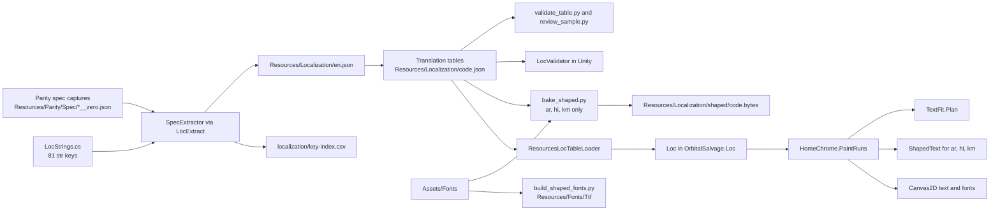

# 12. Localisation and i18n System

**How the 17-language Unity build loads, draws, checks, and ships its text**

- **Project:** _Orbital Salvage: Space Trash Clean_ (maze-puzzle)
- **Document Version:** 1.0
- **Date:** 2026-10-13
- **Branch:** `maze-puzzle`
- **Scope:** The Unity port in `unity/maze-puzzle/`. The web prototype in `web/` is not covered.
- **Purpose:** Describe how localisation works today: what is translated, how a language is chosen, how text is drawn and fitted, which checks and tools exist, and what is still open. Each claim points at a file, function, or command in this repository. Where the repository disagrees with itself, this document says so (section 11).
- **Companion Documents:**
  - [`05_GAME_UI_UX_DESIGN_SPECIFICATION.md`](./05_GAME_UI_UX_DESIGN_SPECIFICATION.md)
  - [`08_UNITY_MIGRATION_AND_IOS_DEPLOYMENT_PLAN.md`](./08_UNITY_MIGRATION_AND_IOS_DEPLOYMENT_PLAN.md)
  - [`10_PROJECT_REVIEW_2026-09-30.md`](./10_PROJECT_REVIEW_2026-09-30.md)
  - [`localization/README.md`](./localization/README.md), [`localization/process.md`](./localization/process.md), [`localization/translator-brief.md`](./localization/translator-brief.md), [`localization/glossary.md`](./localization/glossary.md)
  - [`CHANGELOG.md`](./CHANGELOG.md)

---

## 1. Purpose, Scope and Status

The game has 17 languages: English (`en`, the source language) and 16 translations. The Unity port draws its own Canvas2D screens through `AppController`. Text is not drawn by uGUI or by Unity's text components.

Status on 2026-10-13:

| Area                                         | Status                                                                                                              |
| -------------------------------------------- | ------------------------------------------------------------------------------------------------------------------- |
| Languages in the registry                    | 17: `en` plus 16 translation tables                                                                                 |
| Spec keys (screen text captured from parity) | 355 per table                                                                                                       |
| `str` keys (C# literals in `LocStrings`)     | 81 per table                                                                                                        |
| Never translated (`doNotTranslate`)          | 50 entries in `en.json`: endonyms, symbols, digits-only runs                                                        |
| Translation review                           | Not complete. Review samples are generated; no note marks them reviewed                                             |
| Device check                                 | iPhone X, iOS 16.7.10. Home screen for all 17 languages across two reports; gameplay for six languages (section 10) |
| Legal links                                  | Placeholders (`https://www.bing.com`). Open (section 11)                                                            |
| Pseudo-locale `qps`                          | Diagnostic only. Not a player language                                                                              |

**What is translated.** Text that the parity capture records on the screens (45 `*__zero.json` capture files under `Resources/Parity/Spec/`), and the 81 keys in `LocStrings`. Both are in each translation table.

**What is not translated.**

- Entries in `doNotTranslate`: language endonyms, `✓`, `×`, `▶`, and digits-only runs.
- Any English text that is not in a spec capture or in `LocStrings`. The gate `LocHardcodedStringTests` fails on unlisted English literals in the listed UI sources. Accepted exceptions go in `localization/hardcoded-allowlist.txt`, each with a reason.
- Store listings. No store-listing localisation is in the repository.

---

## 2. Architecture



The code is split into three layers:

| Layer                   | Location                              | Role                                                                                                    |
| ----------------------- | ------------------------------------- | ------------------------------------------------------------------------------------------------------- |
| Core (no `UnityEngine`) | `Scripts/Loc/` (`OrbitalSalvage.Loc`) | Registry, locale resolver, table parser, validator, pseudo-locale, string definitions, text rules       |
| Unity adapter           | `Scripts/Loc/Unity/`                  | Resources table and font loaders, device locale provider, `os.parity.lang` boot preference              |
| Renderer and app        | `Scripts/Render/`, `Scripts/App/`     | `HomeChrome` paints runs, `TextFit` plans fit, `ShapedText` handles complex scripts, `AppController` UI |
| Editor tools            | `Scripts/Editor/`                     | Spec extraction, overflow audit, iOS export                                                             |
| Offline tools           | `localization/tools/`                 | Python scripts: validate, merge, stub, review sample, bake shaping, build fonts                         |

Boot order, from `ParityViewer.BootApp` (`Scripts/Viewer/ParityViewer.App.cs`):

1. `Loc.SetLoader(new ResourcesLocTableLoader())` gives `Loc` a way to load `Resources/Localization/<code>.json`.
2. `app.InitializeLanguage(new UnityDeviceLocaleProvider())` calls `Loc.InitializeFromProfile` with the saved profile language and the device locale (section 3.2).
3. `LocBootPref.Apply()` runs. If the PlayerPrefs key `os.parity.lang` is set, it calls `Loc.SetDiagnostic(code)`.

From then on, each paint goes through `HomeChrome.PaintRuns`. A run in the active language is translated, fitted with `TextFit.Plan`, and drawn. Runs in complex scripts go through `ShapedText` first.

---

## 3. Language Selection

### 3.1 Registry

`Scripts/Loc/LanguageRegistry.cs` holds the 17 languages. `en` is the default and the fallback.

| Code      | English name          | Endonym          | Script | Font group | Line breaker | Latin length budget |
| --------- | --------------------- | ---------------- | ------ | ---------- | ------------ | ------------------- |
| `en`      | English               | English          | Latn   | latin      | Latin        | yes                 |
| `de`      | German                | Deutsch          | Latn   | latin      | Latin        | yes                 |
| `fr`      | French                | Français         | Latn   | latin      | Latin        | yes                 |
| `es`      | Spanish               | Español          | Latn   | latin      | Latin        | yes                 |
| `it`      | Italian               | Italiano         | Latn   | latin      | Latin        | yes                 |
| `pt-PT`   | Portuguese            | Português        | Latn   | latin      | Latin        | yes                 |
| `vi`      | Vietnamese            | Tiếng Việt       | Latn   | latin-vi   | Latin        | yes                 |
| `fil`     | Filipino              | Filipino         | Latn   | latin      | Latin        | yes                 |
| `id`      | Indonesian            | Bahasa Indonesia | Latn   | latin      | Latin        | yes                 |
| `uz`      | Uzbek                 | Oʻzbekcha        | Latn   | latin      | Latin        | yes                 |
| `zh-Hans` | Chinese (Simplified)  | 简体中文         | Hans   | cjk-sc     | Cjk          | no                  |
| `zh-Hant` | Chinese (Traditional) | 繁體中文         | Hant   | cjk-tc     | Cjk          | no                  |
| `ja`      | Japanese              | 日本語           | Jpan   | cjk-jp     | Cjk          | no                  |
| `ko`      | Korean                | 한국어           | Kore   | cjk-kr     | Korean       | no                  |
| `km`      | Khmer                 | ភាសាខ្មែរ        | Khmr   | khmer      | Complex      | no                  |
| `hi`      | Hindi                 | हिन्दी           | Deva   | devanagari | Complex      | no                  |
| `ar`      | Arabic (RTL)          | العربية          | Arab   | arabic     | Complex      | no                  |

- **Uzbek** is `FontGroup.Latin` in the registry, but `LocFonts.GroupId` maps `uz` to the `latin-uz` font group. Line breaking uses the Latin breaker.
- **Latin length budget** is `LanguageRegistry.UsesLatinLengthBudget`. It is true only for the Latin and Latin-Vietnamese groups. The length check in `LocValidator` applies to those languages.
- **Complex** line breaking is the Latin breaker, unless the string is in the baked table. Baked strings wrap from the stored break flags (section 7).
- `ar` is the only right-to-left language (`IsRtl`).

### 3.2 Choosing a language at first launch

`Loc.InitializeFromProfile(storedLanguage, device)` (`Scripts/Loc/Loc.cs`) decides the language in this order:

1. **Stored profile value wins.** If `Settings.Language` (JSON key `language`) is non-empty, it is canonicalised. If its table loads, that language is used. If not, the language is English. A stored value is never rewritten.
2. **Device detection** runs only when the profile value is empty. `LocaleResolver.ResolveSystemLanguage(systemLanguage, cultureName)` is tried. The culture name wins if it resolves. Otherwise the Unity `SystemLanguage` name is looked up in a fixed map of 15 names.
3. **Persistence.** A detected non-English code is written back only if its table loaded. `AppController.InitializeLanguage` then saves it to the profile. English detection is never saved.
4. **Anything else** (no device value, an unsupported language, or a missing table) activates English. Nothing is saved.

`LocaleResolver.ResolveTag` (`Scripts/Loc/LocaleResolver.cs`) maps tags as follows:

- `en-*` gives `en`.
- `uz`, with or without a `latn` subtag, gives `uz`. A `cyrl` subtag gives no match, so English is used.
- `zh` with `hant`, or a `tw`, `hk`, or `mo` region, gives `zh-Hant`. Other `zh` tags give `zh-Hans`.
- `pt` with any region gives `pt-PT`. **Brazilian Portuguese (`pt-BR`) therefore gets the European Portuguese table.**
- `fil` and `tl` give `fil`. `id` and `in` give `id`.
- `nb`, `nn`, `no`, and `iw` give no match.
- Any other tag with a registry code gives that code.

### 3.3 Manual choice in Settings

The language picker is the modal `modal-language`. Each row is a button `btn-lang-<code>`. `AppController.TryLanguageButton` passes the code to `AppController.SetLanguage`, which calls `EconomyManager.SetLanguage`. That method saves the profile and calls `Loc.SetLanguage`. The picker then closes. The current row is marked with `LanguageMarker` (U+2713 followed by a space).

A language whose table is missing still gets saved. `Loc.CurrentLanguage` stays `en` until the table loads.

### 3.4 Diagnostic overrides

- **`os.parity.lang`** (PlayerPrefs, `LocBootPref.PrefKey`) forces a language at boot through `Loc.SetDiagnostic`. It accepts registry codes and `qps`. It does not write the profile.
- **`qps`** (pseudo-locale) is built at runtime from the loaded English table by `PseudoLocale.BuildTable`. Latin letters are replaced by look-alikes, the text is padded with `~` to about 1.4 times the English length, and the result is wrapped in `[` and `]`. Digits, separators, placeholders, and emoji are kept. `qps` is not in `LanguageRegistry.All`.

### 3.5 Fallback and change events

- A key that is missing from the active table falls back to English. Misses are recorded in `Loc.MissingKeys`, up to `MissingKeyLimit` (256).
- `Loc.Version` increments only when the active code changes. `Loc.LanguageChanged` is raised at the same time. `HomeChrome.InvalidateForLanguage` uses the version to clear its caches.

---

## 4. Table Format and Keys

Each non-English language has one table, `Resources/Localization/<code>.json`. `en.json` is the English source. `Loc` loads these files through `ResourcesLocTableLoader` (`Scripts/Loc/Unity/UnityLocale.cs`) at the path `Localization/<code>`.

The shape of a translation table is:

```json
{
  "meta": {
    "code": "<registry code>",
    "name": "<endonym>",
    "sourceHashes": { "spec": {}, "str": {} }
  },
  "spec": { "<normalised English run text>": "<translation>" },
  "str": { "<dot.key>": "<translation>" }
}
```

- `LocTable.TryParse` reads `meta.code`, `meta.name`, `spec`, and `str`. It ignores `doNotTranslate`. The `doNotTranslate` rule is applied by the extractor (`SpecExtractor.IsNeverTranslate`) when it writes `en.json`.
- **Spec keys** are English run text after `LocText.Normalize`, which collapses internal whitespace and trims the ends. The runtime normalises the same way before lookup.
- **Str keys** are dot-separated names from `LocStrings.All`. Each row is a `LocStringDef(key, english, context, maxChars, dynamic)`. For example, `unit.kg` is `{0} kg`, and `shop.footer.unlock` has a 22-character limit. Data names (level, world, and achievement names) are looked up through `data.*` rows by `Loc.TrName`.
- **Source hashes.** `meta.sourceHashes` holds a SHA-256 of `section`, a newline, `key`, a newline, and the English value, for each entry (`validate_table.py`, `source_hash`). A changed English value makes its translation stale. `zh-Hans`, `ko`, and `km` have these hashes. `ja` does not (section 11).
- **Placeholders** are `{0}`, `{1}`, and so on. `{{` is an escaped brace. `LocText.PlaceholderIndexes` gives the set of indexes, and the validator reports a mismatch as an error.
- **Formatting.** `LocText.Format` calls `string.Format` with the invariant culture. Doubles go through `JsNumber.ToString`. If the template is malformed, `Format` returns the raw template text rather than throwing.
- **Counts.** Each of the 16 translation tables has 355 spec keys and 81 str keys. `en.json` also lists 50 `doNotTranslate` entries.

---

## 5. Rendering Rules

Text is drawn in `HomeChrome` (`Scripts/Render/HomeChrome.cs`). This is what happens to one run:

1. **Route.** `PaintRuns` paints the captured English run when English is active and no text overrides exist. Otherwise it calls `PaintLocalisedRun`.
2. **Lookup.** `LocText.HasLetter` gates the lookup. Runs with no letter (digits, symbols) are not translated. `Loc.TryTranslateSpecText` looks up the normalised text. On a miss, the captured English is painted, and the miss is recorded as `spec:<key>`.
3. **Case.** `LocCase.Upper` applies to uppercase text. Caseless languages are `zh-Hans`, `zh-Hant`, `ja`, `ko`, `km`, `hi`, and `ar`. For other languages, `ß` becomes `SS` before the invariant uppercase conversion.
4. **Letter spacing.** `LocTextStyle.LetterSpacing` returns 0 for CJK, `ar`, `hi`, and `km`. Other languages keep the captured spacing.
5. **Line pitch.** For multi-line CJK runs, `LocTextStyle.LinePitchOverride` uses the English box pitch.
6. **Fit.** `TextFit.Plan` tries these steps in order:
   - a. Fit on one line at the captured size.
   - b. Wrap, if `TextFit.AllowsWrap` is true and at least two lines fit.
   - c. Shrink in 2 percent steps down to 72 percent of the captured size.
   - d. Wrap at 72 percent, if step b was allowed.
   - e. Ellipsis (`…`, U+2026) at 72 percent.
7. **Wrap.** `LineBreaker.For(lang)` picks the breaker: Latin (spaces), Cjk (line-start and line-end rules), Korean, or Latin for Complex languages that are not baked. Baked Complex strings use their stored break flags.
8. **Placement.** `TextFit.ChooseAnchor` and `PlaceX` choose left, centre, or right anchoring. Icons that precede a run reserve space. `TextFit.HomeIndicatorY` (898.25) is the home-indicator band that the overflow audit checks.

Constants (`Scripts/Render/TextFit.cs`): `SidePadding` 16, `FloorRatio` 0.72, `ShrinkStep` 0.02, `SoftShrink` 0.80, `ControlHeightFactor` 2.2, `TwoLineFactor` 1.9.

**Length checks** are in `LocValidator` (`Scripts/Loc/LocValidator.cs`). A translation at or above 1.6 times the English length is a warning. At or above 2.5 times it is an error. These limits apply only to the Latin and Latin-Vietnamese groups. The validator also reports missing and extra keys, placeholder mismatch, control characters (error), and leading or trailing whitespace (warning).

**The overflow audit** is `LocOverflowAudit.Run(specDir)` (`Scripts/Render/LocOverflowAudit.cs`). It replays every spec capture through `TextFit` and sorts each finding into a bucket:

- **Hard** (counted in `Hard`): outside the box, band intrusion, wider than the box, wrapped in a one-line control, missing glyph, and icon overlap. `HardOverlap` is the same icon crossing when the run is not kept in place. That column is still printed as `hard_overlap`, and it is not added into `Hard` again.
- **Soft** (counted in `Soft`): shrink, ellipsis, control ellipsis, and allowed wrap.

---

## 6. Fonts

Fonts are described by `Resources/Localization/fonts.json`. `LocFonts.GetChain(languageCode, family, cssWeight)` builds the list of faces to try, in order.

**Roles.** Fredoka (display) at 400, 600, and 700. Nunito (body) at 700, 800, and 900. Both are read from the files under `Resources/Fonts/Ttf/`.

**Groups.**

| Group        | Display                     | Body                       | Fallback        | Languages                          |
| ------------ | --------------------------- | -------------------------- | --------------- | ---------------------------------- |
| `latin`      | Fredoka                     | Nunito                     | Symbols         | en, de, fr, es, it, pt-PT, fil, id |
| `latin-vi`   | Fredoka                     | Nunito                     | Symbols         | vi                                 |
| `latin-uz`   | Fredoka, with U+02BB prefix | Nunito, with U+02BB prefix | Symbols         | uz (see below)                     |
| `cjk-sc`     | ZCOOL KuaiLe (one master)   | ZCOOL KuaiLe               | Nunito, Symbols | zh-Hans                            |
| `cjk-tc`     | Huninn (one master)         | Huninn                     | Nunito, Symbols | zh-Hant                            |
| `cjk-jp`     | M PLUS Rounded 1c 700       | M PLUS Rounded 1c 700      | Nunito, Symbols | ja                                 |
| `cjk-kr`     | Jua (one master)            | Jua                        | Nunito, Symbols | ko                                 |
| `devanagari` | Baloo 2 700                 | Baloo 2 700                | Nunito, Symbols | hi                                 |
| `khmer`      | Kantumruy Pro 700           | Kantumruy Pro 700          | Nunito, Symbols | km                                 |
| `arabic`     | Cairo 700                   | Cairo 700                  | Nunito, Symbols | ar                                 |

- **Symbols** are `NotoSansSymbols2-Regular` and `NotoSansSymbols-Regular`.
- **Uzbek** adds a U+02BB prefix face (`Nunito-uz-patch-600/700/800/900`) with a narrow advance. Display weights 600 and 700 follow the Fredoka face. Body uses 700, 800, and 900.
- **CJK faces** are single-weight. The `fonts.json` notes say every CSS weight uses the one file. M PLUS Rounded 1c is 700, and Black (900) is not shipped.
- **Weight matching** follows CSS Fonts 4 (`LocFonts.MatchWeight`). The code does not synthesise bold.
- **Fallback.** `LocFonts.NeedsLatinFallback` reports when the first requested face did not load for a non-Latin language.

**Font files.** `Assets/Fonts/` holds the source TTFs and each one's OFL licence text, for example `Baloo2-700.ttf` and `Baloo2-OFL.txt`. `Assets/Resources/Fonts/Ttf/` holds the `*.bytes` copies that the runtime reads through `TrueTypeFont`, which reads glyf-only fonts. `ParityAssetBuilder.OutlineExtraFonts` lists the extra faces.

**Building fonts.** These scripts under `localization/tools/` produce the subset files:

- `make_fonts.sh` is the font download and build script. Its default Python is `/tmp/maze-i18n/fonts-venv/bin/python`, and its download folder is `/tmp/maze-i18n/fonts/dl`. Read its header for the steps.
- `subset_fonts.py` subsets font files. Read its header for the character set it uses.
- `make_cjk_fonts.py` builds the CJK subsets from the full source files. It uses the safety set in `cjk_safety.json`, which has keys for zh-Hans, zh-Hant, ja, and ko. Its documented rebuild command uses `/tmp/maze-i18n/kit-venv/bin/python`.
- `patch_uz_modifier.py` builds the Uzbek U+02BB prefix faces.

The `/tmp` paths are defaults. They do not survive a reboot or a clean checkout, so the venvs must be recreated first.

**Glyph coverage.** `validate_table.py` checks each translation against its font chain (`--fonts-dir`, `--fonts-chains`). `LocGlyphCoverage` ignores whitespace, controls, U+FE0F, U+200D, and U+200B, and skips emoji graphemes. `fonts-chains.json` is the chain list that check reads. `vi` and `uz` use the Latin faces there. Baloo 2 is the `hi` face.

---

## 7. Complex Scripts: Arabic, Hindi, Khmer

Arabic, Hindi, and Khmer need shaping: joined Arabic forms, Devanagari matras and conjuncts, and Khmer stacked vowels. Canvas2D draws one code point at a time with `TrueTypeFont`, so these scripts are shaped offline with HarfBuzz (`uharfbuzz` in `shaped_engine.py`) and the result is stored in a binary table.

**Flow.**

1. `bake_shaped.py --lang <code>` reads `Resources/Localization/<code>.json` and the font in `Assets/Fonts/`. It writes `Resources/Localization/shaped/<code>.bytes`. The `--table`, `--font`, and `--out` flags override the defaults. The script fails if the table or font is missing.
2. `build_shaped_fonts.py` writes the matching Resources font files, one 700 instance per face, into `Resources/Fonts/Ttf/`. Its documented rebuild command uses `/tmp/maze-i18n/shaping/venv/bin/python`, and it downloads `Baloo2[wght].ttf` into `/tmp/maze-i18n/fonts/dl`.
3. At runtime, `ShapedText.Table(lang)` loads `Resources/Localization/shaped/<lang>` and the matching font bytes from `Resources/Fonts/Ttf/`.

Current baked files: `ar.bytes` (84,461 bytes), `hi.bytes` (96,826 bytes), and `km.bytes` (88,170 bytes).

**Binary format (`OSB1`, `Scripts/Loc/ShapedTable.cs`).**

| Field     | Type              | Meaning                                                                                            |
| --------- | ----------------- | -------------------------------------------------------------------------------------------------- |
| magic     | 4 bytes           | `OSB1`                                                                                             |
| version   | u16               | 1                                                                                                  |
| weight    | u16               | Font weight                                                                                        |
| upem      | u16               | Units per em                                                                                       |
| font name | u8 length + UTF-8 | Font file name                                                                                     |
| font hash | 32 bytes          | SHA-256 of the font file                                                                           |
| count     | u32               | Number of entries                                                                                  |
| index     | count × 16 bytes  | Key (u64), offset (u32), size (u32)                                                                |
| record    | variable          | Base level (u8), run count (u16), then runs                                                        |
| run       | variable          | Kind (u8), level (u8), slot (u8), text length (u16), text, glyph count (u16), glyphs               |
| glyph     | 11 bytes          | Glyph id (u16), advance (i16), dx (i16), dy (i16), cluster (u16), flags (u8; bit 0 = break before) |

Run kinds: 1 glyph, 2 Latin, 3 symbol, 4 emoji, 5 slot.

**Keys.** The key is FNV-1a 64-bit over the NFC UTF-8 text (`ShapedTable.Hash`).

**Refusal rules.**

- `ShapedTable.Load` refuses the table when the SHA-256 of the font file does not match the hash stored in the table. A refused table shapes nothing.
- When text contains a script that the table does not have, `Canvas2D.TryConsumeShaped` returns true and clears the lay-out. **Nothing is painted for that run.** The English run does not appear either. `ShapedTextTests.MissingBake_PaintsNothing_AndEnglishDoesNotEnter` checks this.
- Hindi is shaped with HarfBuzz script `dev2`, not `deva`. The module header of `shaped_engine.py` explains the choice.

**Layout.** `ShapedText.TryFit` builds lines from the stored break flags, adds ellipsis when needed, and reorders runs by bidi level. Arabic is right-aligned when the base level is odd. `ShapedText.PxForBox` sizes the text inside the box. `ShapedText.IsComplex` returns true for `ar`, `hi`, and `km`.

---

## 8. Translation Workflow and Rebuild Steps

The steps below are the procedure recorded in the localisation documents and the tools. The locations are in `localization/process.md`, `localization/translator-brief.md`, and the tool headers. Run each step in order.

1. **Extract English.** In the Unity Editor, run the menu item `Orbital Salvage/Tools/Extract Localization Spec Strings`. It calls `LocExtract.Run`, which writes `Resources/Localization/en.json` and `localization/key-index.csv`. For batch use, the entry point is `LocExtract.RunBatch` (`Scripts/Editor/LocExtract.cs`). Run it again after any change to a capture or to `LocStrings`.
2. **Brief and glossary.** Give translators `localization/translator-brief.md` and `localization/glossary.md`.
3. **Make a skeleton.** `python3 localization/tools/make_translation_stubs.py --lang <code>` writes a skeleton to `/tmp/maze-i18n/translation-stubs` by default. Use `--allow-repo` only to write inside the worktree.
4. **Translate.** Translators fill `spec` and `str`. A partial file is merged with `merge_table.py --lang <code> --partial <file> --en <en.json> --into <canonical> --out <file>`.
5. **Validate.** `python3 localization/tools/validate_table.py --lang <code> --table <table> --en <en.json> --key-index localization/key-index.csv --glossary localization/glossary.md --fonts-dir <Assets/Fonts> --fonts-chains localization/tools/fonts-chains.json`. The default length error ratio is 2.5 (`--max-ratio`). `--fit-exceptions` names the accepted fit warnings (default `localization/notes/<code>-fit-exceptions.json`). `--json` writes a machine-readable report.
6. **Review sample.** `python3 localization/tools/review_sample.py --lang <code> --table <table> --en <en.json> --key-index localization/key-index.csv --out <file.md>` writes up to 30 keys side by side. Placeholder-heavy and the longest keys come first.
7. **Record decisions.** Add accepted fit warnings to `localization/notes/<code>-fit-exceptions.json`. Add identical-to-English keys that are correct to `localization/notes/<code>-identical-ok.json`. Write notes in `localization/notes/<code>-notes.md`.
8. **Overflow audit.** In the Unity Editor, run `Orbital Salvage/Tools/Localization Overflow Audit` (`LocOverflowMenu.RunBatch`). In batch mode it reads `-loc-audit-lang` (default `qps`) and writes `-loc-audit-out` (default `/tmp/maze-i18n/loc-render/overflow.txt`).
9. **Bake shaping** for `ar`, `hi`, or `km` when their tables or fonts change: `bake_shaped.py --lang <code>`, then `build_shaped_fonts.py`. Both need `uharfbuzz` and the font download (section 7).
10. **Let Unity import.** Open the Editor, or run a batch job, so that changed `Resources` files are imported before tests or builds.
11. **Test.** Run the EditMode suite (section 9). Run the Python self-tests (`selftest_kit.py`, `selftest_shaping.py`).

**Adding a language** needs more than a table. It needs a `LanguageRegistry` row, a `LocaleResolver` entry if device codes map to it, a `fonts.json` group if it needs new faces, and tool entries in `validate_table.py`. Run Unity batch jobs one at a time (section 9.1).

---

## 9. Testing and Audit

### 9.1 EditMode suites

Tests are in `unity/maze-puzzle/Assets/Tests/EditMode/`.

| Area                    | Test files                                                                                                      |
| ----------------------- | --------------------------------------------------------------------------------------------------------------- |
| Table and keys          | `Loc/LocTableTests.cs`, `Loc/LocStringTests.cs`, `Loc/LocValidatorTests.cs`, `Loc/SpecExtractorTests.cs`        |
| Hard-coded string gate  | `Loc/LocHardcodedStringTests.cs` (reads `localization/hardcoded-allowlist.txt`)                                 |
| Language audit          | `Loc/LocLanguageAuditTests.cs`                                                                                  |
| Registry, boot, profile | `Loc/RegistryAndResolverTests.cs`, `Loc/ProfileAndBootTests.cs`, `Loc/SettingsLanguageFlowTests.cs`             |
| Fonts                   | `Loc/LocFontRegistryTests.cs`, `Render/LocFontChainTests.cs`, `Viewer/LocFontPickerTests.cs`                    |
| Layout and text         | `Loc/LineAndCaseTests.cs`, `Render/CjkRenderTests.cs`, `Render/LocRenderHookTests.cs` (includes `TextFitTests`) |
| Shaping                 | `Render/ShapedTextTests.cs` (includes `KhmerWrap_BreaksOnlyBetweenClusters`)                                    |
| Stills                  | `Viewer/LocLanguageStillTests.cs`, `Viewer/LocPseudoStillTests.cs`, `Viewer/PagePreviewTests.cs`                |

`SettingsLanguageFlowTests` also checks that the Kids Category comment in `App/LegalLinks.cs` is present.

### 9.2 Running the suite

- **Windows** (the reference in `tools/parity/golden/README.md`): run `Unity.exe -batchmode -nographics -projectPath games\maze-puzzle\unity\maze-puzzle -runTests -testPlatform EditMode -testResults <xml> -logFile <log>`. Do not pass `-quit` with `-runTests`.
- **Serialise runs.** Only one Unity batch process may use a project at a time. The runs for this feature wrapped the command in a lock: `until mkdir /tmp/maze-unity.lock 2>/dev/null; do sleep 10; done; <unity command>; rmdir /tmp/maze-unity.lock`. This is a convention of the localisation work, not a script in the repo. After a batch run, restore `ProjectSettings/ProjectSettings.asset` and the PNGs under `tools/parity/reports` with `git checkout`.
- **Mac:** the recorded runs use Unity `6000.4.0f1` in EditMode batch mode without `-nographics`. The changelog records that `-nographics` forces the null device, so readback is flat grey and the stills are not real images.
- **Python self-tests:** `python3 localization/tools/selftest_kit.py` (19 groups) and `python3 localization/tools/selftest_shaping.py` (7 groups). Both are recorded as passing in `CHANGELOG.md`.

### 9.3 Known failures (83)

The full EditMode run on the Mac records **83 known failures**. They are listed in `CHANGELOG.md` as the known set:

- `ReferenceComparisonTests`: 73 (`Assets/Tests/EditMode/Audio/AudioParityTests.cs`)
- `ReferenceGateTests`: 9 (same file)
- `QuotaAndModalTests.GameAndPauseStills_MatchKnownHashes` (`Assets/Tests/EditMode/Viewer/QuotaAndModalTests.cs`): 1

These tests pin hashes made on Windows. Metal does not reproduce them. `PagePreviewTests` says so in a comment: the Windows game hash is one that "Metal does not reproduce". These 83 are not localisation failures. **Any failure outside this set, or a count above 83, needs investigation.** Totals change as tests are added, so compare by test name, not by total.

### 9.4 Self-skipping tests

- `PagePreviewTests` skips with `Assert.Ignore` when `tools/parity/out` is missing. That folder is not in this checkout.
- `LocLanguageAuditTests` and `LocLanguageStillTests` skip with `Assert.Ignore` when a language's `<code>.json` is absent.
- Full runs record three skipped tests. The changelog does not list them by name.

### 9.5 Overflow audit results

| Report                                             | Scope                                                                                 | Result                   |
| -------------------------------------------------- | ------------------------------------------------------------------------------------- | ------------------------ |
| `localization/reports/audit-all-2026-10-12.md`     | Latin languages (nine)                                                                | Hard 0                   |
| `localization/reports/audit-cjk-2026-10-13.md`     | Nine Latin plus four CJK (13 languages). Editor stills only, no native-speaker review | Hard 0 in every language |
| `localization/reports/audit-complex-2026-10-13.md` | ar, hi, km                                                                            | Hard 0                   |

The `qps` audit reported Hard 0 across 90 spec files and 2,006 runs (`CHANGELOG.md`). Soft findings (shrink, ellipsis, control ellipsis, wrap) are expected and are counted separately.

---

## 10. Device Verification (iPhone X)

**Device.** iPhone X (`iPhone10,3`), iOS 16.7.10 (`localization/reports/device-check-2026-10-12.md`).

**Build.** A Release IL2CPP build from `IosExport.ExportDevice`. The export folder is `games/maze-puzzle/output/maze-puzzle`, which is gitignored. `IosExport.BundleId` is `io.dev.maze`. For device installs, the team switched the bundle identifier only in the exported `project.pbxproj`, to `com.curiomatch.test`. The project file keeps `io.dev.maze`.

**Language on the device.** A language was set by pushing `os.parity.lang` into `Library/Preferences/com.curiomatch.test.plist` with `pymobiledevice3 apps push` before the first launch. The report records that a pushed key is ignored once the app has run. The phone language was English.

**What was checked.**

| Report                       | Scope                                                                                                                        |
| ---------------------------- | ---------------------------------------------------------------------------------------------------------------------------- |
| `device-check-2026-10-12.md` | Home screen only, for all 17 languages and `qps`. The file name says 2026-10-12 but the heading says 2026-10-13.             |
| `device-check-2026-10-13.md` | Home screen for ar, de, en, hi, ja, km, ko, zh-Hans, zh-Hant, and `qps`. Gameplay (level 1) for ar, hi, km, ja, ko, zh-Hans. |

The reports record tofu-free Chinese, Japanese, and Korean Home text, joined Arabic, and Khmer stacked vowels. They also record one gap that was found and fixed: on the first 2026-10-13 pass the Home ring pill label was blank for Arabic, Hindi, and Khmer, because the device drops the donut emoji and then looked up a string that was not in the bake. The lookup now falls back to the rest of the baked label, and the "Ring pill fix verification" section of the report shows the name on the device. Stills are in the report folders.

**What was not checked.** The reports say only Home was verified in the first pass. Settings screens, the language picker on the device, legal links, and Shop and Daily as timed runs were not part of either pass. Gameplay was checked only for the six languages listed above.

**Crashes.** The 2026-10-12 report records no `maze-puzzle` crash log before the first launch or after the language passes. It also records that the Unity boot line for `6000.4.0f1` Release IL2CPP showed no exception.

**Performance.** Launch timings and frame rates are in the reports. This document does not restate them.

**Font importer warning.** The 2026-10-13 report says Unity's TrueType importer logs `family_name cannot be parsed` for the editor copies of M PLUS Rounded 1c, Jua, ZCOOL KuaiLe, Huninn, Baloo 2, Cairo, and Kantumruy Pro. It says the player does not use that importer. The runtime reads `Resources/Fonts/Ttf/*.bytes` through `OutlineFonts`' own parser. The cause of the editor warning is not investigated.

---

## 11. Known Limitations and Open Items

| #   | Item                          | Detail                                                                                                                                                                                                                                                                                                         |
| --- | ----------------------------- | -------------------------------------------------------------------------------------------------------------------------------------------------------------------------------------------------------------------------------------------------------------------------------------------------------------- |
| 1   | Translation review            | Not done. The review samples under `localization/reports/review-samples-2026-10-13/` are generated, and no note marks them reviewed. Translations are not yet approved for release.                                                                                                                            |
| 2   | Legal links                   | `LegalLinks.PrivacyPolicy` and `LegalLinks.UserAgreement` are both `https://www.bing.com`. The file's TODOs say to replace them. A TODO also notes that an external link in a Kids Category app may need a parental gate, which is not built.                                                                  |
| 3   | Unbaked complex-script text   | A run in `ar`, `hi`, or `km` that is not in the baked table is not painted at all (section 7). The failure is silent.                                                                                                                                                                                          |
| 4   | Silent language fallbacks     | Unsupported device languages go to English. `pt-BR` gets `pt-PT`. Russian and other languages outside the 17 get English.                                                                                                                                                                                      |
| 5   | No native locale API          | `LocaleResolver` uses Unity's `SystemLanguage` and `CultureInfo`. Its own comment says native NSLocale and Android Locale lookup is "a later task".                                                                                                                                                            |
| 6   | Japanese source hashes (done) | `ja.json` now stores `meta.sourceHashes` like the other tables. The hashes came from `merge_table.py` into a temporary file, and only the `meta.sourceHashes` field was copied into `ja.json`. The translations are byte-identical, and the English `doNotTranslate` list was not added.                       |
| 7   | Startup order                 | `ParityViewer.BootApp` runs `InitializeLanguage` (which can save a detected language) before `LocBootPref.Apply`. Reading the code, a detected language could be saved before the diagnostic override applies. This is not reproduced.                                                                         |
| 8   | Font importer warnings        | Unity logs `family_name cannot be parsed` for several font files (section 10). Cause not investigated.                                                                                                                                                                                                         |
| 9   | Temporary tool paths          | Scripts default to `/tmp/maze-i18n/...` for venvs, downloads, and output. These do not persist.                                                                                                                                                                                                                |
| 10  | Historical spikes             | `localization/spikes/` records decisions from earlier spikes. The spike on fonts recommended Baloo 2 for `vi` and `uz`, which was not adopted. Use `fonts.json`.                                                                                                                                               |
| 11  | Web prototype                 | Not covered by this system.                                                                                                                                                                                                                                                                                    |
| 12  | Ring pill (fixed)             | The blank Home ring pill for `ar`, `hi`, and `km` was fixed and re-verified on the device (see `device-check-2026-10-13.md`, "Ring pill fix verification"). Kept here as a reminder: an unbaked complex-script string paints nothing, so any new code path that builds a string must resolve to a baked entry. |

---

## 12. File and Folder Map

Paths are relative to `games/maze-puzzle/` unless stated otherwise.

| Path                                                          | Purpose                                                                                              |
| ------------------------------------------------------------- | ---------------------------------------------------------------------------------------------------- |
| `unity/maze-puzzle/Assets/Scripts/Loc/`                       | Registry, resolver, table parser, validator, pseudo-locale, strings, text rules, fonts, shaped table |
| `unity/maze-puzzle/Assets/Scripts/Loc/Unity/`                 | Resources table and font loaders, device locale, `LocBootPref`                                       |
| `unity/maze-puzzle/Assets/Scripts/Render/`                    | `HomeChrome`, `TextFit`, `ShapedText`, `Canvas2D.Shaped`, `LocOverflowAudit`                         |
| `unity/maze-puzzle/Assets/Scripts/App/AppController.cs`       | Profile language, language picker, legal link buttons                                                |
| `unity/maze-puzzle/Assets/Scripts/App/LegalLinks.cs`          | Legal link placeholders and TODOs                                                                    |
| `unity/maze-puzzle/Assets/Scripts/Editor/LocExtract.cs`       | Spec extraction menu and batch entry                                                                 |
| `unity/maze-puzzle/Assets/Scripts/Editor/LocOverflowMenu.cs`  | Overflow audit menu and batch entry                                                                  |
| `unity/maze-puzzle/Assets/Scripts/Editor/IosExport.cs`        | iOS export (`ExportSimulator`, `ExportDevice`)                                                       |
| `unity/maze-puzzle/Assets/Resources/Localization/en.json`     | English source table                                                                                 |
| `unity/maze-puzzle/Assets/Resources/Localization/<code>.json` | Translation tables (16)                                                                              |
| `unity/maze-puzzle/Assets/Resources/Localization/fonts.json`  | Font roles and groups                                                                                |
| `unity/maze-puzzle/Assets/Resources/Localization/shaped/`     | Baked tables for `ar`, `hi`, `km`                                                                    |
| `unity/maze-puzzle/Assets/Resources/Parity/Spec/`             | Spec captures (`*__zero.json`, `*__iphone.json`)                                                     |
| `unity/maze-puzzle/Assets/Resources/Fonts/Ttf/`               | Runtime font files (`*.bytes`)                                                                       |
| `unity/maze-puzzle/Assets/Fonts/`                             | Source font files and OFL licence texts                                                              |
| `unity/maze-puzzle/Assets/Tests/EditMode/`                    | Loc, render, and viewer tests (section 9)                                                            |
| `localization/README.md`, `process.md`                        | Process and overview                                                                                 |
| `localization/translator-brief.md`, `glossary.md`             | Translator inputs                                                                                    |
| `localization/key-index.csv`                                  | Key list written by the extractor                                                                    |
| `localization/hardcoded-allowlist.txt`                        | Accepted C# literals, with reasons                                                                   |
| `localization/notes/`                                         | Per-language notes, fit exceptions, identical-ok lists                                               |
| `localization/reports/`                                       | Audits, device checks, review samples                                                                |
| `localization/spikes/`                                        | Historical decision records                                                                          |
| `localization/tools/`                                         | Python tools (validate, merge, stub, review, bake, font build, self-tests)                           |
| `localization/tools/fonts-chains.json`                        | Font chain list for the Python glyph check                                                           |
| `CHANGELOG.md`                                                | Milestones and recorded test runs                                                                    |
