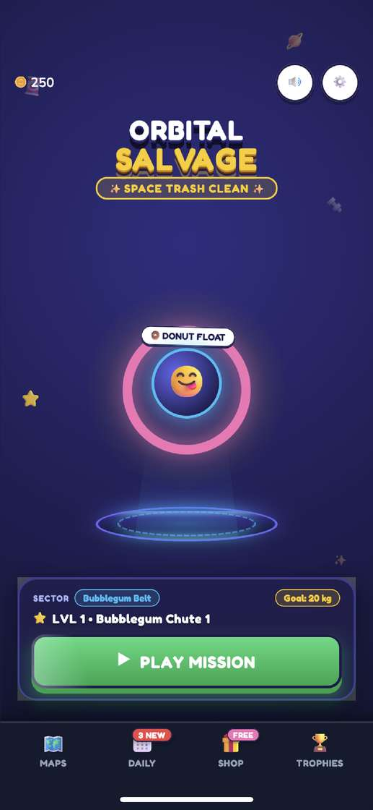
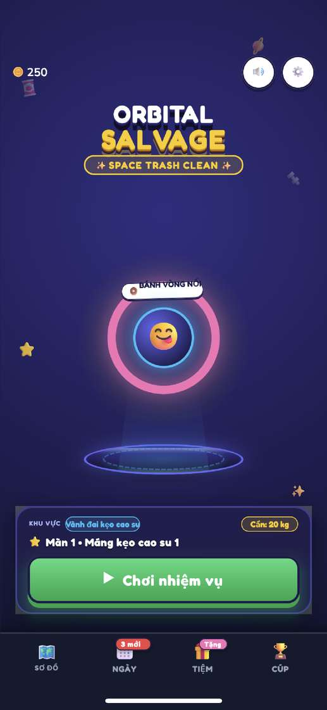
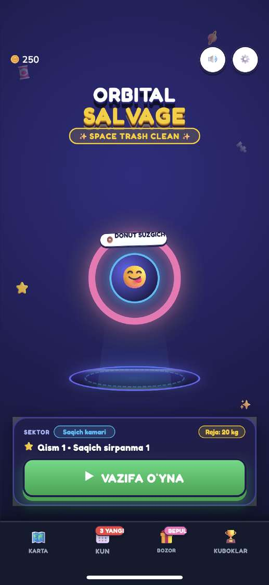
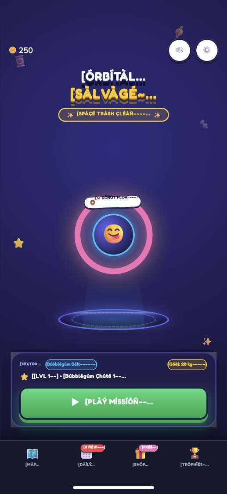

Note: this work is now on branch `maze-puzzle`. `integration/i18n` was fast-forwarded into it (tip `d1c79a9`).

# Device check — iPhone X — 2026-10-13

Release device build of `integration/i18n` at `10de22f`, checked on the USB iPhone X. Home only. No translation, spec, or C# edits.

## Build

|                   |                                                                                                               |
| ----------------- | ------------------------------------------------------------------------------------------------------------- |
| Device            | iphonex, iPhone10,3, iOS 16.7.10, udid `e881fa63cc3f392e4c7c0a79c65536daf00e711b`                             |
| Phone language    | `Language: en-US`, `Locale: en_US` (`ideviceinfo -q com.apple.international`)                                 |
| Export            | `[IosExport] result=Succeeded sdk=DeviceSDK arch=unchanged frameTiming=1 output=.../output/maze-puzzle`       |
| Compile           | no `error CS`                                                                                                 |
| Sign              | `** BUILD SUCCEEDED **`. Manual, team `XS55JWXZMN`, identity Apple Development, profile `com.curiomatch.test` |
| Install           | `ideviceinstaller install` → `Install: Complete`. Listed as `com.curiomatch.test`, `1.0`, `maze-puzzle`       |
| Project bundle id | left `io.dev.maze`. Only the exported `project.pbxproj` was switched to `com.curiomatch.test`                 |
| ProjectSettings   | `ProjectSettings.asset` hash unchanged after the Unity export                                                 |

The old `com.curiomatch.test` 1.0 was uninstalled first. Each language pass uninstalled and reinstalled again, so saved progress is gone.

Prefs: after install and before the first launch, `pymobiledevice3 apps push` wrote `Library/Preferences/com.curiomatch.test.plist` with `os.parity.lang`. A pull-back confirmed the code. The default and final launches pushed no language key.

## What was not opened

Only Home was verified on device. `os.parity.boot.exp` is a creation-time flag list (`rt16` and the same family), not a page. Settings is not a `DeviceBench` scenario. `os.parity.bench` can visit Shop and Daily as a timed perf run and then leave; that path was not used for these shots.

Sim stills are `1290×2796`. Device shots are `1125×2436` and include the status bar and the home indicator. String comparison below is against `/tmp/maze-i18n/audit-all/<code>/stills/home__iphone.png`. There is no `qps` still in that folder.

## Home, one line each

- **en (no pref, phone language):** English. `PLAY MISSION`, `MAPS`, `DAILY`, `SHOP`, `TROPHIES`, `LVL 1 • Bubblegum Chute 1`, `DONUT FLOAT`. No ellipsis, clip, tofu, or overlap.
- **de:** German. `LOS GEHT'S!`, `KARTE`, `TAG`, `LADEN`, `TROPHÄEN`, `Level 1 • Kaugummi-Rutsche 1`. `ü` and `ä` are intact. Matches the sim still. No ellipsis, clip, tofu, or overlap.
- **fr:** French. `JOUER MISSION`, `CARTE`, `JOUR`, `JOUET`, `TROPHÉES`, `Étape 1 • Glisse bulles 1`, `DONUT FLOTTEUR`. The daily pill clips `3 NOUVEAU` to `3 NOUVE` at the pill edge, the same clip as the sim still. Other diacritics are intact. No tofu or overlap.
- **es:** Spanish. `JUGAR MISIÓN`, `MAPAS`, `DÍA`, `TIENDA`, `TROFEOS`, `Nivel 1 • Rampa de chicle 1`, `DONA FLOTANTE`. Accents intact. Matches the sim still. No ellipsis, clip, tofu, or overlap.
- **it:** Italian. `GIOCA MISSIONE`, `MAPPE`, `OGGI`, `SHOP`, `TROFEO`, badge `3 novità`, level line `Fase 1 • Scivolo gommoso 1`. The sim still says `Livello 1 • Scivolo gommoso 1` and `3 NUOVI`. The table has both `LVL 1` = `Fase 1` and the combined key = `Livello 1 • …`, and `dock.daily.new` = `{0} novità`. No ellipsis, clip, tofu, or overlap.
- **pt-PT:** Portuguese. `JOGAR MISSÃO`, `MAPAS`, `HOJE`, `LOJA`, `TROFÉUS`, `Nível 1 • Escorrega pastilha 1`, `DONUT FLUTUA`, `Cinturão pastilha`. Accents intact. Matches the sim still. No ellipsis, clip, tofu, or overlap.
- **vi:** Vietnamese. `Chơi nhiệm vụ`, `SƠ ĐỒ`, `NGÀY`, `TIỆM`, `CÚP`, `Màn 1 • Máng kẹo cao su 1`, `BÁNH VÒNG NỔI`. Diacritics intact. Matches the sim still. No ellipsis, clip, tofu, or overlap.
- **fil:** Filipino. `LARUIN MISYON`, `MAPA`, `ARAW`, `BILI`, `TROPEO`, `Antas 1 • Dulas Bubblegum 1`, `DONAT LUTANG`. Matches the sim still. No ellipsis, clip, tofu, or overlap.
- **id:** Indonesian. `MAIN MISI`, `PETA`, `TUGAS`, `TOKO`, `TROFI`, `Level 1 • Luncur Permen 1`, `DONAT APUNG`. Matches the sim still. No ellipsis, clip, tofu, or overlap.
- **uz:** Uzbek. `VAZIFA OʻYNA` (the modifier sits on the O), `KARTA`, `KUN`, `BOZOR`, `KUBOKLAR`, `DONUT SUZGICH`, level line `Qism 1 • Saqich sirpanma 1`. The sim still says `Bosqich 1 • Saqich sirpanma 1`. The table has `LVL 1` = `Qism 1` and the combined key = `Bosqich 1 • …`. No ellipsis, clip, tofu, or overlap.
- **qps:** Pseudo-locale. Brackets, tildes, Latin-1 lookalikes, and ellipses on the title, subtitle, ring, sector, level, goal, play button, and every dock label. No tofu. No sim still to compare.

## Crashes

`idevicecrashreport` before the first launch and again after the language passes. No `maze-puzzle` crash log. The only new file versus the pre-launch copy is `ExcUserFault_diagnosticd-2026-10-13-102518.ips` (diagnosticd, from the syslog attach, not the game). Launch streams showed the Unity `6000.4.0f1` Release IL2CPP boot line and no exception.

## Phone left as

`com.curiomatch.test` 1.0 (`maze-puzzle`) is installed, with no `os.parity.lang`. It is on Home in English, which is the phone language. Progress was reset by the reinstalls. To show another language, change the iPhone language under Settings > General > Language & Region. A pushed `os.parity.lang` is ignored after the app has run once.

