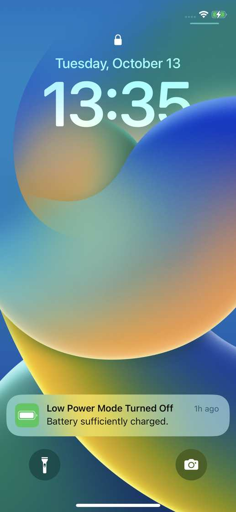

# Device check — full language set — 2026-10-13

`agent/i18n/device` fast-forwarded to `integration/i18n` at `12b9605` with no conflicts. The language shots were not taken. The iPhone X was locked.

## Build

| | |
| --- | --- |
| Device | iphonex, iOS 16.7.10, udid `e881fa63cc3f392e4c7c0a79c65536daf00e711b` |
| Export | `[IosExport] result=Succeeded sdk=DeviceSDK arch=unchanged frameTiming=1` |
| Compile | no `error CS` |
| Sign | `** BUILD SUCCEEDED **` (team `XS55JWXZMN`, profile `com.curiomatch.test`) |
| Install | `Install: Complete`. Listed as `com.curiomatch.test`, `1.0`, `maze-puzzle` |
| Project bundle id | left `io.dev.maze` |
| ProjectSettings and tracked PNGs | unchanged after the Unity export |

Unity's TrueType importer logged `FreeType error: ... family_name cannot be parsed` for the editor copies of Baloo 2, Cairo, Kantumruy Pro, M PLUS Rounded 1c, Jua, Huninn, and ZCOOL KuaiLe. The export still succeeded. The player data includes the matching `Resources/Fonts/Ttf/*.bytes` files and `shaped/{ar,hi,km}.bytes`.

## What the phone showed

The display was the lock screen (13:35, passcode set), then it slept. `pymobiledevice3 developer dvt launch com.curiomatch.test` failed twelve times over three minutes:

`DTXNsError` code 2, `Failed to launch process with bundle identifier 'com.curiomatch.test'`.

`idevicescreenshot` during that window is a black frame (1125×2436, all pixels 0) or the lock screen. No Home was visible, so none of zh-Hans, zh-Hant, ja, ko, hi, km, ar, qps, en, or de was read off the device. There is nothing to compare with `/tmp/maze-i18n/audit-all/<code>/stills/home__iphone.png`.

`os.parity.bench=game` can open a level without a code change. It was not used, because the app never started.

## Crashes and timing

No `maze-puzzle` crash from this run. `idevicecrashreport` still has retired `maze-puzzle` reports from 2026-10-11 only. Today's jetsam files are earlier than this session. Launch time and font slowness were not measured. Install of the `.app` took about 8–11 seconds.

## Phone left as

The new build is installed. It has never been launched, so there is no `os.parity.lang` plist. The screen is locked, not English Home. Progress was reset by the reinstall. Unlock the phone and the first launch should follow `en-US`.

