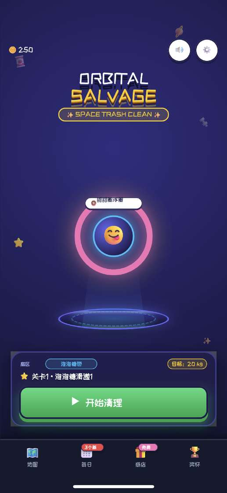
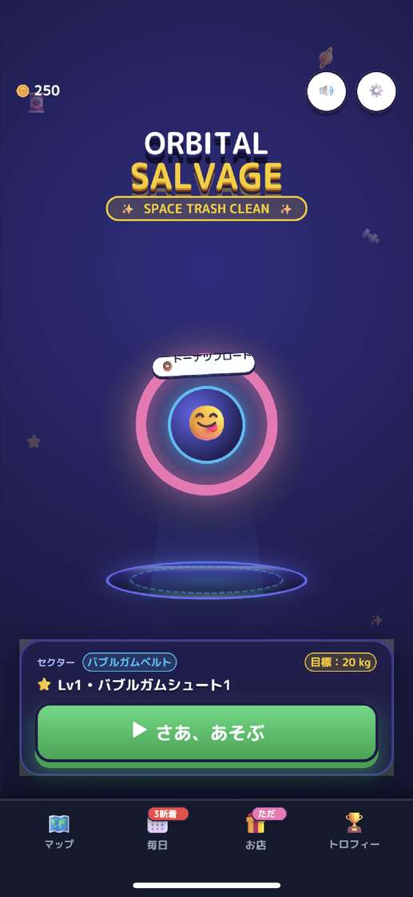
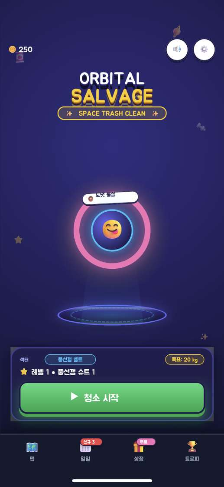
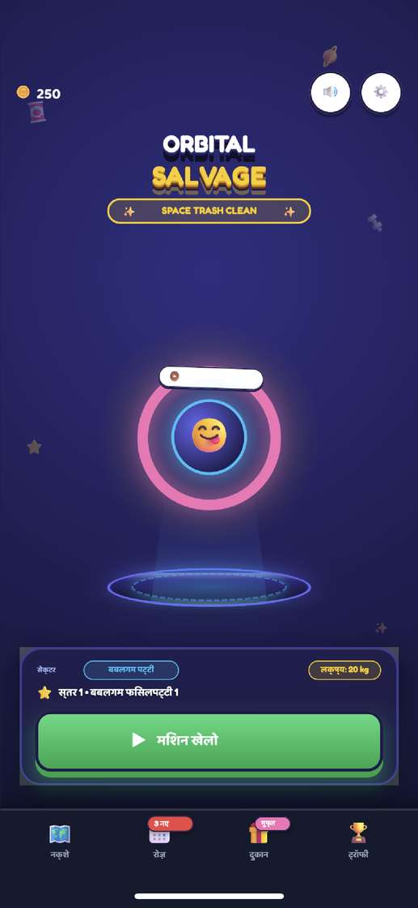
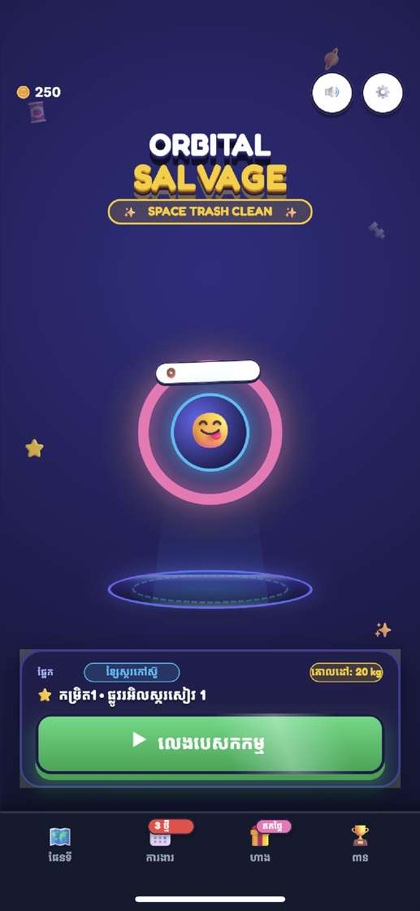
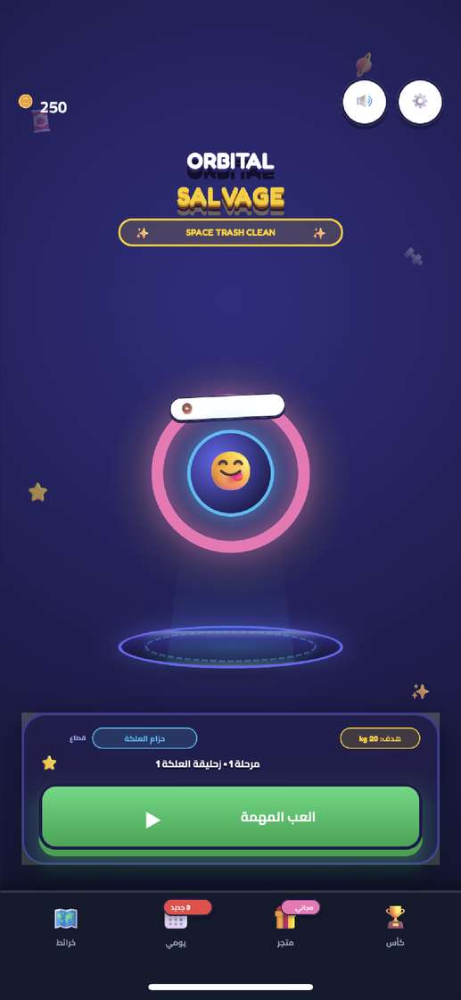
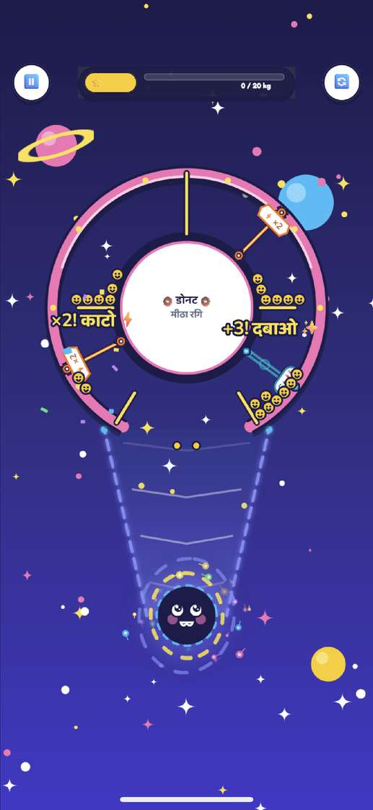
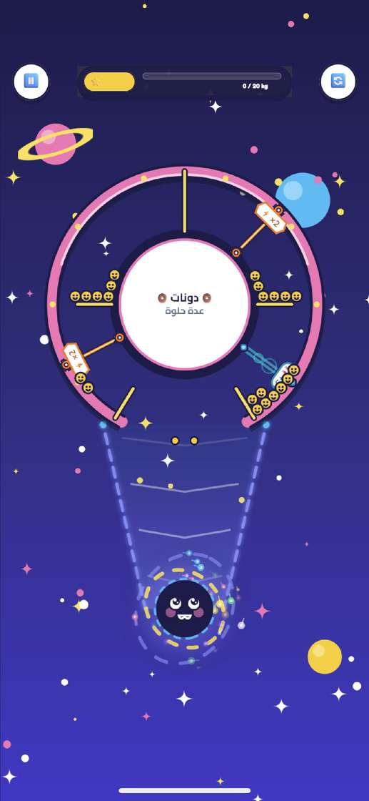
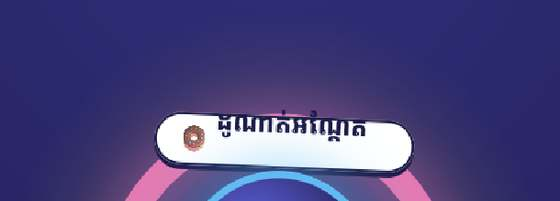
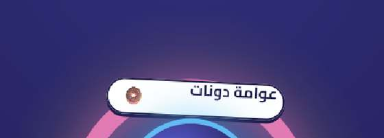

# Device check — full language set — 2026-10-13

Second pass, after the phone was unlocked. Same Release build as the locked attempt (`12b9605`, no re-export). `dvt launch` succeeded on the first try for every language. `PasswordProtected` was false and the screen was the Home Screen.

## Build (from the earlier export)

| | |
| --- | --- |
| Export | `[IosExport] result=Succeeded sdk=DeviceSDK arch=unchanged frameTiming=1`. No `error CS` |
| Sign | `** BUILD SUCCEEDED **` |
| Install | `Install: Complete`, `com.curiomatch.test` 1.0 |
| Project bundle id | left `io.dev.maze` |

## Home

Shots are 1125×2436. Sim stills are 1290×2796. Chrome (status bar, home indicator) differs. Strings below are what the device showed.

- **zh-Hans:** 开始清理, 地图, 每日, 商店, 奖杯, 甜甜圈浮圈, 关卡1 · 泡泡糖滑道1. Simplified glyphs, even weight, no tofu, no clip. Matches the sim still.
- **zh-Hant:** 開始任務, 地圖, 每日, 商店, 獎盃, 甜甜圈漂浮, 關卡1 · 泡泡糖滑道1. Traditional glyphs, no tofu. Matches the sim still.
- **ja:** さあ、あそぶ, マップ, 毎日, お店, トロフィー, ドーナツフロート. Level line is `Lv1・バブルガムシュート1`. The sim still uses the combined string `レベル1・バブルガムシュート1`. The table has both: `LVL 1` = `Lv1`, and the combined key = `レベル1•…`. No tofu.
- **ko:** 청소 시작, 맵, 일일, 상점, 트로피, 도넛 둥실, 레벨 1 · 풍선껌 슈트 1. Hangul is complete. Matches the sim still.
- **hi:** मशीन खेलो, नक्शे, रोज़, दुकान, ट्रॉफी, स्तर 1 · बबलगम फिसलपट्टी 1. Headstrokes and matras are intact on those strings. The ring pill is blank except the donut icon. The sim still has तैरता डोनट in that pill.
- **km:** ចូលលេង, ផែនទី, កម្រិត 1 · ផ្លូវស្ករគ្រាប់ 1, with stacked vowels on the strings that drew. The ring pill is blank except the donut icon. The sim still has ដូណាត់អណ្ដែត there.
- **ar:** العب المهمة sits to the right of the play icon. Joined Arabic on the level line (مرحلة 1 · زحليقة العلكة 1), sector, goal, and dock. Same arrangement as the sim still. The ring pill is blank except the donut icon. The sim still has دوامة دونات there.
- **qps:** brackets, tildes, Latin-1 lookalikes, and ellipses on the title, ring, level, button, and dock. No tofu. No sim still in the audit folder.
- **en:** PLAY MISSION, MAPS, DAILY, SHOP, TROPHIES, DONUT FLOAT. No ellipsis or tofu.
- **de:** LOS GEHT'S!, KARTE, TAG, LADEN, TROPHÄEN, DONUT-FLOSS. `ü` and `ä` intact. Matches the earlier sim still.

## Gameplay

`os.parity.bench=game` with `os.parity.bench.exps=none` opened level 1 for ar, hi, km, ja, zh-Hans, and ko. Logs include `[Bench] start mode=game` and `page home -> game`.

The hole label is real text in each of those six: Arabic دونات / عدة حلوة, Hindi डोनट / मीठा रमी, Khmer ដូណាត់ with a stacked second line, Japanese ドーナツ / スイートリング, simplified 甜甜圈 / 甜甜环, Korean 도넛 / 달콤 세트. Side gate words were readable for Hindi (काटो, दबाओ), Japanese (シュレッド, ぎゅっ), and Korean (분쇄). On the Arabic, Khmer, and simplified-Chinese frames the same gates did not show a readable word. Settings, Shop, and Daily were not opened.

## Time and crashes

Loading-to-home bake, from `[Perf] page loading -> home`: zh-Hans 44 ms, zh-Hant 41 ms, hi 759 ms, ar 1139 ms, ja 1359 ms, de 1729 ms, en 2017 ms. A loading hitch of about 1.0–1.5 s sits in front of that. Steady Home is about 30 fps for Chinese and about 27 fps for Hindi, footprint near 450 MB of 2824 MB. Korean gameplay logged `applicationDidReceiveMemoryWarning` once and kept running. No `maze-puzzle` crash in the launch streams.

## Font importer warning

`family_name cannot be parsed` is Unity's TrueType importer, on the editor copies of the new subset files: M PLUS Rounded 1c, Jua, ZCOOL KuaiLe, Huninn, Baloo 2, Cairo, and Kantumruy Pro. The same four CJK files already logged it in `/tmp/maze-i18n/shaping-core/full-merge.log`. No surviving log shows the old `*-endonym.ttf` files hitting that line. The player does not use that importer. `OutlineFonts` reads `Resources/Fonts/Ttf/*.bytes` with its own parser, and those bytes are in the player data. Chinese, Japanese, and Korean glyphs on device are that runtime path working. The blank Hindi, Khmer, and Arabic ring pills are a missing paint on that one label, not a missing font: the same languages draw on the rest of Home and in the gameplay hole.

## Phone left as

The new build is installed and open on English Home. No `os.parity.lang` was pushed for this last install. Progress was reset by the reinstalls. Change language under Settings > General > Language & Region.

## Ring pill fix verification

Rechecked on `99a7e5f` after a new device export. `[IosExport] result=Succeeded`, no `error CS`, `** BUILD SUCCEEDED **`, install complete. The phone was unlocked. Home only.

The white pill above the pink ring now has the donut icon and the name, inside the capsule:

- **hi:** तैरता डोनट. Headstrokes are intact. Not blank.
- **km:** ដូណាត់អណ្ដែត, stacked, with the icon. Not blank.
- **ar:** joined عوامة دونات, icon on the left of the pill. Not blank.

The rest of those Home screens matches the earlier check: Hindi मशीन खेलो / नक्शे / रोज़ / दुकान / ट्रॉफी and स्तर 1, Khmer play label and dock, Arabic play label to the right of the icon. Controls still show the name too: zh-Hans 甜甜圈浮圈 with 开始清理 and 关卡1, ja ドーナツフロート with さあ、あそぶ and `Lv1`, de DONUT-FLOSS with LOS GEHT'S! / KARTE / TAG / LADEN / TROPHÄEN. No crash in the launch streams.

